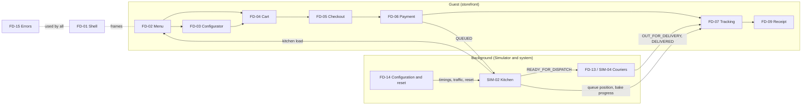

# 02 — Functional Design

This folder describes **what the app does**, area by area: the behaviour step by step, the business rules, the data each area reads and writes, the order states it touches, and the exact behaviour and messages for errors and edge cases. It is functional only: how you build it in Mendix 11.16.1 (domain model, logic, pages, widgets, modules) and with which tools is your decision.

Read the foundation first: [product brief](../01-product-brief/product-brief.md), [glossary](../01-product-brief/glossary.md), [IDs and traceability](../01-product-brief/ids-and-traceability.md), [information model](../04-information-model/information-model.md), [order lifecycle](../05-processes/order-lifecycle.md), [Lite simulation configuration](../10-simulations/lite-configuration.md), [menu catalog](../09-demo-data/menu-catalog.md), [design tokens](../07-design-system/tokens.md).

In Lite every visitor is a guest (user role `Anonymous`), and the kitchen, the couriers and the order traffic are run by the Simulator. Rules of the full product that need accounts, staff, the simulation panel or an intake pause are removed or marked **"not used in Lite"**; their numbers are not re-used.

---

## 1. Index

| FD | File | Area | Actors in Lite | Screens | Rules | Epic · stories in Lite | Priority |
|---|---|---|---|---|---|---|---|
| FD-01 | [fd-01-shell-navigation.md](fd-01-shell-navigation.md) | Shell, navigation and branding (incl. the screen access matrix) | Guest | SCR-16 | BR-NAV-01 – 21 | EP-01 · 9 stories | Must |
| FD-02 | [fd-02-menu.md](fd-02-menu.md) | Menu browsing (module explorer), home page, item info | Guest | SCR-01, SCR-02, SCR-04 | BR-MENU-01 – 23 | EP-02 · 14 stories | Must |
| FD-03 | [fd-03-configurator.md](fd-03-configurator.md) | Pizza configurator (dependency manager) | Guest | SCR-03 | BR-CONF-01 – 22 | EP-03 · 13 stories | Must |
| FD-04 | [fd-04-cart.md](fd-04-cart.md) | Cart (manifest) and coupons | Guest | SCR-05 | BR-CART-01 – 25 | EP-04 · 13 stories | Must |
| FD-05 | [fd-05-checkout.md](fd-05-checkout.md) | Checkout (deploy config) | Guest | SCR-06 | BR-CHK-01 – 24 | EP-05 · 14 stories | Must |
| FD-06 | [fd-06-payment.md](fd-06-payment.md) | Simulated payment and confirmation | Guest, Simulator | SCR-07, SCR-08 | BR-PAY-01 – 20 | EP-06 · 14 stories | Must |
| FD-07 | [fd-07-tracking.md](fd-07-tracking.md) | Order tracking, guest lookup, guest rollback | Guest | SCR-09, SCR-10 | BR-TRK-01 – 23 | EP-07 · 17 stories | Must |
| FD-09 | [fd-09-profile.md](fd-09-profile.md) | Lite: order detail and receipt only | Guest | SCR-13 | BR-PRF-09 – 11 | EP-09 · US-166, US-167 | Must (print: Should) |
| FD-13 | [fd-13-couriers.md](fd-13-couriers.md) | Lite: automatic courier dispatch only | Simulator | — | BR-COUR-10, 11, 14, 15, 17 | EP-13 · US-247 | Must |
| FD-14 | [fd-14-simulation-control.md](fd-14-simulation-control.md) | Lite: fixed simulation configuration, demo reset without a screen, housekeeping | Simulator, System | — | BR-SIM-60 – 75 (Lite part) | EP-14 · US-265, US-270 – 273 | Must |
| FD-15 | [fd-15-errors.md](fd-15-errors.md) | Error pages, validation, toasts, dialogs, session expiry, connection loss | Guest | SCR-40, SCR-41 | BR-ERR-01 – 19 | EP-15 · 8 stories | Must |

FD-08 (accounts and demo access), FD-10 (kitchen display), FD-11 (order operations) and FD-12 (menu management) are not in Lite. The Simulator's kitchen work (US-194) is specified in [SIM-02](../10-simulations/sim-02-kitchen-auto-advance.md).

Test cases: epic `EP-n` owns `TC-((n−1)×20+1)` … `TC-(n×20)` in `12-acceptance/`, as in the register.

### 1.1 Where to find a topic

| Topic | Area |
|---|---|
| Guest session, cart lifetime, which orders a guest may open | Information model section 2 (LITE-SES-01 – 05); FD-04, FD-07 |
| Access rights (role `Anonymous`) | Information model section 10 (LITE-SEC-01 – 05); FD-01 section 2.1 |
| Prices, fees, tax, tip, coupons | Foundation `BR-PRICE` (information model section 6); applied in FD-03, FD-04, FD-05 |
| Delivery zone and minimum order | FD-05 (BR-CHK-05, BR-CHK-06, BR-CHK-13) |
| Stock and sold out | Seed only (Tiramisu Stack sold out, jalapeño out of stock; `09-demo-data/`); effects in FD-02 (BR-MENU-08), FD-03, FD-04 (BR-CART-13) |
| Cancellation windows | Foundation BR-ORD-08; guest rollback FD-07 (BR-TRK-13), payment FD-06 (BR-PAY-10) |
| Opening hours | None (A-08); the store is always open, intake is always `OPEN` |
| Payment outcomes and retries | FD-06 |
| ETA, map, live log, queue position, bake progress | FD-07; SIM-02 (BR-SIM-16b, BR-SIM-16c) |
| Home page KPIs, kitchen load | FD-02 (BR-MENU-17); SIM-02 (BR-SIM-16d) |
| Simulator speed, traffic, failure rates | `10-simulations/lite-configuration.md`; FD-14 |
| Demo reset | FD-14 (BR-SIM-71, BR-SIM-73), SIM-08 |
| Server log lines for the tests | `10-simulations/lite-configuration.md` section 3 (LITE-CFG-04 – 08) |
| Generic messages, toasts, dialogs | FD-15 |

## 2. How the areas connect

The order itself moves through the state machine of [order-lifecycle.md](../05-processes/order-lifecycle.md); each FD names the transitions (`T-xx`) it triggers.

## 3. Structure of every FD file

1. Header table: epic, roles, screens, processes, simulations, objects, referenced foundation rules, priority.
2. **Purpose** — what the area is for.
3. **Actors** (and access).
4. **Preconditions.**
5. **Behaviour** — step by step, per screen.
6. **Business rules** — `BR-<AREA>-xx`, one atomic, testable statement each, with priority.
7. **Data read and written** — objects of the information model.
8. **States touched** — `OrderStatus` transitions and other state enumerations.
9. **Errors and edge cases** — case, exact behaviour, exact message.
10. **Notifications** — banners, toasts, log lines (all in-app; the app sends no email, SMS or push).

Assumptions appear as quote blocks starting with **Assumption A-xx:**.

## 4. Conventions used in all FD files

| Convention | Meaning |
|---|---|
| **must / should / may** | Must / Should / Could (MoSCoW), as in [00-README](../00-README.md) section 6.2. A rule without a priority is Must. A rule marked "Must (x) / Should (y)" has a mandatory part x and an expected part y. A rule marked "not used in Lite" is not built. |
| Rule references | Foundation rules (`BR-PRICE`, `BR-ORD`, `BR-DATA`) are referenced, never redefined. If an FD rule seems to contradict a foundation rule, the foundation rule wins (00-README section 6.5). |
| Quoted texts | Every visible text is defined once in [`../06-ui-specification/ui-copy.md`](../06-ui-specification/ui-copy.md); **for visible text `ui-copy.md` wins over these files** (00-README section 6.5). FD files refer to texts by `TXT-…` ID; where a message is quoted, it is the `ui-copy.md` text followed by its ID (`{…}` = value inserted at runtime). A quote marked "example of TXT-…" shows the text with sample values. Labels shown in backticks without an ID are for orientation; their exact wording is the matching `ui-copy.md` entry. |
| "within 5 seconds" | The change is visible on an open screen without a manual reload, at most 5 s after it happened on the server (BR-ORD-20). Any technique that achieves this in Mendix 11 is fine (e.g. periodic refresh). |
| "today" | The calendar day in the store time zone `America/Los_Angeles`. |
| Durations | Simulated durations are seconds at speed 1× and are divided by the speed factor (order-lifecycle 7.2). "Effective" duration = after the speed factor. The speed factor comes from the constant `Simulation.SpeedFactor`. |
| Money | USD, `$1,024.00`, discounts `−$3.22` (BR-PRICE-11). |
| Dates and times | `YYYY-MM-DD`, `HH:mm` (24 h), log `HH:mm:ss` (BR-DATA-05). |
| Dev labels | The visible label; its plain meaning is the tooltip or accessible name (glossary). |
| Images | Only files from `assets/`; the one missing file (`illustrations/no-results.png`) uses the placeholder of `assets/README.md` section 2. |
| Server-side | Every rule is enforced when data is saved or an action is executed, not only in the browser (BR-ERR-07, LITE-SEC-01). |

## 5. Assumptions added by the functional design

These continue the list in the product brief (A-01 – A-17) in the block A-18 – A-30 of the register (`ids-and-traceability.md` section 1.2). Each one is also an open question for the owner in [../open-questions.md](../open-questions.md).

| ID | Assumption | File | In Lite |
|---|---|---|---|
| A-18 | Staff accounts cannot place orders; customer pages are browse-only for them. | FD-01 | not used (no staff) |
| A-19 | Drinks show caffeine content; the contractor adds an optional caffeine attribute (mg) to drink products. | FD-02 | yes |
| A-20 | The cart shows delivery fee and tax as "calculated at checkout" (cart total = subtotal − discount) and remembers the order type last chosen at checkout (default DELIVERY) only for the coupon rule "delivery only" and the delivery hints. | FD-04 | yes |
| A-21 | Checkout pre-selects Card with test card `Visa •••• 4242`. | FD-05 | yes |
| A-22 | The payment sheet can be closed in the failure state; the order stays `PAYMENT_FAILED` and is resumed from SCR-09. | FD-06 | yes |
| A-23 | A guest browser session may open every order placed or looked up in that session; the tracking link works anywhere. | FD-07 | yes (LITE-SES-03) |
| A-24 | Guest lookup: max 5 failed attempts per 10 minutes per session. | FD-07 | yes |
| A-25 | Sign up has no username field; the username is generated from the email. | FD-08 | not used (no accounts) |
| A-26 | Re-order skips lines whose exact configuration is no longer available instead of changing them. | FD-09 | not used (no re-order) |
| A-27 | The manager can upload product images at runtime. | FD-12 | not used (no menu management) |
| A-28 | Store fees, tax rate and delivery-zone activity are editable on the simulation panel. | FD-14 | not used (values fixed in the seed) |
| A-29 | Demo reset is confirmed by typing `RESET`. | FD-14 | not used (no reset dialog) |
| A-30 | Couriers are never deleted; they are set off duty. | FD-13 | not used (no courier management; `CU-05` is always off duty) |
