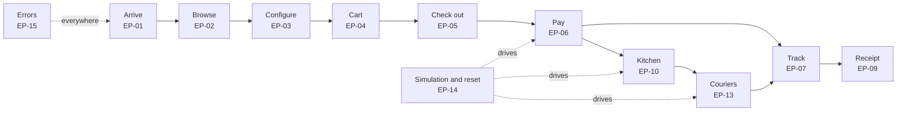

# User Stories — Git Pizza MxDev Lite

This folder describes the app as **111 user stories in 12 epics**, each with Given/When/Then acceptance criteria that use the concrete names, prices, states and timings of the foundation files. Together with `02-functional-design/` and `10-simulations/` the stories define *what* the app must do; how it is built in Mendix 11.16.1, and with which tools, is the contractor's decision.

Git Pizza MxDev Lite has one user role, the guest (Mendix user role `Anonymous`): no accounts, no sign-in, no customer profile or saved addresses, no staff screens and no simulation panel. The kitchen, the couriers, pickup customers and the order traffic are run by the Simulator with fixed parameters ([lite-configuration.md](../10-simulations/lite-configuration.md)). Story IDs are those of the full Git Pizza MxDev package, so the numbers inside an epic have gaps; acceptance criteria keep their numbers as well, so a story may skip a criterion number.

Stories do **not** carry story points or estimates.

Related: [../00-README.md](../00-README.md) (conventions, precedence), [../01-product-brief/ids-and-traceability.md](../01-product-brief/ids-and-traceability.md) (ID register, screen inventory), [traceability-matrix.md](traceability-matrix.md).

---

## 1. Files

| File | Epic | Functional area | Stories | Must | Should | Could |
|---|---|---|---|---|---|---|
| [EP-01-shell-navigation.md](EP-01-shell-navigation.md) | EP-01 Shell, navigation and branding | FD-01 | 9 | 9 | 0 | 0 |
| [EP-02-menu-browsing.md](EP-02-menu-browsing.md) | EP-02 Menu browsing | FD-02 | 14 | 12 | 1 | 1 |
| [EP-03-pizza-configurator.md](EP-03-pizza-configurator.md) | EP-03 Pizza configurator | FD-03 | 13 | 11 | 2 | 0 |
| [EP-04-cart-coupons.md](EP-04-cart-coupons.md) | EP-04 Cart and coupons | FD-04 | 13 | 13 | 0 | 0 |
| [EP-05-checkout.md](EP-05-checkout.md) | EP-05 Checkout | FD-05 | 14 | 12 | 1 | 1 |
| [EP-06-simulated-payment.md](EP-06-simulated-payment.md) | EP-06 Simulated payment | FD-06 | 14 | 14 | 0 | 0 |
| [EP-07-order-tracking.md](EP-07-order-tracking.md) | EP-07 Order tracking | FD-07 | 17 | 16 | 1 | 0 |
| [EP-09-customer-profile.md](EP-09-customer-profile.md) | EP-09 Order receipt (receipt stories of the full app's profile epic) | FD-09 | 2 | 1 | 1 | 0 |
| [EP-10-kitchen-display.md](EP-10-kitchen-display.md) | EP-10 Kitchen run by the simulator | SIM-02 | 1 | 1 | 0 | 0 |
| [EP-13-courier-management.md](EP-13-courier-management.md) | EP-13 Automatic courier dispatch | FD-13 | 1 | 1 | 0 | 0 |
| [EP-14-simulation-control.md](EP-14-simulation-control.md) | EP-14 Simulation and demo reset (fixed configuration) | FD-14 | 5 | 5 | 0 | 0 |
| [EP-15-errors-messages.md](EP-15-errors-messages.md) | EP-15 Errors and system messages | FD-15 | 8 | 8 | 0 | 0 |
| | **Total** | | **111** | **103** | **6** | **2** |
| [traceability-matrix.md](traceability-matrix.md) | Story → screen → functional area → rules, plus coverage of every screen, simulation, process and rule family | | | | | |

Epic `EP-n` covers functional area `FD-n` and owns the story numbers `(n−1)×20+1` … `n×20` of the full app. Lite keeps the epic numbers of the full app, so some epic numbers are not used. EP-10 has no functional area in Lite: its story is specified by SIM-02.

---

## 2. How a story is written

```text
### US-133 Look up an order by number and email

> As a **guest who lost the tracking link**, I want to find my order with its number and my email, so that I can still track it.

| Priority | Roles | Screens | Area | Rules | Processes | Simulations |
|---|---|---|---|---|---|---|
| Must | G | SCR-10, SCR-09 | FD-07 | BR-TRK-* | PR-02 | — |

**Acceptance criteria**
1. **Given** …, **when** …, **then** ….
2. **Given** … **then** … *(negative)*

**Notes.** …
```

| Element | Meaning |
|---|---|
| `US-xxx` + title | Unique ID (never reused) and a short title |
| Statement | "As a *role*, I want *goal*, so that *benefit*" |
| Priority | MoSCoW (section 3) |
| Roles | **G** guest (every visitor; Mendix user role `Anonymous`), **SIM** simulator (system actor: kitchen, couriers, pickup customers, traffic, reset) |
| Screens | `SCR-xx` from the screen inventory; the first screen is the main one; `—` for a story without a guest screen (its evidence is the server log, section 2.1) |
| Area | The functional area `FD-xx` whose rules the story implements, or the simulation (`SIM-02`) where Lite has no functional area |
| Rules | Business rules the acceptance criteria verify. Foundation rules by number (`BR-PRICE-08`, `BR-ORD-11`, `BR-DATA-12`); functional-design rules by family (`BR-CART-*` = rules of FD-04) or by number; Lite rules by number (`LITE-CFG-04`, `LITE-SES-02`, `LITE-SEC-02`), see the matrix note |
| Processes / Simulations | `PR-xx`, `SIM-xx` the story takes part in |
| Acceptance criteria | Numbered Given/When/Then statements with concrete values. Criteria marked *(negative)* describe a rejected input, a forbidden action, an error path or something that must **not** happen |
| Notes | Clarifications, links to the owning document, out-of-scope reminders |
| Assumption block | A default chosen on the owner's behalf (`A-xx`, section 7 and `open-questions.md`) |

### 2.1 Conventions inside acceptance criteria

- **Data.** Product names, prices, options, coupons, zones, couriers and ovens are exactly those of `09-demo-data/menu-catalog.md` and information model section 7.8. Worked price examples A – D are those of information model section 6.1. The seed orders of `09-demo-data/` are guest and simulated orders; guest seed orders can be found on SCR-10 with their order number and contact email (e.g. `MX-1014` with `jordan.lee@example.com`).
- **Starting state.** Unless a criterion says otherwise: the app was started with `Simulation.ResetOnStartup = true` (demo reset, SIM-08), the simulation runs at **1×**, and the fixed values of [lite-configuration.md](../10-simulations/lite-configuration.md) apply: kitchen, dispatch, pickup and traffic always automatic, payment and QA failure rates 0 %, intake always OPEN, `CU-05` always off duty.
- **Availability.** In the seed, **Tiramisu Stack** is sold out and the ingredient **`jalapeno`** (fresh jalapeños, extra EX-09) is out of stock; everything else is available (BR-DEMO-03a). Nobody changes availability, prices or the menu while the app runs. Criteria that name another sold-out or inactive state describe a rule the app must implement for any data; the automated tests check the two seed cases.
- **Speed.** Durations are the defaults of order-lifecycle section 7.1 at the stated speed. The speed factor is the constant `Simulation.SpeedFactor` (1, 2, 5 or 10, read at start); the automated acceptance tests run at **10×**, where every duration `x` becomes `max(1, ceil(x / 10))` seconds. Automatic transitions may happen up to 3 s later (NFR-08.2); ETAs and countdowns are accepted within **± 2 s** (NFR-07.2).
- **"Within 5 seconds"** means without a manual page reload (BR-ORD-20).
- **Evidence.** A criterion is checked on the guest screens, in the INFO lines of the server log on the log node `Simulation` (`ORDER`, `COURIER`, `SPAWN`, `CONFIG`, `RESET`; lite-configuration.md section 3) and with the seed orders found on SCR-10. Simulated orders are never shown to guests.
- **Texts.** Quoted dev labels (`Execute Order --force`, `ROLLBACK REJECTED — …`) and messages that come from the foundation (BR-PRICE-06, BR-ORD-08, order-lifecycle section 5) are binding. Other message wording is indicative; the exact text is owned by `06-ui-specification/`. A criterion is met when the meaning matches.
- **Money** is shown `$1,024.00`, discounts `−$3.22` (BR-PRICE-11).
- **Placeholders.** Where an image is not delivered (today only `illustrations/no-results.png`, or a product created without photo), the placeholder of `assets/README.md` section 2 counts as correct (e.g. `IMAGE_PENDING // illustrations/no-results.png`). For every delivered file the image itself is expected.

### 2.2 Precedence

If a story contradicts a foundation file, `02-functional-design/` or `10-simulations/`, those win (`00-README.md` section 6.5); [lite-configuration.md](../10-simulations/lite-configuration.md) wins over every value it fixes. Write the contradiction in `RUN/journal.md` and `RUN/delivery-notes.md`.

---

## 3. Priorities (MoSCoW)

| Priority | Count | Meaning for the contractor |
|---|---|---|
| **Must** | 103 | Mandatory for acceptance |
| **Should** | 6 | Expected; may be dropped only with a written reason in `RUN/delivery-notes.md` |
| **Could** | 2 | Optional; counts in your favor only if every Must is done |
| **Won't** | — | Out of scope (`product-brief.md` section 3.2) and everything of the full app that Lite leaves out (accounts, staff screens, simulation panel). Several stories contain *(negative)* criteria that make sure Won't items (real card fields, accounts, role switching, chat with the courier, `DINE_IN`) do **not** appear |

A story's priority applies to the whole story. A Must story may reference a Should or Could story.

---

## 4. Definition of Ready

A story is ready to be built when:

1. It has an ID, a statement, a priority, roles, screens, area and at least one acceptance criterion with concrete values.
2. Every screen it names exists in the screen inventory and in `06-ui-specification/`.
3. Every rule it names exists in the foundation, in the functional-design file of its area or in `10-simulations/`.
4. The data it needs exists in the information model and the demo seed (`09-demo-data/`).
5. Open questions that affect it are answered, or the documented assumption is accepted.
6. Stories it depends on are known (see the story map, section 6, and the cross-references inside the criteria).

## 5. Definition of Done

A story is done when:

1. Every acceptance criterion passes on the running app at desktop (≥ 1200 px) **and** phone (390 px) width, as a guest, after a demo reset.
2. All *(negative)* criteria are verified, including server-side refusal where a criterion says an action is refused (not only a hidden button).
3. Texts, labels, prices and states match the package exactly; the plain meaning of every dev label is available (US-012).
4. The look follows `07-design-system/` (tokens, components, official logo only) and the screen spec in `06-ui-specification/`.
5. Live data appears within 5 seconds where required; no manual reload is needed.
6. The non-functional requirements of `11-non-functional/` that apply to the story are met (accessibility, performance, security).
7. The story is committed with the message `US-xxx: <title>`, and its entry in `RUN/self-assessment.json` states `done`, `partial` or `no` and where in the app it is.
8. The demo reset restores any data the story changes.
9. Deviations and interpretations are written in `RUN/journal.md` and `RUN/delivery-notes.md`.

---

## 6. Story map

The backbone follows the guest from left to right — arrive, browse, configure, order, pay and track — while the Simulator runs the kitchen, the couriers and the order traffic. Each row is an activity (one epic); the columns slice it by priority. A team that builds all **Must** columns top to bottom has a complete, demonstrable app; Should and Could stories add depth.



| Activity | Who | Epic | Must | Should | Could |
|---|---|---|---|---|---|
| Arrive and find my way | Guest | [EP-01](EP-01-shell-navigation.md) | US-001, US-002, US-003, US-004, US-006, US-007, US-010, US-011, US-012 | — | — |
| Browse and choose | Guest | [EP-02](EP-02-menu-browsing.md) | US-021, US-022, US-023, US-024, US-025, US-026, US-027, US-028, US-029, US-030, US-031, US-032 | US-034 | US-033 |
| Configure a pizza | Guest | [EP-03](EP-03-pizza-configurator.md) | US-041, US-042, US-043, US-044, US-045, US-046, US-047, US-048, US-049, US-050, US-051 | US-052, US-053 | — |
| Build the cart | Guest | [EP-04](EP-04-cart-coupons.md) | US-061, US-062, US-063, US-064, US-065, US-066, US-067, US-068, US-069, US-070, US-071, US-072, US-073 | — | — |
| Check out | Guest | [EP-05](EP-05-checkout.md) | US-081, US-082, US-083, US-085, US-086, US-087, US-088, US-089, US-091, US-092, US-094, US-095 | US-093 | US-097 |
| Pay | Guest, Simulator | [EP-06](EP-06-simulated-payment.md) | US-101, US-102, US-103, US-104, US-105, US-106, US-107, US-108, US-109, US-110, US-111, US-112, US-113, US-114 | — | — |
| Track and cancel | Guest | [EP-07](EP-07-order-tracking.md) | US-121, US-122, US-123, US-124, US-125, US-126, US-127, US-128, US-129, US-130, US-131, US-132, US-133, US-134, US-135, US-137 | US-136 | — |
| Read and print the receipt | Guest | [EP-09](EP-09-customer-profile.md) | US-166 | US-167 | — |
| Kitchen | Simulator | [EP-10](EP-10-kitchen-display.md) | US-194 | — | — |
| Couriers | Simulator | [EP-13](EP-13-courier-management.md) | US-247 | — | — |
| Simulated world and reset | Simulator | [EP-14](EP-14-simulation-control.md) | US-265, US-270, US-271, US-272, US-273 | — | — |
| Recover from errors | Guest | [EP-15](EP-15-errors-messages.md) | US-281, US-282, US-284, US-285, US-286, US-287, US-288, US-289 | — | — |

### 6.1 The demo journeys as stories

The guest journeys of `product-brief.md` section 6 run through these stories (the end-to-end tests `E2E-xx` in `12-acceptance/` follow them):

| Journey | Stories in order |
|---|---|
| 1. Guest order (delivery) | US-021 → US-027 → US-041/US-045 (Inferno Payload Large + Cherry tomatoes) → US-029 (Mate Compiler Tonic) → US-061 → US-066 (`GITHUB_STUDENT`) → US-082/US-083/US-085/US-086 → US-101 (`Visa •••• 4242`) → US-091 → US-102 → US-103 → US-110 → US-122 – US-126 → US-194 → US-247 → US-137 → US-166 |
| 2. Failed payment | US-091 with `Visa •••• 0002` → US-104 → US-106 (Apple Pay) → US-103 → US-110 |
| 3. Pickup | US-081 (pickup) → US-093 → US-091 → US-110 → US-132 → US-272 → US-137 |
| 4. Watching the simulation | US-023 (KPIs) → US-265 → US-114 → US-194 → US-247 → US-271 (server log) → US-270 (reset at start) |

---

## 7. Assumptions introduced by the stories

The stories add one assumption that applies in Lite (block A-80 – A-89 of the register) and rely on assumptions of other documents. Build according to them. All assumptions are listed with their open question in [../open-questions.md](../open-questions.md).

| ID | Assumption | Story |
|---|---|---|
| A-80 | The 30-item limit per order is enforced already in the cart. | US-063 |

| Topic | Assumption used | Owner |
|---|---|---|
| Home KPIs from live data instead of the Stitch figures | A-73 | UI specification |
| Cart shows fee and tax as "calculated at checkout"; remembered order type | A-20 | FD-04 |
| Card + `Visa •••• 4242` preselected at checkout | A-21 | FD-05 |
| Confirmation names no oven ("assigned when baking starts") | A-74 | UI specification |
| A guest session can open the orders placed or looked up in it; the tracking link works anywhere | A-23 | FD-07, information model section 2 |
| Demos and acceptance tests run between 02:00 and 24:00 store time | A-31 | `09-demo-data/README.md` |
| Scheduled demo reset every day at 04:00 store time | A-42 | SIM-08 |

Smaller defaults that are stated directly in a criterion (e.g. lookup throttling in US-136) follow the same rule: they are binding unless the owner changes them.
