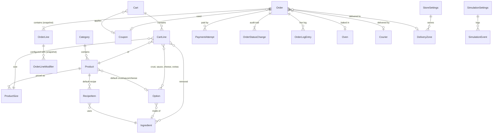

# Information Model (conceptual)

**Scope.** This is a platform-independent description of the data the app works with: objects, attributes, relations, enumerations, derived values, audit records and access rights. It is not a database design or a Mendix domain model. The contractor maps it to Mendix entities, associations, enumerations and access rules in their own way. Names here are binding for the documentation (all package documents use them). The contractor may choose other technical names if their delivery notes contain a mapping table (see `12-acceptance/`).

**Notation.**

- Types: `String(n)` (max length n), `Text` (long text, max length given), `Integer`, `Decimal(2)` (money, exactly two decimals, decimal arithmetic, never floating point), `Decimal(p)` (other decimals), `Boolean`, `DateTime` (stored in UTC, shown in the store time zone `America/Los_Angeles`, 24-hour clock), `Enum <Name>`, `Set<Enum>` (zero or more values of an enumeration), `Image`.
- **Req** = required. **Derived** = calculated, never typed in by a user. Derived values may be stored for performance as long as they always equal the rule.
- Cardinality: `1`, `0..1`, `*` (zero or more), `1..*` (one or more).
- Rules are numbered `BR-PRICE-xx` (prices, section 6) and `BR-DATA-xx` (general data rules, section 8). Order state rules are `BR-ORD-xx` in [order-lifecycle.md](../05-processes/order-lifecycle.md).

Related: [ids-and-traceability.md](../01-product-brief/ids-and-traceability.md), [glossary.md](../01-product-brief/glossary.md), [menu-catalog.md](../09-demo-data/menu-catalog.md).

**Lite.** Git Pizza MxDev Lite has no user accounts: every visitor is a guest in an anonymous session (section 2), and the kitchen, couriers and order traffic are run by the system (`10-simulations/`). Accounts, customer profiles, saved addresses and staff roles of the full app are not part of this model.

---

## 1. Overview diagram

Singletons (exactly one instance): `StoreSettings`, `SimulationSettings`. A `Cart` belongs to one guest session (section 2), not to a stored object.

---

## 2. Guests and sessions

There is no `UserAccount`, `CustomerProfile` or `Address` in Lite. A visitor is identified only by the browser session.

| ID | Rule |
|---|---|
| LITE-SES-01 | **Anonymous session.** Every visitor gets an anonymous session on the first visit, without sign-in, sign-up or cookie banner. In Mendix this is an anonymous user with the user role `Anonymous` (section 10). |
| LITE-SES-02 | **Cart.** Each session has at most one `Cart` (created with the first line). It survives page reloads and new tabs of the same browser session, and ends with the session. |
| LITE-SES-03 | **Orders of the session.** A session may open every order that was placed in it or found in it with the lookup (SCR-10, order number + contact email) (A-23). The tracking link (`trackingToken`) opens its order in any browser, also in a new session (NFR-11). Together these are the orders the guest holds a "token" for (section 10). |
| LITE-SES-04 | **Lifetime.** A session does not expire while a tab of the app is open and online (A-53). After all tabs are closed it may expire after an inactivity period chosen by the contractor (at least 10 minutes), stated in `RUN/delivery-notes.md`. |
| LITE-SES-05 | **After expiry.** The visitor continues in a new guest session with an empty cart; if a non-empty cart was lost, a toast says so (US-286). Orders stay reachable with the tracking link or the lookup. |

---

## 3. Menu (catalog)

### 3.1 Category

| Attribute | Type | Req | Constraints | Example |
|---|---|---|---|---|
| code | String(20) | yes | unique | `PIZZAS` |
| fileName | String(30) | yes | dev label shown on the tab | `pizzas.json` |
| displayName | String(30) | yes | plain name | `Pizzas` |
| productKind | Enum ProductKind | yes | drives configurability | `PIZZA` |
| sortOrder | Integer | yes | | `1` |

The four categories are fixed (no create/delete in the UI): see menu-catalog section 1.

### 3.2 Product

A menu item ("module"). Relation: `Category 1 — * Product`.

| Attribute | Type | Req | Constraints | Example |
|---|---|---|---|---|
| code | String(5) | yes | unique; `PZ-nn`, `SD-nn`, `DR-nn`, `DS-nn`; immutable after creation | `PZ-01` |
| name | String(40) | yes | unique among non-archived products; the dev-style display name | `The Root Pizza` |
| moduleKey | String(40) | yes | unique; kebab-case; used in dev labels (`./pizzas/root-pizza.ts`, `root-pizza@v1.4`) | `root-pizza` |
| realWorldName | String(40) | yes | the plain dish name, shown under the dev name | `Margherita` |
| shortDescription | String(140) | yes | one sentence for cards | `San Marzano tomatoes, fior di latte and fresh basil on our 48-hour dough.` |
| description | Text(600) | yes | appetizing full description | see menu catalog |
| versionTag | String(12) | yes | decorative release label: `v` + digits and dots, optional suffix `-` + letters | `v1.0-LTS` |
| status | Enum ProductStatus | yes | see 3.2.1 | `PUBLISHED` |
| isSoldOut | Boolean | yes | "sold out today"; in Lite a seed value only (BR-DEMO-03a: the seed has one sold-out product) | `false` |
| isFeatured | Boolean | yes | shown in the home carousel (max 6 featured) | `true` |
| badges | Set<Enum ProductBadge> | no | | `{CLASSIC}` |
| spiceLevel | Enum SpiceLevel | yes | | `NONE` |
| declaredAllergens | Set<Enum Allergen> | non-pizza only | for products without a recipe | `{GLUTEN, MILK}` |
| declaredVegetarian | Boolean | non-pizza only | | `true` |
| declaredVegan | Boolean | non-pizza only | vegan implies vegetarian | `false` |
| defaultCrust | → Option (CRUST) | pizza only | | `CR-01` Neapolitan Core |
| defaultSauce | → Option (SAUCE) | pizza only | | `SA-01` San Marzano Tomato |
| defaultCheese | → Option (CHEESE) | pizza only | | `CH-01` Fior di Latte |
| crustSelectable | Boolean | pizza only | false = crust fixed to default (calzone) | `true` |
| maxExtras | Integer | pizza only | 0–5 | `5` |
| image | Image | no | product photo; when missing the UI shows the placeholder defined in `07-design-system/` | `pz-04-binary-bbq.jpg` |
| imageAlt | String(140) | yes | alt text | `Binary BBQ pizza with pulled pork and caramelized onions` |
| sortOrder | Integer | yes | order within category | `1` |
| createdAt / updatedAt | DateTime | yes | | |
| updatedBy | String(60) | no | free text from the seed (who last changed the product); not shown in Lite | `menu-seed` |
| allergens | Set<Enum Allergen> | Derived | pizzas: BR-DATA-11 for the default configuration; others: `declaredAllergens` | `{GLUTEN, MILK}` |
| isVegetarian / isVegan | Boolean | Derived | pizzas: BR-DATA-10 for the default configuration; others: declared values | `true` / `false` |
| isOrderable | Boolean | Derived | BR-DATA-12 | `true` |
| defaultSize | → ProductSize | Derived | the `ProductSize` with `isDefault = true` | Medium 12" |
| cardPrice | Decimal(2) | Derived | BR-PRICE-01 | `14.99` |

#### 3.2.1 Product status

| Value | Dev label | Meaning | Visible to customers |
|---|---|---|---|
| `DRAFT` | `STAGING` | Being prepared; not on the menu | no |
| `PUBLISHED` | `PRODUCTION` | On the menu | yes |
| `ARCHIVED` | `DEPRECATED` | Withdrawn; kept for order history | no |

In Lite the status is a seed value; nobody changes it (there is no menu management). A published product must have all required attributes and at least one `ProductSize` (BR-DATA-14).

### 3.3 ProductSize

A price point. Relation: `Product 1 — 1..* ProductSize`; at most one per `SizeCode` per product.

| Attribute | Type | Req | Constraints | Example |
|---|---|---|---|---|
| sizeCode | Enum SizeCode | yes | pizzas: SMALL/MEDIUM/LARGE (subset allowed); others: REGULAR | `MEDIUM` |
| diameterInches | Integer | pizza only | SMALL 10, MEDIUM 12, LARGE 14 | `12` |
| servingDescription | String(40) | yes | | `12" · 8 slices`, `12 fl oz can`, `6 pieces` |
| price | Decimal(2) | yes | 0.50 – 99.99 | `14.99` |
| calories | Integer | no | whole item | `1080` |
| slices | Integer | pizza only | SMALL 6, MEDIUM 8, LARGE 8; calzone 1 | `8` |
| isDefault | Boolean | yes | exactly one per product; pizzas: MEDIUM | `true` |

### 3.4 Ingredient

| Attribute | Type | Req | Constraints | Example |
|---|---|---|---|---|
| code | String(30) | yes | unique, snake_case | `fior_di_latte` |
| name | String(50) | yes | | `Fior di latte mozzarella` |
| allergens | Set<Enum Allergen> | yes (may be empty) | | `{MILK}` |
| isVegetarian | Boolean | yes | | `true` |
| isVegan | Boolean | yes | vegan implies vegetarian | `false` |
| isInStock | Boolean | yes | false = sold out; in Lite a seed value only (BR-DEMO-03a: the seed has one ingredient out of stock) | `true` |
| updatedAt | DateTime | yes | | |

### 3.5 RecipeItem

A default ingredient of a pizza besides its crust, sauce and cheese (those come from the default options). Relation: `Product 1 — * RecipeItem — 1 Ingredient`.

| Attribute | Type | Req | Constraints | Example |
|---|---|---|---|---|
| role | Enum RecipeRole | yes | | `TOPPING` |
| isRemovable | Boolean | yes | customer may remove it in the configurator | `true` |
| sortOrder | Integer | yes | display order | `1` |

### 3.6 Option

A configurator choice. Relation: `Option * — 0..1 Ingredient` (the ingredient gives allergens, dietary flags and stock; "No sauce" and "No cheese" have no ingredient).

| Attribute | Type | Req | Constraints | Example |
|---|---|---|---|---|
| code | String(5) | yes | unique; `CR-nn`, `SA-nn`, `CH-nn`, `EX-nn` | `EX-01` |
| key | String(30) | yes | unique, snake_case dev key shown in the UI | `extra_cheese` |
| name | String(40) | yes | plain name | `Extra mozzarella` |
| description | String(140) | no | | `A second layer of fior di latte.` |
| group | Enum OptionGroup | yes | | `EXTRA` |
| priceClass | Enum PriceClass | yes | EXTRA: STANDARD or PREMIUM; others: FLAT | `STANDARD` |
| surcharge | Decimal(2) | CRUST/SAUCE/CHEESE | 0.00 – 9.99; same for every size | `2.50` |
| priceSmall / priceMedium / priceLarge | Decimal(2) | EXTRA | price per pizza size | `1.50 / 2.00 / 2.50` |
| availableSizes | Set<Enum SizeCode> | yes | sizes the option can be chosen for | `{MEDIUM, LARGE}` |
| isActive | Boolean | yes | seed value | `true` |
| versionTag | String(20) | no | decorative label in the dependency list | `v1.2.0 · core` |
| sortOrder | Integer | yes | | `1` |
| isAvailable | Boolean | Derived | `isActive` and (no ingredient or ingredient `isInStock`) | `true` |

---

## 4. Cart

### 4.1 Cart

One cart per guest session (LITE-SES-02). Lite has no accounts, so there is no persistent customer cart and no cart merge.

| Attribute | Type | Req | Constraints | Example |
|---|---|---|---|---|
| owner | session | yes | the guest session the cart belongs to (implementation free, e.g. the platform session) | |
| coupon | → Coupon | no | max one | `GITHUB_STUDENT` |
| couponState | Enum CouponState | Derived | BR-PRICE-06 | `APPLIED` |
| couponMessage | String(120) | Derived | BR-PRICE-06 | `Add $3.51 more to use this coupon` |
| itemCount | Integer | Derived | Σ line quantity | `4` |
| subtotal | Decimal(2) | Derived | BR-PRICE-04 | `55.50` |
| discountPreview | Decimal(2) | Derived | BR-PRICE-05 | `0.00` |
| updatedAt | DateTime | yes | | |

### 4.2 CartLine

| Attribute | Type | Req | Constraints | Example |
|---|---|---|---|---|
| product | → Product | yes | | `PZ-05` |
| size | → ProductSize | yes | belongs to product | Large 14" |
| crust | → Option (CRUST) | pizza | in `availableSizes` | `CR-01` |
| sauce | → Option (SAUCE) | pizza | | `SA-01` |
| cheese | → Option (CHEESE) | pizza | | `CH-02` |
| extras | → Option (EXTRA) `*` | no | each option at most once; count ≤ `Product.maxExtras` | `{EX-11 cherry_tomatoes}` |
| removedIngredients | → Ingredient `*` | no | only removable `RecipeItem` ingredients of the product | `{basil}` |
| quantity | Integer | yes | 1 – 10 | `1` |
| unitPrice | Decimal(2) | Derived | BR-PRICE-02 | `22.50` |
| lineTotal | Decimal(2) | Derived | BR-PRICE-04 | `22.50` |
| allergens | Set<Allergen> | Derived | BR-DATA-11 | `{GLUTEN, MILK}` |
| isVegetarian / isVegan | Boolean | Derived | BR-DATA-10 | `false / false` |
| isAvailable | Boolean | Derived | product orderable and every chosen option available and no remaining default ingredient sold out | `true` |
| configurationKey | String | Derived | product + size + crust + sauce + cheese + sorted extras + sorted removals; two lines with the same key are merged | |

---

## 5. Orders

### 5.1 Order

| Attribute | Type | Req | Constraints | Example |
|---|---|---|---|---|
| orderNumber | Integer | yes | unique, ascending sequence; shown as `MX-` + number | `1048` → `MX-1048` |
| commitHash | String(7) | yes | unique, 7 lowercase hex chars, random; shown as `#` + hash | `a3f9c2e` |
| trackingToken | String(32) | yes | unique, random, URL-safe, not guessable; used in the guest tracking link | |
| source | Enum OrderSource | yes | | `GUEST` |
| type | Enum OrderType | yes | | `DELIVERY` |
| status | Enum OrderStatus | yes | changes only by the transitions in order-lifecycle | `BAKING` |
| statusChangedAt | DateTime | yes | time the current status was entered | |
| paymentStatus | Enum PaymentStatus | yes | | `PAID` |
| contactName | String(80) | yes | snapshot | `Jordan Lee` |
| contactEmail | String(254) | yes | snapshot | `jordan.lee@example.com` |
| contactPhone | String(20) | yes | snapshot | `(415) 555-0117` |
| addressLine1, addressLine2, city, state, zip, deliveryNotes | String(80), String(80), String(40), String(2), String(5), String(140) | DELIVERY only (line2 and notes optional) | snapshot of the address typed at checkout (BR-DATA-06) | `500 Howard Street`, `Floor 4, Suite 410`, `San Francisco`, `CA`, `94105`, `Ring the call box #410.` |
| deliveryZone | → DeliveryZone | DELIVERY only | zone matched by zip | `94105` |
| distanceMiles | Decimal(1) | DELIVERY only | snapshot of zone distance | `2.8` |
| coupon | → Coupon | no | only when applied (BR-PRICE-06) | |
| couponCode | String(30) | no | snapshot text | `GITHUB_STUDENT` |
| subtotal | Decimal(2) | yes | BR-PRICE-04 | `21.49` |
| discountAmount | Decimal(2) | yes | BR-PRICE-05; 0.00 if none | `3.22` |
| deliveryFee | Decimal(2) | yes | BR-PRICE-07 | `3.99` |
| deliveryFeeWaivedBy | Enum FeeWaiver | no | `THRESHOLD`, `COUPON` | |
| taxRatePercent | Decimal(3) | yes | snapshot of `StoreSettings.taxRatePercent` | `8.625` |
| taxAmount | Decimal(2) | yes | BR-PRICE-08 | `1.58` |
| tipOption | Enum TipOption | yes | PICKUP: always `NONE` | `FIFTEEN` |
| tipAmount | Decimal(2) | yes | BR-PRICE-09 | `2.74` |
| total | Decimal(2) | yes | BR-PRICE-10 | `26.58` |
| placedAt | DateTime | yes | "Execute Order" time | |
| paidAt, queuedAt, bakingStartedAt, qaStartedAt, readyAt, dispatchedAt, completedAt, cancelledAt | DateTime | no | set when the related transition happens | |
| estimatedReadyAt | DateTime | Derived | order-lifecycle section 7.3 | |
| estimatedCompletionAt | DateTime | Derived | order-lifecycle section 7.3 (delivered or picked up) | |
| oven | → Oven | while BAKING (kept afterwards) | | `OVEN_01` |
| courier | → Courier | DELIVERY, from assignment | | Marek Nowak |
| routeProgressPercent | Integer | DELIVERY | 0–100, set by SIM-04 while OUT_FOR_DELIVERY | `64` |
| timerProgress, timerAnchorAt | Decimal / DateTime | technical | progress `p` (0–1) of the running automatic timer of the current state and the moment it was last re-anchored (BR-ORD-21); may be modelled differently as long as BR-ORD-21 holds | `0.667` |
| qaSlicedDone, qaExtrasDone, qaSealedDone | Boolean | yes | QA checklist ticked by the Simulator (SIM-02), all false until QA_CHECK | `true` |
| remakeCount | Integer | yes | 0–2 (BR-ORD-14) | `0` |
| isPriority | Boolean | yes | true after a remake; sorts first in the kitchen queue | `false` |
| cancelReason | String(200) | when CANCELLED | | `Payment failed 3 times` |
| cancelledBy | Enum ActorType | when CANCELLED | | `SYSTEM` |
| pizzaCount | Integer | Derived | Σ quantity of PIZZA lines | `2` |
| isActive | Boolean | Derived | status in the active set (order-lifecycle section 2) | `true` |

### 5.2 OrderLine (snapshot)

Created from a `CartLine` when the order is placed. Never changes afterwards, even if the menu changes (BR-DATA-03).

| Attribute | Type | Req | Example |
|---|---|---|---|
| product | → Product (0..1, kept for re-order and stats; may be archived later) | no | `PZ-05` |
| productCode | String(5) | yes | `PZ-05` |
| productName | String(40) | yes | `Inferno Payload` |
| realWorldName | String(40) | yes | `Diavola` |
| moduleKey | String(40) | yes | `inferno-payload` |
| sizeCode | Enum SizeCode | yes | `LARGE` |
| sizeLabel | String(40) | yes | `Large 14"` |
| quantity | Integer | yes | `1` |
| unitPrice | Decimal(2) | yes | `22.50` |
| lineTotal | Decimal(2) | yes | `22.50` |
| allergens | Set<Allergen> | yes | `{GLUTEN, MILK}` |
| isVegetarian / isVegan | Boolean | yes | `false / false` |
| sortOrder | Integer | yes | `1` |

### 5.3 OrderLineModifier (snapshot)

One configuration choice of a pizza line, so the receipt and the order details can list it. Relation: `OrderLine 1 — * OrderLineModifier`.

| Attribute | Type | Req | Example |
|---|---|---|---|
| type | Enum ModifierType | yes | `ADD` |
| optionKey / ingredientCode | String(30) | yes | `cherry_tomatoes` |
| name | String(40) | yes | `Cherry tomatoes` |
| price | Decimal(2) | yes | `2.50` (0.00 for removals and free choices) |
| isDefault | Boolean | yes | true for crust/sauce/cheese that equal the product default |

Every pizza line has exactly one CRUST, one SAUCE and one CHEESE modifier, plus zero or more ADD and REMOVE modifiers.

### 5.4 PaymentAttempt

Relation: `Order 1 — * PaymentAttempt` (max 3, BR-ORD-05).

| Attribute | Type | Req | Constraints | Example |
|---|---|---|---|---|
| attemptNumber | Integer | yes | 1–3 | `1` |
| method | Enum PaymentMethod | yes | | `CARD` |
| testCard | Enum TestCard | CARD only | | `VISA_4242` |
| amount | Decimal(2) | yes | = order total | `68.62` |
| status | Enum PaymentAttemptStatus | yes | | `SUCCEEDED` |
| failureCode | Enum PaymentFailureCode | if FAILED | | `DECLINED` |
| transactionId | String(24) | if SUCCEEDED | `txn_sim_` + 12 hex chars | `txn_sim_8f2a44b1c90e` |
| startedAt / finishedAt | DateTime | yes / no | | |
| refundedAt | DateTime | if refunded | | |
| refundId | String(24) | if refunded | `rfd_sim_` + 12 hex chars | |

### 5.5 OrderStatusChange (audit)

One record per transition, including the initial creation (`fromStatus` empty). Never edited or deleted (except by demo reset and housekeeping).

| Attribute | Type | Req | Example |
|---|---|---|---|
| fromStatus | Enum OrderStatus | no | `QUEUED` |
| toStatus | Enum OrderStatus | yes | `BAKING` |
| changedAt | DateTime | yes | `2026-11-05 18:30:44` |
| actorType | Enum ActorType | yes | `SIMULATOR` |
| actorName | String(60) | yes | `sim/kitchen-auto`, `guest`; seed history may also contain `demo.kitchen` |
| reason | String(200) | for CANCELLED, remake and manual overrides | `QA failed: crust under-baked` |

### 5.6 OrderLogEntry (live log)

The terminal-style log shown on tracking (customer-visible lines only). Staff-only lines are stored but no Lite screen shows them.

| Attribute | Type | Req | Example |
|---|---|---|---|
| loggedAt | DateTime | yes | `18:30:44` |
| level | Enum LogLevel | yes | `INFO` |
| tag | String(12) | yes | `OVEN` (shown as `[OVEN]`) |
| message | String(200) | yes | `Entered OVEN_01 at 850°F. Bake timer 01:30.` |
| isCustomerVisible | Boolean | yes | `true` |

Minimum log content per transition is defined in order-lifecycle section 4; message wording is in `06-ui-specification/`.

---

## 6. Prices, fees, taxes and discounts (`BR-PRICE`)

All money is USD, `Decimal(2)`, calculated with decimal arithmetic. Rounding is **half-up to the cent** ("0.005 → 0.01") and is applied only where a rule says "round".

| ID | Rule |
|---|---|
| BR-PRICE-01 | **Card price.** A product card shows the price of the product's default size with the size label: pizzas show Medium 12" (calzone: its only size), other items show their REGULAR price. Example: The Root Pizza card shows `$14.99 · 12"`. |
| BR-PRICE-02 | **Configured pizza unit price** = `ProductSize.price` + crust surcharge + sauce surcharge + cheese surcharge + Σ extra prices for the chosen size. A crust, sauce or cheese surcharge is **0.00 when the option is the product's default** for that group, otherwise the option's `surcharge`. Removing default ingredients never changes the price. Non-pizza unit price = `ProductSize.price`. |
| BR-PRICE-03 | **Extra price by size.** An extra costs `priceSmall`, `priceMedium` or `priceLarge` of the chosen size. Catalog values: STANDARD 1.50 / 2.00 / 2.50, PREMIUM 2.50 / 3.00 / 3.50 (menu catalog section 4.4). |
| BR-PRICE-04 | **Line total and subtotal.** `lineTotal = unitPrice × quantity`. `subtotal = Σ lineTotal` of all lines. No rounding needed (inputs have two decimals). |
| BR-PRICE-05 | **Discount** (only when the coupon state is `APPLIED`, BR-PRICE-06). `PERCENT`: `round(subtotal × value / 100)`, then capped at `maxDiscount` if set. `FIXED_AMOUNT`: `min(value, subtotal)`. `FREE_DELIVERY`: discount 0.00 and the delivery fee becomes 0.00 (`deliveryFeeWaivedBy = COUPON`). Discount never makes `subtotal − discount` negative. |
| BR-PRICE-06 | **Coupon validation**, checked in this order whenever the cart or checkout changes; the first failing check sets the state and message: (1) code unknown → state `INVALID`, "Coupon not found: CODE" — the code is not attached; (2) `isActive = false` or now outside `validFrom`–`validUntil` → `INVALID`, "Coupon CODE has expired" — not attached; (3) and (4) not used in Lite (no accounts; no coupon requires one); (5) `deliveryOnly` and the order type is PICKUP → `NOT_APPLIED`, "CODE is valid for delivery orders only"; (6) `subtotal < minSubtotal` → `NOT_APPLIED`, "Add $X.XX more to use CODE" (X.XX = minSubtotal − subtotal); otherwise `APPLIED`. A `NOT_APPLIED` coupon stays in the cart, gives no discount, and does not block the order; the placed order then stores no coupon. Codes are matched case-insensitively. One coupon per cart; applying another replaces it. |
| BR-PRICE-07 | **Delivery fee.** PICKUP: 0.00. DELIVERY: `StoreSettings.deliveryFee` (3.99), except 0.00 when `subtotal ≥ freeDeliveryThreshold` (40.00, measured before discount; `deliveryFeeWaivedBy = THRESHOLD`) or when a `FREE_DELIVERY` coupon is APPLIED. |
| BR-PRICE-08 | **Sales tax** = `round((subtotal − discount) × taxRatePercent / 100)`. Rate 8.625 % (San Francisco). Delivery fee and tip are not taxed. |
| BR-PRICE-09 | **Tip** (DELIVERY only): `round((subtotal − discount) × tipPercent / 100)` with tipPercent 0, 10, 15 or 20 (`TipOption`). Default for delivery: `FIFTEEN`. PICKUP: tip is not offered and is 0.00. |
| BR-PRICE-10 | **Order total** = subtotal − discount + deliveryFee + tax + tip. |
| BR-PRICE-11 | **Display format.** `$` + amount with thousands separator and two decimals (`$1,024.00`). Negative amounts (discounts) display as `−$3.22`. All amounts USD; no other currency appears anywhere. |
| BR-PRICE-12 | **Price snapshot.** All order amounts and line prices are fixed when the order is placed (`PAYMENT_PENDING` created). Later menu, option, fee or tax changes never change an existing order. A payment retry charges the same total. |
| BR-PRICE-13 | **Minimum delivery order.** DELIVERY requires `subtotal ≥ StoreSettings.minDeliverySubtotal` (15.00, before discount). PICKUP has no minimum. |
| BR-PRICE-14 | **Refund amount** = the order `total` of the SUCCEEDED payment attempt (full refund only; no partial refunds). |
| BR-PRICE-15 | Not used in Lite (no customer profiles, no reward pixels). |

### 6.1 Worked examples (use as test data)

**Example A — delivery, threshold reached, no coupon, tip 15 %**

| Item | Calculation | Amount |
|---|---|---|
| Inferno Payload, Large 14", default config (in the Lite seed without jalapeños, which are out of stock; the price does not change) | 22.50 | 22.50 |
| Binary BBQ, Large 14", default config | 24.00 | 24.00 |
| Mate Compiler Tonic × 2 | 4.50 × 2 | 9.00 |
| Subtotal | | 55.50 |
| Delivery fee | 55.50 ≥ 40.00 → waived | 0.00 |
| Tax | 55.50 × 8.625 % = 4.786875 → | 4.79 |
| Tip 15 % | 55.50 × 15 % = 8.325 → | 8.33 |
| **Total** | 55.50 + 0.00 + 4.79 + 8.33 | **68.62** |

**Example B — delivery, coupon GITHUB_STUDENT, below threshold**

| Item | Calculation | Amount |
|---|---|---|
| The Root Pizza, Medium 12" | 14.99 | 14.99 |
| Garlic Knot Loop | 6.50 | 6.50 |
| Subtotal | | 21.49 |
| Discount 15 % (min 20.00 met, cap 10.00) | 21.49 × 15 % = 3.2235 → | −3.22 |
| Delivery fee | 21.49 < 40.00 | 3.99 |
| Tax | (21.49 − 3.22) = 18.27 × 8.625 % = 1.5757875 → | 1.58 |
| Tip 15 % | 18.27 × 15 % = 2.7405 → | 2.74 |
| **Total** | 21.49 − 3.22 + 3.99 + 1.58 + 2.74 | **26.58** |

**Example C — configured pizza unit price**

Boolean Pepperoni, Large 14", crust Cheese-Stuffed v2 (+2.50), sauce default, cheese Buffalo Mozzarella (+2.00), extras Cherry tomatoes (EX-11, STANDARD, Large 2.50) and 'Nduja (PREMIUM, Large 3.50), oregano removed: `20.49 + 2.50 + 0.00 + 2.00 + 2.50 + 3.50 = 30.99`.

**Example D — pickup, no coupon**

Guest, pickup, Quad-Core Formaggi Small 13.99 + Cold Brew Commit 4.75 = 18.74, no coupon, discount 0.00, delivery fee 0.00, tax `18.74 × 8.625 % = 1.616325 → 1.62`, tip 0.00, total **20.36**.

---

## 7. Supporting objects

### 7.1 Courier

| Attribute | Type | Req | Constraints | Example |
|---|---|---|---|---|
| code | String(5) | yes | unique; `CU-nn` | `CU-01` |
| name | String(60) | yes | | `Marek Nowak` |
| nodeHandle | String(30) | yes | dev handle shown in UI | `Marek // Moto-v3` |
| vehicleType | Enum VehicleType | yes | | `SCOOTER` |
| plate | String(10) | no | for SCOOTER and CAR | `8MXD992` |
| phone | String(20) | yes | fictional 555-01xx number | `(415) 555-0161` |
| status | Enum CourierStatus | yes | changes per order-lifecycle section 8 | `DELIVERING` |
| statusChangedAt | DateTime | yes | | |
| currentOrder | → Order | no | the order being fetched or delivered; kept during `RETURNING` until the courier is `AVAILABLE` again (SIM-04 4.5) | `MX-1041` |
| tripProgressPercent | Integer | yes | 0–100 within the current trip phase (TO_STORE, DELIVERING, RETURNING) | `40` |
| tripAnchorAt | DateTime | technical | moment the trip progress was last re-anchored (BR-ORD-21); may be modelled differently | |
| deliveriesToday | Integer | Derived | completed deliveries since 00:00 store time | `6` |

### 7.2 Oven

| Attribute | Type | Req | Constraints | Example |
|---|---|---|---|---|
| code | String(10) | yes | unique | `OVEN_01` |
| displayName | String(30) | yes | | `OVEN_01::CORE` |
| ovenType | String(30) | yes | | `Stone deck, wood-fired` |
| targetTempF | Integer | yes | 400–950 | `850` |
| currentTempF | Integer | no | not simulated in Lite (SIM-03 is not part of Lite); empty in the seed; the log uses `targetTempF` (SIM-02 BR-SIM-16a) | |
| capacityOrders | Integer | yes | 1–6 | `3` |
| status | Enum OvenStatus | yes | | `ONLINE` |
| ordersBaking | Integer | Derived | orders in BAKING with this oven | `2` |

Kitchen load (home page KPIs, SIM-02 BR-SIM-16d) = Σ ordersBaking / Σ capacityOrders of ONLINE ovens, as a percentage, rounded to a whole number; `≥ 85 %` is labelled `HEAVY`.

### 7.3 DeliveryZone

| Attribute | Type | Req | Constraints | Example |
|---|---|---|---|---|
| zip | String(5) | yes | unique | `94110` |
| neighborhood | String(40) | yes | | `Mission` |
| distanceMiles | Decimal(1) | yes | 0.1 – 10.0, from the store | `0.8` |
| isActive | Boolean | yes | inactive = no delivery | `true` |

### 7.4 Coupon

| Attribute | Type | Req | Constraints | Example |
|---|---|---|---|---|
| code | String(30) | yes | unique, case-insensitive, `[A-Z0-9_]` | `GITHUB_STUDENT` |
| description | String(140) | yes | shown when applied | `Student discount: 15% off, up to $10.` |
| discountType | Enum DiscountType | yes | | `PERCENT` |
| value | Decimal(2) | PERCENT, FIXED_AMOUNT | PERCENT 1–100; FIXED 0.01–99.99 | `15.00` |
| maxDiscount | Decimal(2) | no | PERCENT only | `10.00` |
| minSubtotal | Decimal(2) | yes | 0.00 allowed | `20.00` |
| validFrom / validUntil | DateTime | no | | `— / 2027-06-30 23:59` |
| isActive | Boolean | yes | | `true` |
| deliveryOnly | Boolean | yes | | `false` |
| timesUsed | Integer | Derived | orders with this coupon and paymentStatus PAID | `12` |

### 7.5 StoreSettings (singleton)

| Attribute | Type | Default (after reset) |
|---|---|---|
| storeName | String(60) | `Git Pizza MxDev — Mission Kitchen` |
| addressLine | String(120) | `2140 Folsom Street, San Francisco, CA 94110` (fictional) |
| phone | String(20) | `(415) 555-0142` (fictional) |
| timeZone | String(40) | `America/Los_Angeles` |
| intakeStatus | Enum IntakeStatus | `OPEN` (always in Lite: there is no intake pause) |
| taxRatePercent | Decimal(3) | `8.625` |
| deliveryFee | Decimal(2) | `3.99` |
| freeDeliveryThreshold | Decimal(2) | `40.00` |
| minDeliverySubtotal | Decimal(2) | `15.00` |
| maxQuantityPerLine | Integer | `10` |
| maxItemsPerOrder | Integer | `30` |
| maxPaymentAttempts | Integer | `3` |

In Lite no screen shows or edits the settings: they come from the seed and are restored by the demo reset ([lite-configuration.md](../10-simulations/lite-configuration.md)).

### 7.6 SimulationSettings (singleton)

Defaults and meaning are owned by [order-lifecycle.md](../05-processes/order-lifecycle.md) section 7 and `10-simulations/`. Attributes:

| Attribute | Type | Default |
|---|---|---|
| isPaused | Boolean | `false` (always in Lite) |
| lastResumedAt | DateTime | reset time |
| speedFactor | Enum SpeedFactor (`X1`, `X2`, `X5`, `X10`) | from the constant `Simulation.SpeedFactor` at app start (LITE-CFG-02) |
| autoAdvanceKitchen | Boolean | `true` |
| autoDispatch | Boolean | `true` |
| autoPickup | Boolean | `true` |
| trafficEnabled | Boolean | `true` |
| trafficIntervalSeconds | Integer (30–600) | `120` |
| trafficMaxActiveOrders | Integer (1–20) | `8` |
| randomPaymentFailurePercent | Integer (0–50) | `0` |
| qaFailurePercent | Integer (0–50) | `0` |
| durations (seconds at 1×) | Integer each | see order-lifecycle 7.1 |
| retentionHours | Integer (1–72) | `24` (finished SIMULATOR orders and simulation events older than this are removed by housekeeping, SIM-08 section 7) |
| lastResetAt / lastResetBy | DateTime / String(40) | reset time / the text `SYSTEM (startup)`, `SYSTEM (scheduled)` or `SYSTEM (initial seed)`, stored by each reset (SIM-08 section 2); empty in the seed file before the first start |

### 7.7 SimulationEvent

| Attribute | Type | Req | Example |
|---|---|---|---|
| occurredAt | DateTime | yes | |
| type | Enum SimulationEventType | yes | `ORDER_SPAWNED` |
| message | String(200) | yes | `Spawned MX-1063 (DELIVERY, 94107, 2 items)` |
| order | → Order | no | |

### 7.8 Reference seed values (binding for `09-demo-data/`)

These records are fixed so that every document uses the same zones, ovens and couriers. The full seed (orders and their children) is in `09-demo-data/`.

**Delivery zones** (all active; store in 94110):

| ZIP | Neighborhood | Distance (mi) | Trip at 1× (s) |
|---|---|---|---|
| 94110 | Mission | 0.8 | 92 |
| 94103 | SoMa | 1.4 | 116 |
| 94114 | Castro / Noe Valley | 1.6 | 124 |
| 94107 | Potrero Hill / Dogpatch | 1.9 | 136 |
| 94102 | Hayes Valley / Civic Center | 2.0 | 140 |
| 94158 | Mission Bay | 2.3 | 152 |
| 94117 | Haight-Ashbury | 2.6 | 164 |
| 94105 | Rincon Hill / Financial District | 2.8 | 172 |

Any other ZIP (for example 94121) is outside the delivery zone.

**Ovens:**

| Code | Display name | Type | Target | Capacity | Status after reset |
|---|---|---|---|---|---|
| OVEN_01 | `OVEN_01::CORE` | Stone deck, wood-fired | 850 °F | 3 orders | ONLINE |
| OVEN_02 | `OVEN_02::CONVECT` | Electric deck | 780 °F | 3 orders | ONLINE |

**Couriers:**

| Code | Name | Node handle | Vehicle | Plate | Phone | Status after reset |
|---|---|---|---|---|---|---|
| CU-01 | Marek Nowak | `Marek // Moto-v3` | SCOOTER | 8MXD992 | (415) 555-0161 | per seed orders |
| CU-02 | Alex Kim | `Alex // Node-v2` | CAR | 9KRX204 | (415) 555-0162 | per seed orders |
| CU-03 | Sofia Alvarez | `Sofia // eBike-v4` | E_BIKE | — | (415) 555-0163 | per seed orders |
| CU-04 | Jamal Carter | `Jamal // Moto-v2` | SCOOTER | 7JMC218 | (415) 555-0164 | per seed orders |
| CU-05 | Mei Tanaka | `Mei // eBike-v1` | E_BIKE | — | (415) 555-0165 | OFF_DUTY (always in Lite, BR-DEMO-03a) |

---

## 8. General data rules (`BR-DATA`)

| ID | Rule |
|---|---|
| BR-DATA-01 | Money uses `Decimal(2)` and decimal arithmetic everywhere (see BR-PRICE). |
| BR-DATA-02 | Unique (case-insensitive where text): `Product.code`, `Product.moduleKey`, `Option.code`, `Option.key`, `Ingredient.code`, `Coupon.code`, `Order.orderNumber`, `Order.commitHash`, `Order.trackingToken`, `DeliveryZone.zip`, `Courier.code`, `Oven.code`. |
| BR-DATA-03 | Orders are snapshots: `Order` contact/address/amount fields, `OrderLine` and `OrderLineModifier` never change after placement, except status-related fields, timestamps, oven, courier, route progress, QA checklist, remake fields and cancellation fields. |
| BR-DATA-04 | Products, options and ingredients referenced by any order are never deleted; they are archived/deactivated. Draft products that were never ordered may be deleted. |
| BR-DATA-05 | Timestamps are stored in UTC and shown in `America/Los_Angeles`. Format: date `YYYY-MM-DD`, time `HH:mm` (24-hour), log time `HH:mm:ss`. |
| BR-DATA-06 | Formats: email = standard email syntax; US phone = 10 digits, displayed `(415) 555-0117`, input accepts digits, spaces, `()`, `-`, `+1`; ZIP = 5 digits; state = 2 capital letters. |
| BR-DATA-07 | Text inputs are trimmed; empty after trim counts as missing. Maximum lengths as in the attribute tables. |
| BR-DATA-08 | Required-field messages name the field ("ADDRESS_LINE_1 is required"). Wording is owned by `06-ui-specification/`. |
| BR-DATA-09 | Demo reset (SIM-08) deletes all orders, carts, payment attempts, logs and simulation events, then restores every catalog, settings, courier, oven, zone and coupon record and the seed orders to the seed in `09-demo-data/`. Simulation events are not restored: the event log starts with the `RESET` event of this reset (`09-demo-data/simulation-events.json` is a reference file only). |
| BR-DATA-10 | **Dietary flags of a configuration**: vegetarian = every ingredient of the remaining default recipe items, the chosen crust, sauce, cheese and extras is vegetarian; vegan = all of them are vegan. Options without an ingredient (No sauce, No cheese) count as vegan. |
| BR-DATA-11 | **Allergens of a configuration** = union of the allergens of the remaining default recipe items (after removals) and of the chosen crust, sauce, cheese and extras. |
| BR-DATA-12 | **Orderable product**: `status = PUBLISHED` and `isSoldOut = false` and, for pizzas, the default crust, sauce and cheese options are available and every **non-removable** recipe ingredient is in stock. A removable recipe ingredient that is sold out is shown as "unavailable today" in the configurator and is removed automatically from new configurations. |
| BR-DATA-13 | Not used in Lite (no customer accounts, no ranks). |
| BR-DATA-14 | A product can be PUBLISHED only with: name, moduleKey, realWorldName, short and full description, imageAlt, category, at least one ProductSize with a price, exactly one default size, and for pizzas defaultCrust, defaultSauce, defaultCheese. |

---

## 9. Enumerations

| Enumeration | Values (`KEY` — caption) |
|---|---|
| ProductKind | `PIZZA` · `SIDE` · `DRINK` · `DESSERT` |
| ProductStatus | `DRAFT` — STAGING · `PUBLISHED` — PRODUCTION · `ARCHIVED` — DEPRECATED |
| ProductBadge | `CLASSIC` — `<Classic />` · `BEST_SELLER` — `<BestSeller />` · `NEW` — `<NewRelease />` · `CHEF_PICK` — `<ChefPick />` |
| SizeCode | `SMALL` — Small 10" · `MEDIUM` — Medium 12" · `LARGE` — Large 14" · `REGULAR` — Regular |
| SpiceLevel | `NONE` — Not spicy (0) · `MILD` — Mild (1) · `MEDIUM` — Medium (2) · `HOT` — Hot (3) |
| Allergen (EU 14) | `GLUTEN` — Cereals containing gluten · `CRUSTACEANS` · `EGGS` · `FISH` · `PEANUTS` · `SOYBEANS` · `MILK` · `TREE_NUTS` — Tree nuts · `CELERY` · `MUSTARD` · `SESAME` · `SULPHITES` — Sulphur dioxide and sulphites · `LUPIN` · `MOLLUSCS` |
| OptionGroup | `CRUST` — core_kernel (crust) · `SAUCE` — base_layer (sauce) · `CHEESE` — cheese_driver (cheese) · `EXTRA` — dependencies (extra toppings) |
| PriceClass | `FLAT` · `STANDARD` · `PREMIUM` |
| RecipeRole | `TOPPING` — baked on the pizza · `FINISH` — added after baking |
| CouponState | `NONE` · `APPLIED` · `NOT_APPLIED` · `INVALID` |
| DiscountType | `PERCENT` · `FIXED_AMOUNT` · `FREE_DELIVERY` |
| OrderType | `DELIVERY` — Delivery (`method: 'delivery'`) · `PICKUP` — Pickup (`method: 'pickup'`) |
| OrderSource | `GUEST` — guest checkout · `SIMULATOR` — traffic generator or seed |
| OrderStatus | `PAYMENT_PENDING`, `PAYMENT_FAILED`, `QUEUED`, `BAKING`, `QA_CHECK`, `READY_FOR_DISPATCH`, `READY_FOR_PICKUP`, `OUT_FOR_DELIVERY`, `DELIVERED`, `PICKED_UP`, `CANCELLED` — dev and plain captions in order-lifecycle section 2 |
| PaymentStatus | `UNPAID` · `PAID` · `REFUNDED` |
| PaymentMethod | `CARD` — Card · `APPLE_PAY` — Apple Pay · `GOOGLE_PAY` — Google Pay |
| TestCard | `VISA_4242` — Visa •••• 4242 (approves) · `MASTERCARD_4444` — Mastercard •••• 4444 (approves) · `VISA_0002` — Visa •••• 0002 (declined) · `VISA_9995` — Visa •••• 9995 (insufficient funds) · `AMEX_0005` — Amex •••• 0005 (gateway timeout) |
| PaymentAttemptStatus | `PROCESSING` · `SUCCEEDED` · `FAILED` · `REFUNDED` |
| PaymentFailureCode | `DECLINED` — Card declined by issuer · `INSUFFICIENT_FUNDS` — Insufficient funds · `GATEWAY_TIMEOUT` — Payment gateway timed out · `VOIDED` — Voided — order cancelled (a processing attempt closed because the order was cancelled or reset, SIM-01 BR-SIM-13) |
| FeeWaiver | `THRESHOLD` · `COUPON` |
| TipOption | `NONE` (0 %) · `TEN` (10 %) · `FIFTEEN` (15 %) · `TWENTY` (20 %) |
| ModifierType | `CRUST` · `SAUCE` · `CHEESE` · `ADD` · `REMOVE` |
| ActorType | `GUEST` · `SIMULATOR` · `SYSTEM` (timers, housekeeping, reset) · `KITCHEN` · `MANAGER` (`KITCHEN` and `MANAGER` appear only in the status history of seed orders; nobody acts in these roles in Lite) |
| LogLevel | `INFO` · `SUCCESS` · `WARN` · `ERROR` · `DEBUG` (never shown to guests) |
| CourierStatus | `OFF_DUTY` · `AVAILABLE` — IDLE · `TO_STORE` — EN_ROUTE_TO_STORE · `AT_STORE` — WAITING_HANDOVER · `DELIVERING` — IN_TRANSIT · `RETURNING` — RETURNING |
| VehicleType | `E_BIKE` · `SCOOTER` · `CAR` |
| OvenStatus | `ONLINE` · `OFFLINE` |
| IntakeStatus | `OPEN` — PIPELINE_OPEN (the only value used in Lite) |
| SpeedFactor | `X1` · `X2` · `X5` · `X10` |
| SimulationEventType | `ORDER_SPAWNED` · `PAYMENT_RESULT` · `STAGE_ADVANCED` · `COURIER_ASSIGNED` · `COURIER_ARRIVED` · `DELIVERY_COMPLETED` · `PICKUP_COMPLETED` · `QA_FAILED` · `AUTO_CANCELLED` · `RESET` · `HOUSEKEEPING` |

`Set<Allergen>` and other sets may be implemented in any way the platform supports (for example a set of booleans or a reference list), as long as the behavior is the same.

---

## 10. Access rights (Lite)

The app runs with Mendix security level **Production**. There are two kinds of actors:

- **Guest** — every visitor, as an anonymous user with the user role `Anonymous` (LITE-SES-01). Apart from the administrator role the platform needs for the built-in admin user, `Anonymous` is the only user role. The app offers no sign-in (nothing in the app leads to the platform's default login page), no sign-up and no other user account.
- **System** — the Simulator, timers, housekeeping and the demo reset. They run on the server without a user (scheduled events, startup logic) and may do whatever their rules require.

Legend: **C** create, **R** read, **U** update, **D** delete, **—** no access. "own session" = records of the guest's current session; "token" = an order the guest holds a token for (LITE-SES-03).

| Object | Guest (`Anonymous`) | System |
|---|---|---|
| Category | R | R |
| Product, ProductSize, RecipeItem | R (PUBLISHED only) | R |
| Ingredient | R | R |
| Option | R (active) | R |
| Cart, CartLine | CRUD own session | D (session end, reset) |
| Coupon | R by exact code only | R |
| Order | C; R/U token (rollback per BR-ORD-08, retry and cancel after a failed payment) | C/R/U/D |
| OrderLine, OrderLineModifier | R token | C/R/D |
| PaymentAttempt | C/R token | C/R/U/D |
| OrderStatusChange | R token (time + status only) | C/R/D |
| OrderLogEntry | R token (customer-visible lines only) | C/R/D |
| Courier | R name, nodeHandle, vehicle of the courier of a token order | R/U |
| Oven | R displayName of the oven of a token order | R/U |
| DeliveryZone | R (zip check) | R |
| StoreSettings | R intakeStatus, fees, tax, store name, address, phone | R/U (reset) |
| SimulationSettings, SimulationEvent | — | C/R/U/D |
| Home KPIs (US-023) | R the four numbers only, calculated on the server | — |

| ID | Rule |
|---|---|
| LITE-SEC-01 | The matrix is enforced on the server (entity access and microflow checks), never only by hiding buttons (NFR-10). |
| LITE-SEC-02 | A guest never receives records of orders without a token: no other guest's or simulated order, contact data, address, log line or payment attempt reaches the browser, also not through the KPIs or the queue position. The KPIs, and the queue position and ETA of the guest's own order, are numbers calculated on the server (for example a non-persistent object filled by a microflow); the guest gets no read access to the orders, ovens or couriers behind them. |
| LITE-SEC-03 | Changing an identifier in a URL or a request never exposes an order without a token. The order number or commit hash alone never grants access (NFR-11). |
| LITE-SEC-04 | Prices, discounts, fees, tax, tip and totals are calculated on the server (BR-PRICE); every state change is validated on the server against the current state and guards (BR-ORD-01). |
| LITE-SEC-05 | Simulated orders have no token holder: their `trackingToken` is never shown or sent to a browser. |
