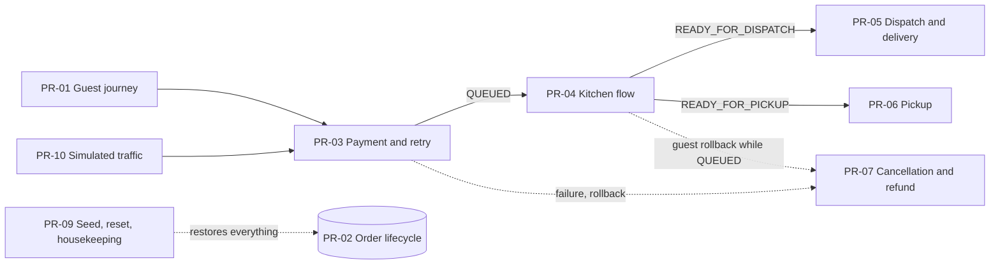

# 05 — Processes

This folder holds the order lifecycle, the only process that is specified as a document of its own: [order-lifecycle.md](order-lifecycle.md) (PR-02 order state machine, PR-07 cancellation and refund, simulator timings, courier and oven behaviour).

Every other business process is specified, with its diagram, in the functional-design or simulation document that owns its rules. The table below is the complete list of processes in Lite; it is the same as [`ids-and-traceability.md`](../01-product-brief/ids-and-traceability.md) section 5. There are no further process files and no further rules outside the documents listed.

In Lite the guest is the only person who acts; the kitchen, the couriers, pickup customers and further orders are run by the Simulator, and seed, reset and housekeeping by the system.

| ID | Process | Specified in (diagram and rules) | Actors in Lite | Main screens |
|---|---|---|---|---|
| PR-01 | Guest ordering journey (browse → configure → cart → checkout → pay → track) | [product-brief.md](../01-product-brief/product-brief.md) section 6 (journeys 1–6); flow of the guest areas in [02-functional-design/README.md](../02-functional-design/README.md) section 2; steps in FD-02 – FD-07 | Guest | SCR-01 → SCR-09 |
| PR-02 | Order lifecycle (state machine) | [order-lifecycle.md](order-lifecycle.md) sections 1–4 | Guest, Simulator, System | all order screens |
| PR-03 | Simulated payment and retry | [FD-06](../02-functional-design/fd-06-payment.md) and [SIM-01](../10-simulations/sim-01-payment-gateway.md) (sequence diagrams) | Guest, Simulator, System | SCR-06, SCR-07, SCR-08 |
| PR-04 | Kitchen flow (queue → oven → QA → ready), automatic only | [SIM-02](../10-simulations/sim-02-kitchen-auto-advance.md) (oven temperature, bake progress, queue position, kitchen load in its section 3.6) | Simulator | SCR-08, SCR-09 (queue position, bake progress), SCR-01 (kitchen load) |
| PR-05 | Dispatch and delivery (automatic courier assignment, route, return) | [SIM-04](../10-simulations/sim-04-courier-dispatch-and-route.md) and [FD-13](../02-functional-design/fd-13-couriers.md); courier state machine in [order-lifecycle.md](order-lifecycle.md) section 8 | Simulator | SCR-09 |
| PR-06 | Pickup | [SIM-06](../10-simulations/sim-06-pickup-arrival.md); guest side in [FD-07](../02-functional-design/fd-07-tracking.md) | Simulator | SCR-09 |
| PR-07 | Cancellation and refund | [order-lifecycle.md](order-lifecycle.md) section 5 | Guest (T-06, T-09), System (T-04, T-07) | SCR-07, SCR-09 |
| PR-09 | Demo seed, reset and housekeeping | [SIM-08](../10-simulations/sim-08-demo-reset.md) (sequence diagrams) and [FD-14](../02-functional-design/fd-14-simulation-control.md) section 4; constant `Simulation.ResetOnStartup` in [lite-configuration.md](../10-simulations/lite-configuration.md) | System | — (no screen) |
| PR-10 | Simulated order traffic | [SIM-05](../10-simulations/sim-05-order-traffic-generator.md) (sequence diagram) | Simulator | SCR-01 (KPIs); indirectly SCR-08, SCR-09 (queue position, ETA) |

PR-08 (menu change and availability), PR-11 (sign-in and role routing) and PR-12 (intake pause and resume) are not in Lite.

## Overview

