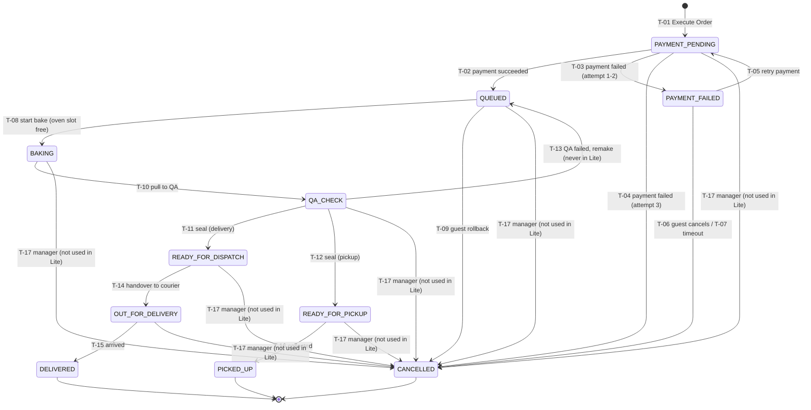
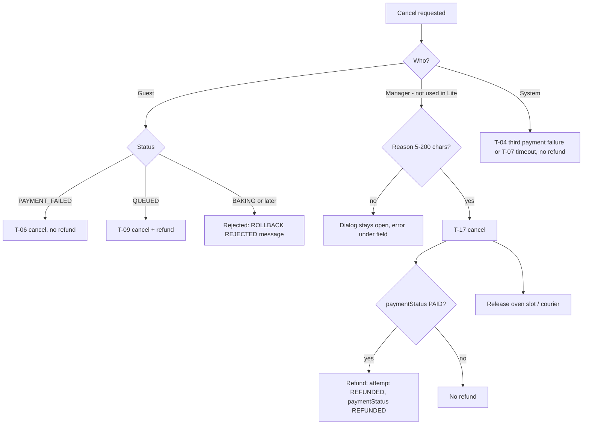
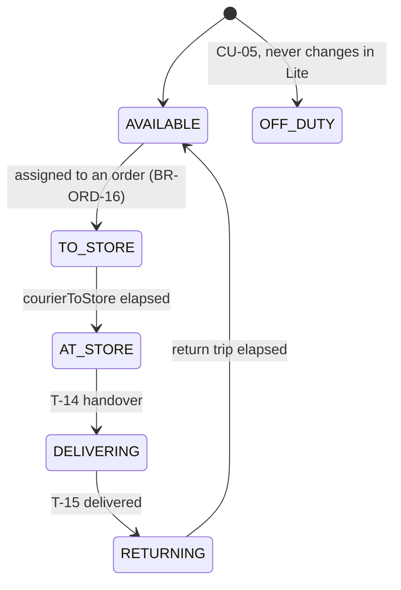

# Order Lifecycle (PR-02) and Cancellation (PR-07)

This document owns the order state machine: the states, every allowed transition with its trigger, guards and side effects, the simulator timings, and which screens show which state. Rules are numbered `BR-ORD-xx`. Other documents reference these rules and do not repeat them.

Related: [information-model.md](../04-information-model/information-model.md) (objects `Order`, `OrderStatusChange`, `OrderLogEntry`, `PaymentAttempt`, `Courier`, `Oven`, `SimulationSettings`), [glossary.md](../01-product-brief/glossary.md), [ids-and-traceability.md](../01-product-brief/ids-and-traceability.md), [lite-configuration.md](../10-simulations/lite-configuration.md) (fixed durations and speed in Lite).

**Lite.** The state machine is complete, because seed order histories and other rules refer to every state and transition. Transitions, triggers and rules that need staff, a manager or the simulation panel are marked **not used in Lite**: they are not built and never happen at run time.

---

## 1. Summary

An order is created when the guest presses **Execute Order --force** at checkout (or when the traffic generator creates a simulated order). It waits for the simulated payment, then runs through the kitchen pipeline (queue → oven → quality check), then either goes out with a courier (delivery) or waits on the pickup shelf (pickup). It ends as delivered, picked up or cancelled.

In Lite the only person who acts on an order is the guest who placed it or holds its token: retry or cancel after a failed payment, and rollback while `QUEUED`. Every other step is done automatically by the **Simulator** or the system, so the demo works without anyone operating the kitchen. Where a guest action and an automatic step meet, whichever comes first wins, and the other is ignored.

---

## 2. States

One canonical set. The **key** is the enumeration value (`OrderStatus`). The **dev label** is the badge text in the UI. The **plain label** is shown next to the dev label to customers (subtitle, tooltip, accessible name).

| # | Key | Dev label (badge) | Plain label | Meaning | Final | Open | Color token |
|---|---|---|---|---|---|---|---|
| 1 | `PAYMENT_PENDING` | `STAGED` | Awaiting payment | Order created, simulated payment is processing | no | yes | `color.status.staged` |
| 2 | `PAYMENT_FAILED` | `PAYMENT_FAILED` | Payment failed | Last payment attempt failed; customer may retry or cancel | no | yes | `color.status.failed` |
| 3 | `QUEUED` | `QUEUED` | Order received | Paid; waiting for the kitchen to start | no | yes | `color.status.queued` |
| 4 | `BAKING` | `BAKING` | In the oven | Assembled and baking in an oven | no | yes | `color.status.baking` |
| 5 | `QA_CHECK` | `QA_CHECK` | Quality check & packing | Out of the oven: checked, sliced, dips added, boxed | no | yes | `color.status.qa` |
| 6 | `READY_FOR_DISPATCH` | `DISPATCH_READY` | Waiting for courier | Delivery order packed on the dispatch shelf | no | yes | `color.status.dispatch` |
| 7 | `READY_FOR_PICKUP` | `READY_TO_PULL` | Ready for pickup | Pickup order packed on the pickup shelf | no | yes | `color.status.dispatch` |
| 8 | `OUT_FOR_DELIVERY` | `IN_TRANSIT` | On the way | Courier is driving to the customer | no | yes | `color.status.dispatch` |
| 9 | `DELIVERED` | `DEPLOYED` | Delivered | Handed to the customer at the address | yes | no | `color.status.deployed` |
| 10 | `PICKED_UP` | `PULLED` | Picked up | Collected by the customer at the store | yes | no | `color.status.deployed` |
| 11 | `CANCELLED` | `ROLLED_BACK` | Cancelled | Stopped before completion; refunded if it was paid | yes | no | `color.status.failed` |

- **Open** states = all non-final states. `Order.isActive` uses this set.
- **Kitchen states** = `QUEUED`, `BAKING`, `QA_CHECK`, `READY_FOR_DISPATCH`, `READY_FOR_PICKUP` (the kitchen part of the pipeline; Lite has no kitchen display).
- Color tokens are defined in [tokens.md](../07-design-system/tokens.md).

### 2.1 Customer pipeline stepper (5 stages)

The tracking page (SCR-09) shows five stages. Stage 4 and 5 depend on the order type.

| Stage | Delivery: label (state) | Pickup: label (state) |
|---|---|---|
| 1 | `QUEUED` (QUEUED) | `QUEUED` (QUEUED) |
| 2 | `BAKING` (BAKING) | `BAKING` (BAKING) |
| 3 | `QA_CHECK` (QA_CHECK) | `QA_CHECK` (QA_CHECK) |
| 4 | `DISPATCH` — sub-label "Waiting for courier" (READY_FOR_DISPATCH) or "Courier on the way" (OUT_FOR_DELIVERY) | `READY_TO_PULL` (READY_FOR_PICKUP) |
| 5 | `DEPLOYED` (DELIVERED) | `PULLED` (PICKED_UP) |

`PAYMENT_PENDING` and `PAYMENT_FAILED` show the stepper with no stage reached and a payment banner. `CANCELLED` shows the stepper frozen at the last reached stage, with a `ROLLED_BACK` banner, the reason (customer-safe wording) and the refund note if applicable.

---

## 3. State diagram

(`PAYMENT_FAILED → CANCELLED` by a manager is also T-17; it is covered by T-06/T-07 in the diagram. T-17 is not used in Lite; it may appear only in the status history of seed orders.)

---

## 4. Transitions

Actors in Lite: **G** guest (an order the session holds a token for, LITE-SES-03), **SIM** simulator, **SYS** system timer. The manual triggers of kitchen staff (**K**) and the manager (**M**) of the full product are not used in Lite: nobody acts in these roles, and `KITCHEN` and `MANAGER` appear only in the status history of seed orders. Timings refer to section 7. Every transition must create one `OrderStatusChange` and at least the listed `OrderLogEntry` lines (BR-ORD-02). Log lines marked *(staff)* have `isCustomerVisible = false`.

| ID | From → To | Trigger and actor | Guards | Side effects | Minimum log lines |
|---|---|---|---|---|---|
| T-01 | (none) → `PAYMENT_PENDING` | G presses **Execute Order --force** on SCR-06; SIM creates a simulated order | BR-ORD-03 | Create `Order` with amounts (BR-PRICE-12), `OrderLine`/`OrderLineModifier` snapshots, `orderNumber`, `commitHash`, `trackingToken`; create `PaymentAttempt` #1 (PROCESSING) with the method/card chosen at checkout; open SCR-07 in processing state. Cart is **not** cleared yet. | `[INIT] Order MX-1048 staged. Commit #a3f9c2e signed.` · `[PAYMENT] Handshake with payment gateway (simulated)…` |
| T-02 | `PAYMENT_PENDING` → `QUEUED` | SIM-01 after `paymentProcessing` with outcome success | attempt status PROCESSING | Attempt → SUCCEEDED with `transactionId`; `paymentStatus` → PAID; `paidAt`, `queuedAt`; clear the customer's cart (and coupon); record coupon on the order if APPLIED; compute ETA (7.3); close SCR-07, show SCR-08 confirmation | `[PAYMENT] Payment confirmed. TxID txn_sim_…` · `[KITCHEN] Order queued at position N.` |
| T-03 | `PAYMENT_PENDING` → `PAYMENT_FAILED` | SIM-01 outcome failure | attempt number < `maxPaymentAttempts` (3) | Attempt → FAILED with `failureCode`; SCR-07 shows the failure state with "Retry payment" and "Cancel order" | `[PAYMENT] ERROR 402: <failure text>. Attempt n of 3.` |
| T-04 | `PAYMENT_PENDING` → `CANCELLED` | SIM-01 outcome failure | attempt number = 3 | Attempt → FAILED; `cancelReason` "Payment failed 3 times"; `cancelledBy` SYSTEM; cart kept unchanged | `[PAYMENT] ERROR 402: … Attempt 3 of 3.` · `[ROLLBACK] Order rolled back: payment failed 3 times.` |
| T-05 | `PAYMENT_FAILED` → `PAYMENT_PENDING` | G presses **Retry payment** on SCR-07 (may change method or test card first); SIM: a simulated customer retries once after 15 s with `VISA_4242` | attempts < 3; total unchanged | New `PaymentAttempt` (PROCESSING) | `[PAYMENT] Retrying payment (attempt n of 3)…` |
| T-06 | `PAYMENT_FAILED` → `CANCELLED` | G presses **Cancel order** on SCR-07 or SCR-09 | — | `cancelledBy` GUEST; reason "Cancelled by customer before payment"; cart kept so the customer can edit and try again | `[ROLLBACK] Order rolled back by customer before payment.` |
| T-07 | `PAYMENT_FAILED` → `CANCELLED` | SYS after `paymentFailedTimeout` in PAYMENT_FAILED | — | `cancelledBy` SYSTEM; reason "Payment not completed in time" | `[ROLLBACK] Payment window expired. Order rolled back.` |
| T-08 | `QUEUED` → `BAKING` | SIM-02 when `autoAdvanceKitchen` and the order has waited `queueWait` and is first in the queue order (BR-ORD-11) | an ONLINE oven has a free slot (BR-ORD-11) | Assign oven (BR-ORD-11); `bakingStartedAt`; bake timer starts | `[KITCHEN] Dough stretched, toppings injected.` · `[OVEN] Entered OVEN_01 at 850°F. Bake timer 01:30.` (target temperature of the oven, SIM-02 BR-SIM-16a) |
| T-09 | `QUEUED` → `CANCELLED` | G presses **Rollback order** on SCR-09 and confirms | BR-ORD-08 | `cancelledBy` GUEST; reason "Cancelled by customer"; refund (BR-ORD-10) | `[ROLLBACK] Order rolled back by customer. Refund issued.` |
| T-10 | `BAKING` → `QA_CHECK` | SIM-02 when the bake timer reaches `bake` | — | `qaStartedAt`; release the oven slot; overbake warnings stop | `[OVEN] Pulled from OVEN_01 after 01:31.` · `[QA] Quality check started.` |
| T-11 | `QA_CHECK` → `READY_FOR_DISPATCH` | SIM-02 after `qa` (ticks all checklist items first) | type DELIVERY; all three QA checks done (BR-ORD-12) | `readyAt`; courier assignment starts (BR-ORD-16) | `[QA] Passed: 8 slices, dips added, box sealed.` · `[ROUTER] Waiting for courier…` |
| T-12 | `QA_CHECK` → `READY_FOR_PICKUP` | as T-11 | type PICKUP; all three QA checks done | `readyAt` | `[QA] Passed: box sealed.` · `[DEPLOY] Ready for pickup at the counter.` |
| T-13 | `QA_CHECK` → `QUEUED` | SIM-02 with probability `qaFailurePercent` (0 % in Lite, so T-13 never happens) | `remakeCount` < 2 (BR-ORD-14) | `remakeCount + 1`; `isPriority` true; QA checks reset to false; oven cleared; `queuedAt` reset; ETA recalculated | `[QA] Check failed: <reason>. Rebuilding your order.` |
| T-14 | `READY_FOR_DISPATCH` → `OUT_FOR_DELIVERY` | SIM-04 when `autoDispatch` and the courier has been `AT_STORE` for `handover` | courier assigned and in status `AT_STORE` (BR-ORD-15) | `dispatchedAt`; courier → DELIVERING; `routeProgressPercent` 0 and rising; map becomes live on SCR-09 | `[ROUTER] Handed over to Marek // Moto-v3.` · `[COURIER] On the way. Distance 2.8 mi.` |
| T-15 | `OUT_FOR_DELIVERY` → `DELIVERED` | SIM-04 when `routeProgressPercent` reaches 100 | — | `completedAt`; courier → RETURNING; `routeProgressPercent` 100 | `[DEPLOY] Delivered. Enjoy your build!` |
| T-16 | `READY_FOR_PICKUP` → `PICKED_UP` | SIM-06 when `autoPickup` and the order has waited `pickupArrival` | — | `completedAt` | `[DEPLOY] Picked up. Enjoy your build!` |
| T-17 | any open state → `CANCELLED` | **Not used in Lite.** M (manager) with a mandatory reason; appears only in the status history of seed orders | BR-ORD-09 | `cancelledBy` MANAGER; reason stored; refund (BR-ORD-10); release oven slot; courier: TO_STORE/AT_STORE → AVAILABLE, DELIVERING → RETURNING | `[ROLLBACK] Order cancelled by the store. Refund issued.` · *(staff)* `[OPS] Cancelled by <manager>: <reason>` |

Manual kitchen, dispatch and pickup actions of the full product (**Start bake**, **Pull to QA**, **Seal & move to dispatch**, **Fail QA**, **Hand over to courier**, **Mark delivered**, **Mark picked up**) are not used in Lite: T-08 and T-10 – T-16 are performed only by the Simulator.

### 4.1 Business rules

| ID | Rule |
|---|---|
| BR-ORD-01 | An order's status changes only through the transitions T-01 – T-17. Any other change is rejected; the guest's screens show only the actions valid for the current state and guards. |
| BR-ORD-02 | Every transition writes one `OrderStatusChange` (from, to, time, actor type, actor name, reason when required) and at least the log lines in section 4. Timestamps use the server clock. |
| BR-ORD-03 | **Creating an order (T-01)** requires: cart has ≥ 1 line; every line `isAvailable`; at least one line that is not a drink; total quantity ≤ `maxItemsPerOrder` (30); `StoreSettings.intakeStatus = OPEN` (always true in Lite); contact name, email and phone present and valid; DELIVERY: complete address with a ZIP of an active `DeliveryZone` and subtotal ≥ `minDeliverySubtotal` (BR-PRICE-13); a payment method chosen (and a test card for CARD). |
| BR-ORD-04 | The outcome of a payment attempt is decided by SIM-01: the chosen test card decides (`VISA_4242`, `MASTERCARD_4444`, Apple Pay, Google Pay → success; `VISA_0002` → DECLINED; `VISA_9995` → INSUFFICIENT_FUNDS; `AMEX_0005` → GATEWAY_TIMEOUT after `paymentTimeout`). A successful outcome turns into a failure (DECLINED) with probability `randomPaymentFailurePercent` (0 % in Lite, so only the failing test cards fail). |
| BR-ORD-05 | An order has at most 3 payment attempts (`StoreSettings.maxPaymentAttempts`). The third failure cancels the order automatically (T-04). The amount of every attempt equals the order total. |
| BR-ORD-06 | An order left in `PAYMENT_FAILED` for `paymentFailedTimeout` is cancelled automatically (T-07). |
| BR-ORD-07 | The cart is cleared only when payment succeeds (T-02). While the order is `PAYMENT_PENDING` or `PAYMENT_FAILED`, and after T-04/T-06/T-07, the cart keeps its lines so the customer can edit and check out again (which creates a new order). |
| BR-ORD-08 | The guest may cancel an order only in `PAYMENT_FAILED` (T-06) or `QUEUED` (T-09). In any later state the **Rollback order** action is disabled with the message `ROLLBACK REJECTED — your order is already in the oven.` (BAKING, QA_CHECK), `…already packed.` (READY_*), `…already on its way.` (OUT_FOR_DELIVERY). |
| BR-ORD-09 | Not used in Lite (cancellation by a manager, T-17). In Lite nobody can cancel an order after `QUEUED`. |
| BR-ORD-10 | Cancelling a `PAID` order refunds it at once (simulated): the SUCCEEDED attempt becomes REFUNDED with `refundedAt` and `refundId`; `paymentStatus` → REFUNDED; full amount (BR-PRICE-14). Unpaid orders are cancelled without refund. |
| BR-ORD-11 | **Oven assignment.** Orders leave the queue in this order: `isPriority` first, then oldest `queuedAt`. An order can start baking only when an ONLINE oven has `ordersBaking < capacityOrders`; it gets the first such oven by oven code (`OVEN_01` before `OVEN_02`). In Lite only the Simulator starts orders, always in this queue order. |
| BR-ORD-12 | Sealing (T-11/T-12) requires the three QA checks on the order to be ticked: **Sliced** (pizzas cut: 6 slices Small, 8 Medium/Large; calzone not cut), **Extras added** (dips and sides packed), **Box sealed**. In Lite the simulator ticks them itself before sealing. Orders without pizzas still pass the same three checks. |
| BR-ORD-13 | Not used in Lite (overbake warnings on the kitchen display). `autoAdvanceKitchen` is always on, so the simulator pulls every order on time (SIM-02 section 3.2). |
| BR-ORD-14 | **Remake.** QA failure (T-13) is allowed at most twice per order (`remakeCount` 0 → 1 → 2). With `remakeCount = 2` the **Fail QA** action is disabled. A remade order goes to the top of the queue. In Lite `qaFailurePercent` is 0 %, so no order is remade. |
| BR-ORD-15 | Handover to the courier (T-14) requires the assigned courier to be `AT_STORE`. |
| BR-ORD-16 | **Courier assignment.** When an order enters READY_FOR_DISPATCH, or when a courier becomes AVAILABLE while orders are waiting, the simulator (if `autoDispatch`) assigns the AVAILABLE courier that has been available longest to the waiting order with the oldest `readyAt`. In Lite `autoDispatch` is always on and there is no manual assignment (FD-13). If no courier is available the order waits; the guest sees stage 4 "Waiting for courier". |
| BR-ORD-17 | Final states (DELIVERED, PICKED_UP, CANCELLED) never change. |
| BR-ORD-18 | Not used in Lite (manager force-advance). |
| BR-ORD-20 | Status, timers, ETA, log and map changes appear on SCR-09 within 5 seconds without a manual page reload; the live build status on SCR-01 shows the order's status within 10 seconds (NFR-07). |
| BR-ORD-21 | **Timers and speed (progress model).** Every automatic timer — payment answer, payment window (`paymentFailedTimeout`), simulated retry, queue wait, bake, QA, courier trips, handover, pickup arrival, traffic spawn — has a progress value `p` from 0 to 1. A timer starts at `p = 0` when its state or phase is entered. While the simulation runs, `p` grows by `1 / eff(d)` per second, where `eff(d)` is the effective duration at the current speed (7.2); the step is due when `p ≥ 1`; the remaining time is `(1 − p) × eff(d)`. The progress already made is never lost: a **speed change** (a restart of the app with another `Simulation.SpeedFactor`, LITE-CFG-02) keeps `p` and changes only the rate, so only the remaining part is scaled. Lite has no pause. How `p` is stored is the contractor's decision (for example the progress and the moment it was last re-anchored, per order and per courier; information model 5.1 and 7.1). |
| BR-ORD-22 | **Housekeeping.** Orders with source SIMULATOR in a final state older than `retentionHours` (24 h, fixed in Lite) are deleted together with their lines, attempts, history and logs; schedule and details in SIM-08 section 7. Guest orders are kept until demo reset. |

---

## 5. Cancellation and refund (PR-07)

Customer-facing wording on SCR-09 for a cancelled order: "This order was rolled back." plus one of: "You cancelled it.", "The store cancelled it. Reason: …" (the manager's reason is shown as typed; in Lite only on seed orders), "Payment was not completed." When refunded: "Refund of $X.XX issued to <method> (simulated)."

---

## 6. Screens per state

| State | SCR-07 Payment | SCR-08 Confirm | SCR-09 Tracking | SCR-01 Home build status | SCR-13 Order detail | Guest actions | Next automatic step |
|---|---|---|---|---|---|---|---|
| PAYMENT_PENDING | processing | — | payment banner "Processing payment…" | yes | current status | — | SIM-01: T-02, T-03 or T-04 |
| PAYMENT_FAILED | failure state | — | banner with retry/cancel | yes | current status | retry, cancel | SYS: T-07 after `paymentFailedTimeout` |
| QUEUED | — | shown once after T-02 | stage 1 with queue position, rollback enabled | yes | current status | rollback | SIM-02: T-08 |
| BAKING | — | — | stage 2, bake progress %, rollback disabled | yes | current status | — | SIM-02: T-10 |
| QA_CHECK | — | — | stage 3 | yes | current status | — | SIM-02: T-11 / T-12 |
| READY_FOR_DISPATCH | — | — | stage 4 "Waiting for courier", courier name once assigned | yes | current status | — | SIM-04: assignment, T-14 |
| READY_FOR_PICKUP | — | — | stage 4 "Ready for pickup", store address | yes | current status | — | SIM-06: T-16 |
| OUT_FOR_DELIVERY | — | — | stage 4 "Courier on the way", live map, ETA, distance remaining | yes | current status | — | SIM-04: T-15 |
| DELIVERED | — | — | stage 5 complete | no | final | — | — |
| PICKED_UP | — | — | stage 5 complete | no | final | — | — |
| CANCELLED | third failure: "Order rolled back" | — | rollback banner, reason, refund note | no | final, with refund | — | — |

Lite has no kitchen display, operations list or staff order detail; simulated orders are never shown to guests (LITE-SEC-02).

---

## 7. Simulator timings

### 7.1 Base durations (at speed 1×)

All durations are stored in `SimulationSettings` and divided by the speed factor (section 7.2). In Lite they are fixed at the default value (`10-simulations/lite-configuration.md` section 2); the range column applies only to the full product.

| Key | Meaning | Default (s) | Range (s) |
|---|---|---|---|
| `paymentProcessing` | PAYMENT_PENDING until the gateway answers | 3 | 1–10 |
| `paymentTimeout` | time until `AMEX_0005` fails with GATEWAY_TIMEOUT | 10 | 5–30 |
| `paymentFailedTimeout` | PAYMENT_FAILED until auto-cancel (T-07) | 600 | 60–1800 |
| `simulatedRetryDelay` | simulated customer waits before retrying (T-05) | 15 | 5–60 |
| `queueWait` | minimum time in QUEUED before auto start bake | 20 | 5–120 |
| `bake` | bake time (Neapolitan-style, 90 s) | 90 | 30–300 |
| `overbakeWarn` | after the bake timer: `DONE! PULL NOW` (not used in Lite) | 15 | 5–60 |
| `overbakeCritical` | after the bake timer: `CRITICAL PULL` (not used in Lite) | 60 | 20–180 |
| `qa` | QA_CHECK until auto seal | 30 | 10–120 |
| `courierToStore` | courier trip from AVAILABLE to AT_STORE | 30 | 10–120 |
| `handover` | courier AT_STORE until auto handover | 5 | 0–30 |
| `travelBase` + `travelPerMile` | delivery trip = `travelBase + travelPerMile × distanceMiles` | 60 + 40 | 10–300 / 10–120 |
| `courierReturn` | return trip = same formula as the delivery trip | — | — |
| `pickupArrival` | READY_FOR_PICKUP until the simulated customer collects | 90 | 15–600 |
| `ovenTempTick` | oven temperature update interval (not used in Lite: no oven telemetry) | 5 | fixed |

Examples at 1×: a delivery to 94110 (0.8 mi) travels `60 + 40 × 0.8 = 92 s`; to 94105 (2.8 mi) `172 s`. A typical delivery order completes about 5 minutes after payment; a pickup order about 4 minutes after payment.

> **Assumption A-04:** Demo time is compressed. Durations are seconds, not real-world minutes, so a whole order can be observed in a few minutes. ETAs and countdowns shown to users are based on these compressed durations.

### 7.2 Speed factor

`speedFactor` ∈ {1×, 2×, 5×, 10×}, set by the constant `Simulation.SpeedFactor` when the app starts (LITE-CFG-01, LITE-CFG-02). Effective duration = `ceil(base / factor)` seconds, minimum 1 s. The factor applies to every duration in 7.1 and to the traffic interval. A new factor (after a restart) keeps the progress already made and scales only the remaining part (BR-ORD-21): an order 60 s into a 90 s bake at 1× (`p = 2/3`) that continues at 2× is pulled `(1 − 2/3) × 45 s = 15 s` later.

### 7.3 ETA calculation

ETAs are recalculated at least every 5 seconds and whenever the status changes. `remaining(d)` = `(1 − p) × eff(d)` for the running timer of the current state (BR-ORD-21), and `eff(d)` for steps not started yet.

| Current state | Ready time (`estimatedReadyAt`) |
|---|---|
| PAYMENT_PENDING, PAYMENT_FAILED | now + `queueWait` + `bake` + `qa` |
| QUEUED | now + remaining(`queueWait`) + `bake` + `qa`; if no oven slot is free, add the remaining bake time of the oldest baking order |
| BAKING | now + remaining(`bake`) + `qa` |
| QA_CHECK | now + remaining(`qa`) |
| READY_* | `readyAt` |

| Order type | Completion time (`estimatedCompletionAt`) |
|---|---|
| PICKUP | = `estimatedReadyAt` (shown as "Ready for pickup at HH:mm") |
| DELIVERY, before OUT_FOR_DELIVERY | `estimatedReadyAt` + courier part + `handover` + trip, where courier part = remaining trip if the courier is TO_STORE, 0 if AT_STORE, `courierToStore` if no courier is assigned yet |
| OUT_FOR_DELIVERY | now + trip × (100 − `routeProgressPercent`) / 100 |

The guest sees the ETA as a countdown `mm:ss` plus the clock time (`ETA 04:35 · ~18:49`). Remaining distance while OUT_FOR_DELIVERY = `distanceMiles × (100 − routeProgressPercent) / 100`, one decimal, e.g. `1.2 mi`.

### 7.4 Simulator tick

The simulator evaluates all timers at least every 2 seconds. In one tick it may advance several orders, each at most one transition. Simulated orders follow exactly the same transitions and guards as real ones.

---

## 8. Courier state machine (SIM-04)

- A courier carries one order at a time. It keeps that order as `currentOrder` from the assignment until it is `AVAILABLE` again, including the return trip, which lasts as long as the delivery trip of that order (SIM-04 4.4, 4.5).
- In Lite `CU-01` – `CU-04` are on duty and `CU-05` stays `OFF_DUTY`; nobody changes the duty status, and no courier is replaced or recalled (lite-configuration section 2, FD-13).
- `tripProgressPercent` runs 0 → 100 in TO_STORE, DELIVERING and RETURNING; for DELIVERING it equals the order's `routeProgressPercent`.

## 9. Oven behavior

- An order occupies one slot of one oven from T-08 until it leaves BAKING (T-10).
- Lite has no oven telemetry: `currentTempF` is not simulated; the T-08 log line uses the oven's `targetTempF` (SIM-02 BR-SIM-16a).
- An OFFLINE oven accepts no new orders; orders already in it finish normally. In Lite both ovens are `ONLINE` and nobody switches them.
- Occupied slots of the ONLINE ovens give the kitchen load shown on SCR-01 (SIM-02 BR-SIM-16d).

---

## 10. Reconciliation of Stitch stage names

The Stitch screens use several naming schemes. They are all replaced by the canonical states in section 2.

| Canonical key (dev label) | Names found in Stitch | Where |
|---|---|---|
| `PAYMENT_PENDING` (`STAGED`) | — (not designed) | — |
| `PAYMENT_FAILED` | — (not designed) | — |
| `QUEUED` | `Queued` / `INIT_SUCCESS` · `1. QUEUED` · `BUILD_QUEUE` · `QUEUED` · `Init`, `Compile` · `01 // QUEUED` | order-status · delivery-status-mobile · kds-kolejka-pieca · zarzadzanie-zamowieniami, handover doc · home · UI kit |
| `BAKING` | `Baking` / `COMPILING_CRUST` · `2. BAKING` · `BAKING_STAGE` · `IN_OVEN` · `Bake (75%)` · `BUILD SUCCEEDED // STAGE: BAKING_INITIALIZED` · `02 // BAKING` | order-status · mobile · KDS · handover doc · home · confirmation modal · UI kit |
| `QA_CHECK` | `Testing` / `QA_PENDING` · `3. QUALITY_TEST` · `QA_&_PACK` · `QA_CHECK` · `TESTING` · `03 // QA & LINT` | order-status · mobile · KDS · handover doc · operations · UI kit |
| `READY_FOR_DISPATCH` (`DISPATCH_READY`) | `DISPATCH_READY` | KDS |
| `READY_FOR_PICKUP` (`READY_TO_PULL`) | `PICKUP::LOCAL_CLIENT` tag only | KDS |
| `OUT_FOR_DELIVERY` (`IN_TRANSIT`) | `Deployed` / `PROD_LIVE` (desktop tracking: meant "out for delivery") · `4. DISPATCH` / `IN_TRANSIT` · `DISPATCHED` · `Deploy` · `04 // DISPATCH` | order-status · mobile · handover doc · home · UI kit |
| `DELIVERED` (`DEPLOYED`) | `5. DELIVERED` · `DEPLOYED` · `MERGED_INTO_STOMACH`, `PIPELINE_COMPLETE`, `ARCHIVED_SUCCESS` | mobile · operations, handover doc · profile screens |
| `PICKED_UP` (`PULLED`) | — | — |
| `CANCELLED` (`ROLLED_BACK`) | `TIMEOUT_ERR (Canceled)` · `ROLLBACK / ABORT` | profile · mobile tracking |

Decisions:

- `DEPLOYED` means **delivered** (final success), not "out for delivery" as in the desktop tracking design.
- Profile flavor labels (`MERGED_INTO_STOMACH` etc.) are dropped; history uses the state's dev label.
- `DINE_IN` (a filter in the Stitch kitchen design) is out of scope.
- The desktop tracking design's four stages become the five-stage stepper in 2.1 (as in the mobile design).
