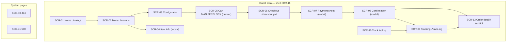
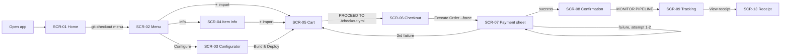
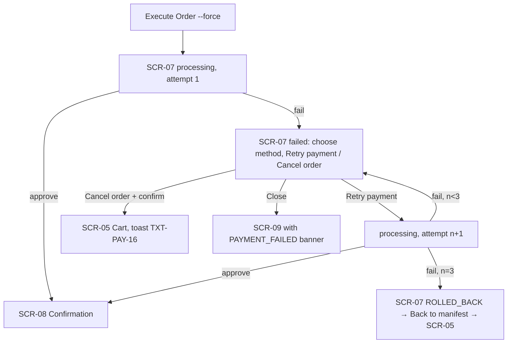

# Navigation Map

How visitors move through Git Pizza MxDev: the sitemap, the shell (header, sidebar, phone bottom tabs), redirects and guards. Lite has one user role, the guest. Screen details are in `screens/`; texts in [ui-copy.md](ui-copy.md).

Related: [../01-product-brief/ids-and-traceability.md](../01-product-brief/ids-and-traceability.md) section 4 (inventory), [../01-product-brief/product-brief.md](../01-product-brief/product-brief.md) section 7 (demo entry points), [../05-processes/order-lifecycle.md](../05-processes/order-lifecycle.md) section 6 (screens per state).

---

## 1. Sitemap

### 1.1 Screen access matrix

Lite has one user role, the guest (Mendix user role `Anonymous`). ✓ = may open. Addresses of screens that are not part of Lite open SCR-40.

| Screen | Guest | Notes |
|---|---|---|
| SCR-01 Home | ✓ | |
| SCR-02 Menu | ✓ | |
| SCR-03 Configurator | ✓ | |
| SCR-04 Item info | ✓ | |
| SCR-05 Cart | ✓ | the cart of the session (LITE-SES-02) |
| SCR-06 Checkout | ✓ | |
| SCR-07 Payment sheet | ✓ (own order) | opens only from SCR-06 or SCR-09 |
| SCR-08 Confirmation | ✓ (own order) | shown once after T-02 |
| SCR-09 Tracking | ✓ (tracking token or an order of the session) | LITE-SES-03 |
| SCR-10 Lookup | ✓ | |
| SCR-13 Order detail / receipt | ✓ (tracking token or an order of the session) | LITE-SES-03 |
| SCR-40, SCR-41 | ✓ | |

---

## 2. Landing pages

| Situation | Lands on |
|---|---|
| Opening the app URL | SCR-01 as guest (a new anonymous session on the first visit, LITE-SES-01) |
| Tracking link (URL with `trackingToken`) | SCR-09 of that order, in any browser (NFR-11) |
| `RETURN_TO_MAIN` on error pages | SCR-01 |
| Session expired | The page that was opened, in a new guest session with an empty cart; toast TXT-ERR-20 when a non-empty cart was lost (LITE-SES-05) |

Lite has no login, no accounts and no role switch.

---

## 3. Customer navigation (SCR-16)

### 3.1 Header (all widths)

| Element | Desktop ≥ 1200 | Tablet 768–1199 | Phone ≤ 767 | Target |
|---|---|---|---|---|
| Logo | horizontal logo `logo-horizontal.svg` 32 px high (wordmark included) | horizontal logo 32 px high | logo mark `logo-mark.svg` 32 px | SCR-01 |
| `./main.js` | ✓ | ✓ | — (logo) | SCR-01 |
| `./menu.ts` | ✓ | ✓ | — (tab `Source`) | SCR-02 |
| `./checkout.yml` | ✓ (disabled when cart empty, TXT-NAV-06) | ✓ | — (via cart) | SCR-06 |
| `./track.log` | ✓ | ✓ | — (tab `Trace`) | see 3.4 |
| Search `grep --pizza '…'` | input 280 px | icon button that expands the input | icon in the menu page only | SCR-02 with the query |
| Cart button with count | ✓ | ✓ | ✓ (also tab `Deploy`) | opens SCR-05 drawer (phone: SCR-05 page) |

The active nav item is underlined (2 px, `color.primary.light`). The header is sticky.

### 3.2 Project Explorer sidebar (desktop only)

| Item | Target |
|---|---|
| `Root` | SCR-01 |
| `Categories` ▸ `pizzas.json`, `sides.yml`, `drinks.env`, `desserts.md` | SCR-02 with that tab |
| `Active_Deployments` | shown only when an order was placed or looked up in this browser session; opens SCR-09 of that order (FD-01 4.1) |
| `New Branch` (button at the bottom) | SCR-02 |

Lite has no `Logs` and `Settings` items. The sidebar is shown on SCR-01, SCR-02, SCR-06, SCR-09, SCR-10, SCR-13. SCR-03 uses the full width without sidebar. The item for the current screen is highlighted (left bar 4 px `color.success.default`, as in Stitch).

### 3.3 Phone bottom tabs

| Tab | Visible label | Accessible name | Target | Active on |
|---|---|---|---|---|
| 1 | `Source` (icon `code`) | Menu | SCR-02 | SCR-02, SCR-03, SCR-04 |
| 2 | `Deploy` (icon `rocket_launch`, count bubble) | Cart, {n} items | SCR-05 page | SCR-05, SCR-06, SCR-07 |
| 3 | `Trace` (icon `terminal`) | Track order | rule 3.4 | SCR-08, SCR-09, SCR-10 |

Home (SCR-01) is reached by the logo; no tab is active on SCR-01. The bottom tabs are hidden while a modal, bottom sheet or the payment sheet is open. There are three tabs; Lite has no `Env` account tab.

### 3.4 `./track.log` rule

| Viewer | Orders | Goes to |
|---|---|---|
| Guest | an order placed, looked up (SCR-10) or opened with its tracking link in this browser session, in any status | SCR-09 of the most recent of them |
| Guest | none | SCR-10 |

The rule is BR-NAV-06 (FD-01); `Trace` and `Active_Deployments` follow it as well.

### 3.5 Footer

On every customer screen except modals and the phone bottom-tab screens' fixed area: TXT-NAV-35 (store line), TXT-NAV-36 (version), links `menu.ts` → SCR-02, `track.log` → rule 3.4 (BR-NAV-06), `allergens.md` → dialog with the allergen notice (FD-01 4.1 step 5). On phone the footer sits at the end of the content, above the bottom-tab spacing.

### 3.6 Banners (stacked at the very top, above the header)

1. `DEMO MODE` (always, all screens incl. the error pages), without a link (US-004).
2. `CONNECTION_LOST` (when live refresh fails).

---

## 5. Flows

### 5.1 Guest ordering (PR-01)

### 5.2 Payment branches (PR-03)

## 6. Redirects and guards

| Rule | Behavior |
|---|---|
| Unknown URL (also the addresses of screens that are not part of Lite), unknown product, archived or draft product link | SCR-40 |
| Invalid or expired tracking token (also the link of an order removed by a demo reset) | SCR-09 in state "invalid link" (TXT-TRK-44 … 46, `RETURN_TO_MAIN`; BR-TRK-21) |
| Order the session holds no token for (SCR-09 without token, SCR-13; LITE-SES-03) | SCR-40 (do not reveal that it exists) |
| SCR-06 with an empty cart | SCR-02 + toast TXT-CHK-49 |
| Unhandled technical error | SCR-41 |
| Back button of the browser | Works between pages. Closing a modal, drawer or bottom sheet with the browser back button **should** close it instead of leaving the page. The payment sheet while processing ignores back (the payment continues; tracking shows the result). |
| Deep links | Every page (not modals and dialogs) **should** have its own URL so it can be bookmarked and reloaded: SCR-01, SCR-02 (with category and search), SCR-03 (with product), SCR-06, SCR-09 (by tracking token), SCR-10, SCR-13 (with order). The tracking link for guests **must** work as a URL (it is shown and copied on SCR-08 and SCR-09). The exact URL paths are the contractor's choice. |
