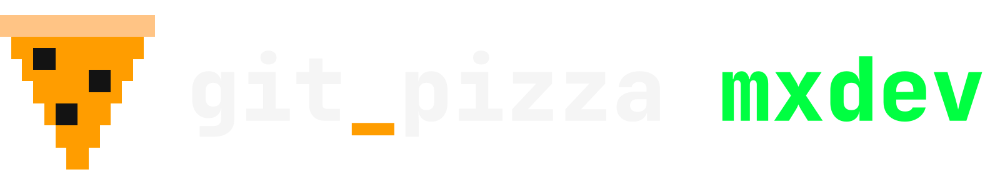

# Logo Usage

Rules for the Git Pizza MxDev logo and brand name. There is **one official logo family, "Pixel Slice"**, delivered as files in `assets/brand/`. Everything else (the Stitch export, the previous raster logo) is obsolete.

---

## 1. The official logo

| Property | Value |
|---|---|
| Name | **Pixel Slice** (owner decision, 2026-11-07; replaces the vector "Commit Slice" logo of 2026-11-05, which replaced the raster "git tree pizza" logo; section 10) |
| Mark | A **pixel-art pizza slice** drawn on a **16 × 16 grid**: an orange body with stepped edges narrowing to a two-pixel tip, a two-row light crust along the top edge and three **2 × 2 pepperoni cut out** of the slice (dark `#131313`). Square pixels and hard edges only: no outlines, curves, gradients or anti-aliasing |
| Meaning | Pizza in the language of the screen: pixels like a terminal, an 8-bit sprite or a favicon. It matches the app's dark grid background, sharp 2 px corners and monospace type, and is pixel-exact as a 16 px browser-tab icon |
| Wordmark | `git_pizza mxdev`, set in **JetBrains Mono ExtraBold** and converted to outlines (no font is needed to show the files). It is the typographic styling of the brand name, not a second name (section 4) |
| Lockups | Horizontal (mark left, wordmark right), stacked (mark above wordmark), mark only |
| Format | Vector masters (SVG, text outlined, the mark as square `rect`s with `shape-rendering="crispEdges"`) in `assets/brand/source/`; ready-made SVG and PNG exports in `assets/brand/` (section 3). The mark is sharpest at **multiples of 16 px** (section 6) |
| Alt text | `Git Pizza MxDev logo` (TXT-NAV-01 note), or `alt=""` when the logo sits inside a link or button whose accessible name already says "Git Pizza MxDev" (accessibility.md 10) |

### 1.1 Colors

The logo uses fixed colors. The tokens are listed in `tokens.md` section 1.8; most have the same value as a UI token.

| Part | On dark backgrounds | On light backgrounds | Token |
|---|---|---|---|
| Slice body | `#ff9d00` | `#ff9d00` | `color.brand.slice` (= `color.primary.default`) |
| Crust | `#ffc485` | `#ffc485` | `color.brand.crust` (= `color.primary.light`) |
| Pepperoni cut-outs | `#131313` | `#131313` | `color.brand.ink` (= `color.surface.base`) |
| Wordmark `git` and `pizza` | `#f5f5f5` | `#131313` | `color.brand.wordmarkOnDark` / `color.brand.wordmarkOnLight` |
| Wordmark underscore `_` | `#ff9d00` | `#ff9d00` | `color.brand.slice` |
| Wordmark `mxdev` | `#00ff41` | `#00a82b` | `color.brand.mxdevOnDark` (= `color.success.default`) / `color.brand.mxdevOnLight` |
| Tile background (app icon, stacked logo on dark, OG image) | `#131313` | — | `color.brand.logoBackground` |

The single-color version uses only black (`logo-mono-black.png`); in them the pepperoni are transparent and one empty pixel row separates the crust from the slice.

Do not edit, redraw, recolor or re-generate the artwork. If a size or variant is needed that is not in section 3, scale the SVG master; if that is not enough, ask the owner.

---

## 2. Brand name

| Rule | Correct | Wrong |
|---|---|---|
| Spelling in text | **Git Pizza MxDev** (capital G, P, M, D; lowercase x) | `GitPizza`, `Git-Pizza`, `Git Pizza MXDEV`, `Git Pizza Mx Dev`, `Git Pizza // MxDev`, `Pizza MxDev`, `MxDev Pizza`, `PIZZA_OS`, `pizza-os` |
| Wordmark styling | `git_pizza mxdev` appears **only inside the logo files**. Never type it as the brand name in UI text, page titles, alt texts or documents | "Welcome to git_pizza mxdev", `<title>git_pizza mxdev</title>` |
| In uppercase UI styles | Do not apply the `typography.label` uppercase transform to the brand name; write it as above | `GIT PIZZA MXDEV` |
| Store name | `Git Pizza MxDev — Mission Kitchen` (`StoreSettings.storeName`) | |
| In dev-style strings | Allowed as a slug: `git-pizza-mxdev` (e.g. `guest@git-pizza-mxdev`, `ops@git-pizza-mxdev:~$`). The project path `src/pizza-mxdev/` in the Project Explorer is a path, not a brand mention, and stays as designed | `root@pizza-os`, `~/pizza-os`, `PIZZA_OS v1.0.4` |
| Page titles | `<page> — Git Pizza MxDev` (accessibility.md S-1) | |

---

## 3. Files

All files are in `assets/brand/`. "Dark" means the app's own dark surfaces (section 7).

| File | Size | Content | Use |
|---|---|---|---|
| `logo-horizontal.svg` / `logo-horizontal.png` | SVG 1354 × 240 / PNG 1600 × 284, transparent | Mark + wordmark side by side, colors for dark | **Default logo of the app**: header (desktop, tablet), error pages |
| `logo-mark.svg` / `logo-mark.png` | 1024 × 1024, transparent | Mark only, no wordmark | Phone header, footer, home hero, order confirmation, any square place from 32 px |
| `logo-git-pizza-mxdev.png` | 1024 × 1024 | **Primary stacked logo**: mark above wordmark on a `#131313` square | Where a square full logo is needed on its own (presentations, README) |
| `logo-git-pizza-mxdev-transparent.png` | 1024 × 1024, transparent | Stacked logo without the square, colors for dark | Stacked logo on app surfaces |
| `logo-mono-black.png` | 1600 × 284, transparent | Horizontal lockup, black only | **Printed receipt** (SCR-13 print view), fax-like or single-color print |
| `app-icon.png` | 1024 × 1024 | Mark on a rounded `#131313` tile | Source of all home-screen icons; app stores, bookmarks |
| `icon-512.png`, `icon-192.png` | 512 × 512, 192 × 192 | Scaled app icon | Web app manifest icons |
| `apple-touch-icon.png` | 180 × 180 | Scaled app icon | `<link rel="apple-touch-icon">` (iOS home screen) |
| `favicon.svg` | vector | The pixel mark (same artwork as `logo-mark.svg`; one grid pixel = one screen pixel at 16 px) | Browser tab icon (`<link rel="icon" type="image/svg+xml">`) |
| `favicon-16.png`, `favicon-32.png`, `favicon-48.png` | 16, 32, 48 px | Pixel mark, raster, pixel-exact | Fallback tab icons (`<link rel="icon" sizes="32x32">`), Windows shortcuts |
| `og-image.png` | 1200 × 630 | Mark, wordmark, tagline "Architect Your Perfect Crust." and `$ git checkout menu` on `#131313` | Link previews (`og:image`, `twitter:image`) when the demo URL is shared |

Every page of the app links `favicon.svg`, `favicon-32.png` and `apple-touch-icon.png`. Prefer the SVG files in the UI (sharp at every size); use the PNG files where SVG is not supported.

---

## 4. Wordmark styling and live text

- The wordmark `git_pizza mxdev` is part of the logo files and is never rebuilt as live text, CSS or a font. Where the brand name is needed as text, write **Git Pizza MxDev**.
- **Do not show the name twice.** The horizontal and stacked lockups already contain the name; do not put the text "Git Pizza MxDev" next to them. Next to the **mark only**, text is allowed (for example the store name `Git Pizza MxDev — Mission Kitchen` in the footer).
- The logo link has the accessible name "Git Pizza MxDev — home"; the image inside is then `alt=""`.

---

## 5. Placement and sizes

| Place | Screen | File | Size desktop / tablet / phone |
|---|---|---|---|
| Customer header | SCR-16 | `logo-horizontal.svg`; phone `logo-mark.svg` | height 32 px / 32 px / mark 32 px |
| Footer | SCR-16 | `logo-mark.svg` + store name as text | 32 px |
| Home hero | SCR-01 (E-02) | `logo-mark.svg`, no glow (section 8) | 240 px / 128 px / 96 px |
| Order confirmation | SCR-08 | `logo-mark.svg` in the `surface.container` tile next to `DEPLOYMENT SUCCESSFUL // 200 OK` (replaces the Stitch `</>` icon) | mark 64 px in an 88 px tile / phone mark 48 px in a 64 px tile |
| Error pages | SCR-40, SCR-41 (E-01) | `logo-horizontal.svg`, top left of the content column | height 48 px at every width |
| Receipt (print view) | SCR-13 | `logo-mono-black.png`, top left | height 40 px |
| Browser tab, home-screen icon | all | `favicon.svg`, `favicon-32.png`, `apple-touch-icon.png`; manifest `icon-192.png`, `icon-512.png` | — |
| Link preview | — | `og-image.png` | 1200 × 630 |

---

## 6. Clear space and minimum size

- **Clear space:** around every lockup and the mark keep at least **x** free, where x = two grid pixels of the mark (1/8 of its width; 4 px for a 32 px mark), and never less than `space.2` (8 px). No text, icon, border or other image enters this area.
- **Pixel grid:** show the mark at **multiples of 16 px** (16, 32, 48, 64, 96 … 240) and the horizontal lockup at **heights that are multiples of 16 px** (32, 48, 64), so every grid pixel covers whole screen pixels. Other sizes blur the pixel edges.
- **Minimum size:**
  - mark (`logo-mark.svg`, `favicon.svg`): **16 px** (browser tab); in the UI **32 px**;
  - horizontal lockup: **32 px** high on desktop and tablet (the wordmark must stay readable); on phone use the mark instead;
  - stacked logos: **96 px** wide.

---

## 7. Backgrounds

| Background | Use |
|---|---|
| App dark surfaces: `color.surface.lowest`, `surface.base`, `surface.low`, `surface.container`, `surface.high`, the `color.overlay.grid` hero pattern | `logo-horizontal.*`, `logo-mark.*`, `logo-git-pizza-mxdev-transparent.png` (colors for dark) |
| White or light grey (documents, slides, print) | `logo-mono-black.png`; the mark works on light backgrounds as it is |
| Single-color print, receipt | `logo-mono-black.png` (black on white) |
| Brand orange `#ff9d00` or other strong colors (merchandise only, not in the app) | `logo-mono-black.png` |
| Not allowed | Photos, the map illustration, glass panels over images, `surface.highest` / `surface.bright` behind the dark-color lockups (low contrast of the `#131313` outlines), the dark-color lockups on white, the light-color lockups on dark |

---

## 8. Effects

- **No effects on the logo**, including the home hero (owner decision 2026-11-07: the glow made the mark stand out from the page). The SCR-08 success tile keeps its own `glow.primaryLarge` as a component effect; the mark inside it has none.
- Not allowed: other drop shadows, outlines, bevels, gradients over the logo, opacity below 100 %, blend modes, filters (grayscale, blur), 3D or perspective.
- Not allowed: animation of the logo (spinning, pulsing, pixels appearing one by one). The obsolete animated SVG logos must not be used or imitated. Under reduced motion even the glow stays static.

---

## 9. Forbidden uses

| # | Do not |
|---|---|
| L-1 | Use any logo other than the Pixel Slice files of section 3 (obsolete logos: section 10) |
| L-2 | Stretch, squash, rotate, flip or skew the logo |
| L-3 | Crop the artwork, rearrange mark and wordmark, or build a lockup that is not in section 3 |
| L-4 | Recolor the artwork: change the slice, crust, commit or wordmark colors, or use a single-color version where a color version fits |
| L-5 | Redraw the logo, set the wordmark as live text, or rebuild it in CSS, an icon font or ASCII art |
| L-6 | Put text, badges, icons or UI elements on top of the logo or inside its clear space |
| L-7 | Combine it with another brand (`PIZZA_OS`, Mendix logo, GitHub logo, git logo) in one lockup |
| L-8 | Use the logo as a button by itself without an accessible name, or as a loading spinner |
| L-9 | Use the logo inside product photos or as a watermark on photos |
| L-10 | Spell the brand name in any form from section 2's "Wrong" column, or use the wordmark styling `git_pizza mxdev` as the name in text |
| L-11 | Show the brand name as text next to a lockup that already contains the wordmark (section 4) |
| L-12 | Smooth, round, outline or blur the pixels (for example by scaling a PNG with smoothing), or show the mark at a size that is not a multiple of 16 px where one fits (section 6) |

---

## 10. Obsolete brand material (never use)

These files and names are not part of the brand. Most exist only in the Stitch designs, which are not part of this package. They are listed so that testers can recognize them; any of them in the built app is a defect.

| Obsolete item | Where it appears | Recognize it by |
|---|---|---|
| **Commit Slice logo** (official 2026-11-05 – 2026-11-07; same file names as today) | Earlier versions of this package and the prototype | A smooth vector slice with a rounded crust and three **red pepperoni with dark outlines joined by a dark branch line**. The current logo is made of square pixels only |
| **Previous raster logo** "git tree pizza" (`developer-devops-logo-for-git-pizza-mxdev.png`; until 2026-11-05 it was shipped as `assets/brand/logo-git-pizza-mxdev.png`) | Earlier versions of this package and the prototype | A whole pizza seen from above whose slice lines form a git tree with the labels `master`, `feature` and `pull-request`, the text "Git Pizza MxDev" in chrome / silver letters, on a `#0d1117` square. The file name `logo-git-pizza-mxdev.png` now holds the **new** stacked logo |
| `PIZZA_OS` brand name, `~/pizza-os`, `root@pizza-os` | Stitch screens `ssh-auth`, `pizza-os-developer-platform`, `system-error`, `developer-profile`, `module-configurator`, `delivery-status-mobile` | Text |
| "Pizza MxDev" without "Git", "Git Pizza // MxDev" | Headers of most Stitch screens | Text |
| Logo variant 1 "CLI Terminal Slice" (`logo-wariant-1-cli-terminal-slice.svg/.png`) | Stitch logo files | Pizza slice as a terminal prompt |
| Logo variant 2 "Bracket Core Scope" (`logo-wariant-2-bracket-core-scope.*`) | Stitch logo files | Slice framed by code brackets |
| Logo variant 3 "Git Branch & Commit Pie" (`logo-wariant-3-git-branch-commit-pie.*`), also called "official, Wariant 3" in the Stitch UI kit and the Stitch Developer Handover doc | Stitch logo files, UI kit "Brand identity" block | Flat vector pie with commit dots. **Not** the Pixel Slice logo despite the similar idea: different shape, colors and wordmark |
| Logo variant 4 "Silicon Chip Pizza Core" (`logo-wariant-4-silicon-chip-pizza-core.*`) | Stitch logo files | Slice as a microchip |
| Logo variant 5 "Monogram Mx Neobrutalist" (`logo-wariant-5-monogram-mx-neobrutalist.*`) | Stitch logo files | Bold "Mx" monogram |
| Triangle "Pizza MxDev Logo" (`pizza-mxdev-logo.svg/.png`) | Stitch logo files | Triangular slice mark |
| Cybernetic hardware logo (`cybernetic-hardware-logo-for-pizza-mxdev-pizza.png`) | Stitch logo files | Slice as a PCB die with gold pins |
| Minimalist dark-mode tech logo (`minimalist-dark-mode-tech-logo-for-pizza.png`) | Stitch logo files | Slice tip as a `> _` prompt |
| Modern developer logo (`modern-developer-logo-for-pizza-mxdev-visual.png`) | Stitch logo files | Slice between glowing `{ }` |
| Neobrutalist monogram (`neobrutalist-tech-startup-monogram-logo-for-mxdev.png`) | Stitch logo files | "Mx" letters in a slice silhouette |
| Animated SVG logos (`git-pizza-animated-svg-logo-wariant-3.*`, `animated-svg.html`, `animated-svg-2.html`, `animated-svg-3.html`) | Stitch logo files | Any animated logo |
| `img` placeholder squares in Stitch headers | All Stitch screens | Grey "img" box — replaced by the horizontal logo (section 5) |

---

## 11. Checks

| Check | Pass criterion |
|---|---|
| G-1 | Search all UI texts, page titles and images: no `PIZZA_OS`, `pizza-os`, "Pizza MxDev" without "Git", "Git Pizza // MxDev"; the brand name in text is always "Git Pizza MxDev", never `git_pizza mxdev` |
| G-2 | Every logo image in the app is a Pixel Slice file from section 3; none of the obsolete items of section 10 (in particular the previous "git tree pizza" raster logo) appears anywhere |
| G-3 | Placements, files and sizes match section 5 at 1440 px and 390 px: horizontal logo in the desktop headers, mark only in the phone headers; nothing below the minimum sizes of section 6 |
| G-4 | Dark-color files only on dark surfaces, light-color files only on light backgrounds, mono black on the printed receipt; never on photos; not distorted, cropped, recolored or animated |
| G-5 | No lockup shows the brand name twice (no live-text "Git Pizza MxDev" next to the horizontal or stacked logo); the logo link has the accessible name of section 4 |
| G-6 | Every page links `favicon.svg`, `favicon-32.png` and `apple-touch-icon.png`; the browser tab shows the pixel slice mark |
