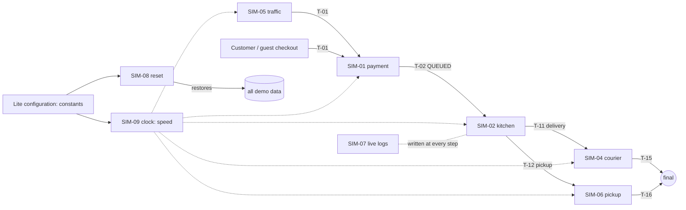

# 10 — Simulations

Git Pizza MxDev is a demo. Payment, kitchen timing, ovens, couriers, pickups and incoming order traffic are **simulated** by a system actor called the **Simulator**, so that anyone can watch a complete pizza business work end to end in a few minutes, with no payment provider, no maps service, no real food and nobody operating the kitchen. The simulations are realistic: they use the real menu, real prices and rules, plausible durations and realistic failures.

In Lite nobody operates the kitchen, the couriers or the simulation: every simulation runs automatically with the fixed parameters of [lite-configuration.md](lite-configuration.md), and the visitor sees its effects on the guest screens.

This folder specifies every simulation: what triggers it, its parameters, its step-by-step behaviour, the data it changes, the order transitions it performs, what users see on which screen, edge cases and acceptance checks. The order state machine, its transitions `T-01 … T-17` and base timings are owned by [order-lifecycle.md](../05-processes/order-lifecycle.md); objects and attributes by [information-model.md](../04-information-model/information-model.md). This folder references them and does not change them.

---

## 1. Overview

| ID | Simulation | File | Trigger | Drives (lifecycle) | Main parameters (default) | Switch (default) | Screens |
|---|---|---|---|---|---|---|---|
| SIM-01 | Payment gateway | [sim-01-payment-gateway.md](sim-01-payment-gateway.md) | Execute Order, Retry payment, simulated order | T-02, T-03, T-04, T-05 (simulated customer), T-07, refunds | `paymentProcessing` 3 s, `paymentTimeout` 10 s, `paymentFailedTimeout` 600 s, `simulatedRetryDelay` 15 s, `randomPaymentFailurePercent` 0 % | always on | SCR-06, SCR-07, SCR-08, SCR-09, SCR-13 |
| SIM-02 | Kitchen auto-advance | [sim-02-kitchen-auto-advance.md](sim-02-kitchen-auto-advance.md) | Tick | T-08, T-10, T-11, T-12, T-13 | `queueWait` 20 s, `bake` 90 s, `qa` 30 s, 2 ovens × 3 slots, `qaFailurePercent` 0 % | always on | SCR-08, SCR-09 (queue position, bake progress), SCR-01 (KPIs) |
| SIM-04 | Courier dispatch and route | [sim-04-courier-dispatch-and-route.md](sim-04-courier-dispatch-and-route.md) | Order ready; courier free; tick | assignment, T-14, route progress, T-15, return | `courierToStore` 30 s, `handover` 5 s, trip `60 + 40 × miles` s, 4 couriers on duty | always on | SCR-09, SCR-01 (KPIs) |
| SIM-05 | Order traffic generator | [sim-05-order-traffic-generator.md](sim-05-order-traffic-generator.md) | Interval | T-01 (source SIMULATOR) | interval 120 s ± 20 %, cap 8 open simulated orders | always on (A-12) | SCR-01 (KPIs); indirectly SCR-08, SCR-09 (queue, ETA) |
| SIM-06 | Pickup arrival | [sim-06-pickup-arrival.md](sim-06-pickup-arrival.md) | Tick | T-16 | `pickupArrival` 90 s | always on | SCR-09 |
| SIM-07 | Live logs | [sim-07-live-logs.md](sim-07-live-logs.md) | Every transition and simulation step | `OrderLogEntry` | — | always on | SCR-08, SCR-09 |
| SIM-08 | Demo seed, reset and housekeeping | [sim-08-demo-reset.md](sim-08-demo-reset.md) | First start; start with `ResetOnStartup`; daily 04:00 (A-42); housekeeping every 15 min | restores seed; removes old simulated orders | `retentionHours` 24 | always on | all |
| SIM-09 | Simulation clock | [sim-09-simulation-clock.md](sim-09-simulation-clock.md) | Constant `SpeedFactor` at start; tick ≤ 2 s | timing of all automatic steps | speed 1× (10× in the acceptance tests), never paused | — | all live screens |
| — | Lite configuration | [lite-configuration.md](lite-configuration.md) | App start | constants, fixed parameters, server log lines for the tests | — | — | — |

## 2. Principles (apply to every simulation)

| ID | Rule |
|---|---|
| BR-SIM-01 | The Simulator runs on the server. It works whether or not any visitor has a page open, for as long as the app runs. No simulation depends on a browser tab staying open. |
| BR-SIM-02 | The Simulator uses exactly the transitions, guards and side effects of order-lifecycle (BR-ORD-01). In Lite the only person who acts on an order is the guest who placed it (retry or cancel after a failed payment, rollback in `QUEUED`); whichever acts first wins. A due automatic step whose guard no longer holds is skipped silently (no error, no log line, no event). |
| BR-SIM-03 | Every simulated transition records `OrderStatusChange.actorType` and `actorName` as in section 4, so status histories show who or what moved the order. |
| BR-SIM-04 | Random choices are independent draws with the probabilities and weights in each file. Reproducible random seeds are not required. Tests of random behaviour use the tolerances or sample sizes stated in the acceptance checks. |
| BR-SIM-05 | Timing: an automatic step never happens before its effective due time and normally happens within 3 s after it (tick ≤ 2 s, lifecycle 7.4). Its result is visible on all affected screens within 5 s without reloading (BR-ORD-20). |
| BR-SIM-06 | No external services. Nothing is sent to a payment provider, maps service, email, SMS or any other system. Every simulated surface says so (`(simulated)`, DEMO MODE banner). No real card data is ever requested or stored (BR-SIM-08). |
| BR-SIM-07 | The **simulation event log** (`SimulationEvent`) records what the Simulator and the system do (`ORDER_SPAWNED`, `PAYMENT_RESULT`, `STAGE_ADVANCED`, `COURIER_ASSIGNED`, `COURIER_ARRIVED`, `DELIVERY_COMPLETED`, `PICKUP_COMPLETED`, `QA_FAILED`, `AUTO_CANCELLED`, `HOUSEKEEPING`, `RESET`). Lite has no screen for it; it is kept as data. Guest actions are not in this log; they are in each order's status history and live log. The acceptance tests read the server log lines of [lite-configuration.md](lite-configuration.md) section 3. |

## 3. Reference timeline (one order, all switches ON, free oven and courier)

| Step | Duration at 1× | At 10× | Transition |
|---|---|---|---|
| Payment | 3 s | 1 s | T-02 |
| Wait in queue | 20 s | 2 s | T-08 |
| Bake | 90 s | 9 s | T-10 |
| QA and packing | 30 s | 3 s | T-11 / T-12 |
| Courier rides to the store | 30 s | 3 s | — |
| Handover | 5 s | 1 s | T-14 |
| Delivery trip (94110, 0.8 mi / 94105, 2.8 mi) | 92 s / 172 s | 10 s / 18 s | T-15 |
| Pickup customer arrives (pickup orders) | 90 s | 9 s | T-16 |
| **Delivery order, payment → delivered** | **≈ 4.5 min (94110) – 5.8 min (94105)** | **≈ 30–40 s** | |
| **Pickup order, payment → picked up** | **≈ 4 min** | **≈ 25 s** | |

Each step may add up to one tick (≤ 2 s) of latency. With traffic (one order about every 120 s), the two ovens (6 slots) and four on-duty couriers are busy but not overloaded at 1×. Queues appear when several orders arrive close together: the guest then sees a queue position above 1, and a longer ETA when the ovens are full.

## 4. Actor names in status histories

| Actor type | Actor name | Used for |
|---|---|---|
| SIMULATOR | `sim/payment-gateway` | T-02, T-03 |
| SYSTEM | `sim/payment-gateway` | T-04 (third failure; `cancelledBy = SYSTEM`) |
| SIMULATOR | `sim/customer` | T-05 retry by a simulated customer |
| SYSTEM | `sys/timer` | T-07 payment window expired |
| SIMULATOR | `sim/kitchen-auto` | T-08, T-10, T-11, T-12, T-13 |
| SIMULATOR | `sim/dispatch` | T-14 automatic handover |
| SIMULATOR | `sim/courier` | T-15 arrival |
| SIMULATOR | `sim/pickup` | T-16 |
| SIMULATOR | `sim/traffic` | T-01 of generated orders |
| SYSTEM | `sys/reset`, `sys/housekeeping` | `SimulationEvent` entries only (no status changes) |
| GUEST | `guest` | the guest's own actions (retry, cancel after a failed payment, rollback) |

## 5. Business rules index (`BR-SIM`)

| Rules | File |
|---|---|
| BR-SIM-01 – 07 | this README (principles) |
| BR-SIM-08 – 15 | SIM-01 payment |
| BR-SIM-16 – 19 | SIM-02 kitchen |
| BR-SIM-20 – 22 | not used in Lite (SIM-03 oven telemetry is not part of Lite) |
| BR-SIM-23 – 27 | SIM-04 couriers |
| BR-SIM-28 – 31 | SIM-05 traffic |
| BR-SIM-32 – 33 | SIM-06 pickup |
| BR-SIM-34 – 37 | SIM-07 logs |
| BR-SIM-38 – 43 | SIM-08 reset and housekeeping |
| BR-SIM-44 – 48 | SIM-09 clock |
| BR-SIM-49 – 54 | not used in Lite (no simulation control panel) |

FD-14 shares the `BR-SIM` area and continues the numbering after BR-SIM-54; every `BR-SIM-nn` number is unique across the package.

## 6. Assumptions introduced here

| ID | Assumption | File |
|---|---|---|
| A-42 | Scheduled demo reset every day at 04:00 store time, not configurable in the UI. | SIM-08 |

The simulations also rely on A-21 (checkout pre-selects `CARD` with `VISA_4242`, FD-05) and A-12 (traffic ON after a reset). In Lite, store parameters and delivery zones are seed values only (no screen changes them). All assumptions are listed in [`../open-questions.md`](../open-questions.md).

## 7. Images

The live delivery map uses `assets/illustrations/map-sf-dark.jpg` (1600 × 1000 JPEG, present; `assets/README.md` section 1.3). The app draws the store, destination, route and courier markers on top of it (SIM-04 section 5.2). No other images are needed by the simulations.

## 8. How to verify the simulations quickly

1. Start the app with `Simulation.SpeedFactor = 10` and `Simulation.ResetOnStartup = true` ([lite-configuration.md](lite-configuration.md)).
2. As a guest, order a delivery to 94105 with `Visa •••• 4242` and watch SCR-09: `STAGED` → `QUEUED` → … → `DEPLOYED` in under a minute, with log lines, bake progress, courier card and the moving marker (SIM-01, SIM-02, SIM-04, SIM-07).
3. Order with `Visa •••• 0002`, then retry with Apple Pay (SIM-01).
4. Order a pickup and watch it reach `PULLED` (SIM-06).
5. Place several orders quickly: the later ones show a queue position above 1, and a longer ETA when the ovens are full (SIM-02).
6. Keep the home page open: the KPIs change as simulated orders finish (SIM-05); the server log shows `SPAWN`, `ORDER` and `COURIER` lines.
7. Restart with `ResetOnStartup = true`: the seed is back (SIM-08).
