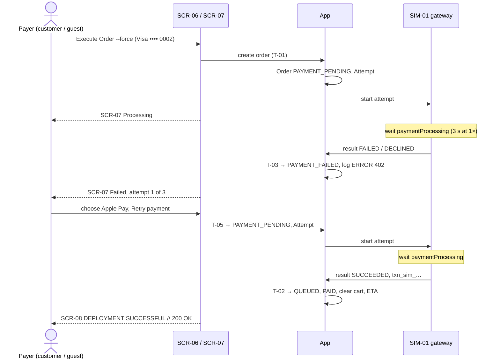
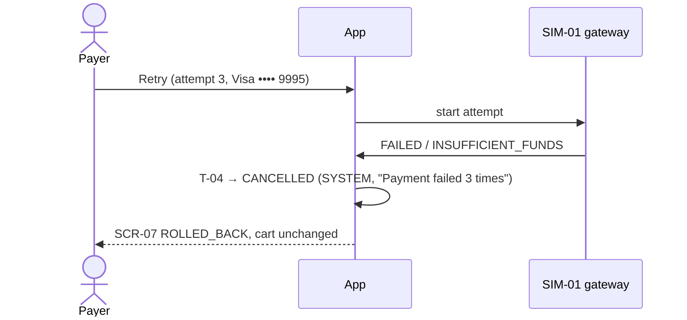
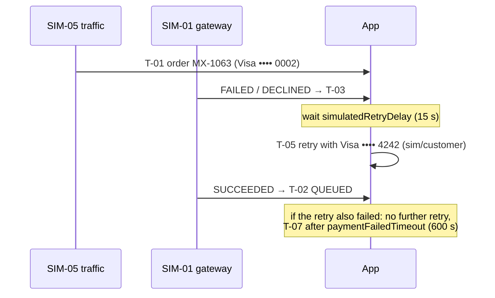

# SIM-01 — Simulated payment gateway

| | |
|---|---|
| Drives | Transitions T-01 (attempt #1 created), T-02, T-03, T-04, T-05, T-07 and the refund in T-09 ([order-lifecycle.md](../05-processes/order-lifecycle.md) section 4) |
| Rules referenced | BR-ORD-04, BR-ORD-05, BR-ORD-06, BR-ORD-07, BR-ORD-10, BR-ORD-21, BR-PRICE-12, BR-PRICE-14 |
| Objects | `Order`, `PaymentAttempt`, `OrderStatusChange`, `OrderLogEntry`, `Cart`, `SimulationEvent`, `SimulationSettings`, `StoreSettings` |
| Screens | SCR-06 Checkout (method choice), SCR-07 Payment sheet, SCR-08 Confirmation, SCR-09 Tracking (payment banner), SCR-13 Order detail |
| Process | PR-03 Simulated payment and retry |
| Default | Outcome decided by the chosen method / test card; random failure rate 0 %; processing 3 s |

---

## 1. Purpose

The app takes "payments" without any payment provider, so that a visitor can experience a complete checkout, including realistic failures, in a few seconds. The outcome of a payment is **deterministic**: it depends only on the method and demo test card the payer chose, plus a random failure rate that is fixed at 0 % in Lite ([lite-configuration.md](lite-configuration.md)). The default experience is a successful payment.

## 2. Safety rule: no card data, ever

| ID | Rule |
|---|---|
| BR-SIM-08 | The app **never** shows, asks for, accepts or stores a card number, expiry date, security code (CVC/CVV), cardholder name, billing address, bank login, wallet credentials or any other payment credential. There are no input fields for them. A payment is described only by `PaymentAttempt.method` (`PaymentMethod`) and, for CARD, `PaymentAttempt.testCard` (`TestCard`), which are fixed demo values with masked labels such as `Visa •••• 4242`. No other payment data exists in the model, in logs or in the database. |
| BR-SIM-09 | Every payment surface (SCR-06 payment block, SCR-07, SCR-08 payment line, SCR-13 receipt) carries the visible marker `(simulated)` or the notice in section 4.1. Third-party payment logos (Visa, Mastercard, Amex, Apple Pay, Google Pay brand marks) are **not** used; methods are shown as text with Material Symbols icons (`credit_card`, `account_balance_wallet`). |

## 3. Parameters

All values are stored in `SimulationSettings` (durations, failure rate) or `StoreSettings` (attempt limit). Durations are seconds at speed 1× and are scaled by the speed factor (SIM-09).

| Parameter | Meaning | Value | Allowed range | Editable |
|---|---|---|---|---|
| `paymentProcessing` | Time from attempt start to the gateway answer (all outcomes except timeout) | 3 s | 1–10 s | no (fixed in Lite) |
| `paymentTimeout` | Time until `AMEX_0005` fails with `GATEWAY_TIMEOUT` | 10 s | 5–30 s | no (fixed in Lite) |
| `paymentFailedTimeout` | Time in `PAYMENT_FAILED` before automatic cancellation (T-07) | 600 s | 60–1800 s | no (fixed in Lite) |
| `simulatedRetryDelay` | Delay before a *simulated customer* retries (T-05) | 15 s | 5–60 s | no (fixed in Lite) |
| `randomPaymentFailurePercent` | Probability that an otherwise successful attempt is turned into `DECLINED` | 0 % | 0–50 % (whole numbers) | no (fixed in Lite) |
| `maxPaymentAttempts` | Attempts per order | 3 | fixed (BR-ORD-05) | not editable |

### 3.1 Outcome table (BR-ORD-04)

| Method | Test card | Label shown | Outcome | Failure code | Answer after |
|---|---|---|---|---|---|
| CARD | `VISA_4242` | Visa •••• 4242 · approves | success | — | `paymentProcessing` |
| CARD | `MASTERCARD_4444` | Mastercard •••• 4444 · approves | success | — | `paymentProcessing` |
| CARD | `VISA_0002` | Visa •••• 0002 · declined | failure | `DECLINED` | `paymentProcessing` |
| CARD | `VISA_9995` | Visa •••• 9995 · insufficient funds | failure | `INSUFFICIENT_FUNDS` | `paymentProcessing` |
| CARD | `AMEX_0005` | Amex •••• 0005 · gateway timeout | failure | `GATEWAY_TIMEOUT` | `paymentTimeout` |
| APPLE_PAY | — | Apple Pay (simulated) | success | — | `paymentProcessing` |
| GOOGLE_PAY | — | Google Pay (simulated) | success | — | `paymentProcessing` |

Random failure: when the table says *success* and `randomPaymentFailurePercent` > 0, the simulator draws once per attempt; with that probability the attempt fails with `DECLINED` instead. A failure from the table is never turned into a success.

Assumption A-21 (FD-05) applies: the pre-selected payment choice on SCR-06 is `CARD` with test card `VISA_4242`, so that a visitor who changes nothing gets a successful payment. Payment methods remain those of A-06; there is no code-based payment such as BLIK.

## 4. What the user sees

### 4.1 SCR-06 — payment block `PAYMENT_PROTOCOL`

- Three selectable method cards: TXT-CHK-26 (`CARD` · Demo test card), TXT-CHK-27 (`APPLE_PAY` · Simulated), TXT-CHK-28 (`GOOGLE_PAY` · Simulated).
- With CARD selected, a list of the five test cards (radio rows) shows the label from 3.1 and an outcome chip TXT-STAT-25: `APPROVES` (`color.success.*`), `DECLINED`, `INSUFFICIENT_FUNDS` (`color.error.*`), `GATEWAY_TIMEOUT` (`color.warning.*`). The chip's plain meaning (TXT-STAT-25) is also the accessible description.
- The helper TXT-CHK-30 under the test cards and TXT-CHK-44 under the execute button.
- No text fields exist in this block.

### 4.2 SCR-07 — payment sheet (modal; bottom sheet on phone)

| State | Content | Actions |
|---|---|---|
| **Processing** | Title TXT-PAY-01; TXT-PAY-02 (order number, amount in `typography.priceLarge`, method); TXT-PAY-03, TXT-PAY-04, TXT-PAY-05 and TXT-PAY-06; the terminal lines of TXT-PAY-35 appearing one after another with a blinking cursor; a linear progress bar that fills over the effective `paymentProcessing` (or `paymentTimeout` for `AMEX_0005`). | None. The sheet cannot be closed (no close button; Escape and backdrop click do nothing). |
| **Success** | Line TXT-PAY-36 (e.g. `200 OK · TxID txn_sim_8f2a44b1c90e`) in `color.success.text` for about 1 s, then the sheet closes and SCR-08 opens. | — |
| **Failed (attempt 1 or 2)** | Headline TXT-PAY-07 `ERROR 402 // PAYMENT_FAILED`; text TXT-PAY-08 with the failure text of TXT-STAT-26 (e.g. "Card declined by issuer. Attempt 1 of 3 failed. Choose a payment method and retry, or cancel the order. Your manifest is unchanged." (example of TXT-PAY-08)); TXT-PAY-09; the method and test-card selector of 4.1 (pre-set to the method just used); total unchanged. | TXT-PAY-10 **Retry payment** (primary; accessible name "Retry payment with the selected method") → T-05. TXT-PAY-11 **Cancel order** (secondary, destructive) → confirm TXT-PAY-12 → T-06. Close (×) → sheet closes, order stays `PAYMENT_FAILED`, tracking page SCR-09 shows the retry banner. |
| **Rolled back (attempt 3 failed)** | Headline TXT-PAY-13; text TXT-PAY-14. | TXT-PAY-15 `Back to manifest` → SCR-05 with the unchanged cart. |

### 4.3 Other screens

| Screen | What appears |
|---|---|
| SCR-08 | Payment line: method label, `TxID txn_sim_…`, "(simulated)". |
| SCR-09 | `PAYMENT_PENDING`: banner "Processing payment…" (STAGED). `PAYMENT_FAILED`: banner with failure text, `Attempt n of 3`, buttons Retry payment (opens SCR-07 in failed state) and Cancel order, and the line "This order will be rolled back automatically at {HH:mm} if not paid." (TXT-TRK-63, BR-TRK-05; the time when the effective `paymentFailedTimeout` ends). Cancelled after payment: "Refund of $68.62 issued to Visa •••• 4242 (simulated)." (example of TXT-TRK-20) |
| SCR-13 | Receipt shows the paid method, transaction ID, and refund ID / time when refunded. |

## 5. Behaviour step by step

### 5.1 Attempt (customer, guest or simulated order)

1. **T-01** (checkout presses `Execute Order --force`, or SIM-05 spawns an order): the order is created in `PAYMENT_PENDING`, `paymentStatus = UNPAID`, and `PaymentAttempt` #1 is created with `status = PROCESSING`, `method`, `testCard` (CARD only), `amount = Order.total`, `startedAt = now`. SCR-07 opens in *Processing*.
2. The simulator decides the outcome when the attempt is created (section 3.1 plus the random draw) and keeps it hidden until the answer time.
3. When the answer timer of the attempt (started at `startedAt`, progress per BR-ORD-21) is complete, on the next tick:
   - **Success → T-02.** Attempt `SUCCEEDED`, `finishedAt`, `transactionId = "txn_sim_" + 12 random lowercase hex characters` (unique). Order `paymentStatus = PAID`, `paidAt`, `queuedAt`, status `QUEUED`; the payer's cart and its coupon are cleared (BR-ORD-07); coupon recorded on the order if it was `APPLIED`; ETA computed (lifecycle 7.3). SCR-07 shows *Success*, then SCR-08.
   - **Failure, attempt < 3 → T-03.** Attempt `FAILED`, `failureCode`, `finishedAt`. Order `PAYMENT_FAILED`. SCR-07 shows *Failed*.
   - **Failure, attempt = 3 → T-04.** Attempt `FAILED`. Order `CANCELLED`, `cancelledBy = SYSTEM`, `cancelReason = "Payment failed 3 times"`, `cancelledAt`. Cart unchanged. SCR-07 shows *Rolled back*.
4. Every result writes one `SimulationEvent` of type `PAYMENT_RESULT`, e.g. `MX-1048 attempt 1/3 SUCCEEDED · Visa •••• 4242 · $68.62`.

### 5.2 Retry (T-05)

- **Person:** in SCR-07 (or via SCR-09) the payer may change method / test card and presses **Retry payment**. A new `PaymentAttempt` (number n+1, `PROCESSING`, same `amount` as the order total, BR-PRICE-12) is created and the order returns to `PAYMENT_PENDING`; continue at 5.1 step 2.
- **Simulated customer** (orders with `source = SIMULATOR` only): after the effective `simulatedRetryDelay` in `PAYMENT_FAILED`, the simulator retries **once** with `CARD` / `VISA_4242` (actor `sim/customer`). If that retry fails as well (random failure), the simulated customer gives up and the order is cancelled by T-07 later. In Lite this path occurs only for the seed order `MX-1044` after every reset (its retry with `VISA_4242` succeeds); generated orders never fail (failure rate 0 %, no spawn scenarios).

### 5.3 Abandoned payment (T-07)

An order in `PAYMENT_FAILED` for the effective `paymentFailedTimeout` (measured per BR-ORD-21) is cancelled by the system: `cancelledBy = SYSTEM`, reason "Payment not completed in time". One `SimulationEvent` of type `AUTO_CANCELLED`.

### 5.4 Refund (part of T-09)

When a `PAID` order is cancelled (in Lite: the guest's rollback in `QUEUED`, T-09), the refund is immediate (BR-ORD-10): the `SUCCEEDED` attempt becomes `REFUNDED` with `refundedAt = now` and `refundId = "rfd_sim_" + 12 random lowercase hex characters`; `Order.paymentStatus = REFUNDED`; refund amount = order total (BR-PRICE-14). Customer log line: `[ROLLBACK] … Refund issued.` (lifecycle T-09). Unpaid orders are cancelled without refund.

### 5.5 Rules

| ID | Rule |
|---|---|
| BR-SIM-10 | The outcome of an attempt depends only on section 3.1 and, for success outcomes, one random draw against `randomPaymentFailurePercent` taken when the attempt starts. Changing the test card or the failure rate does not affect an attempt that is already processing. |
| BR-SIM-11 | An automatic payment result is never shown earlier than the effective answer time and appears on SCR-07 within 3 s after it (5 s on other screens, BR-ORD-20). |
| BR-SIM-12 | At most one attempt per order is `PROCESSING` at any time. A second retry request while one is processing (double click, second browser tab) creates nothing and shows TXT-PAY-37. |
| BR-SIM-13 | If an order leaves `PAYMENT_PENDING` by another route while its attempt is processing, the pending result is discarded: no charge, no `PAID` state. The attempt is closed as `FAILED` with `failureCode = VOIDED` (information model section 9) and shown as "Voided — order cancelled" on SCR-13. In Lite this never happens, so `VOIDED` never occurs: there is no manager cancellation, and every reset deletes the order together with its attempts. |
| BR-SIM-14 | `transactionId` and `refundId` are unique, match `txn_sim_[0-9a-f]{12}` / `rfd_sim_[0-9a-f]{12}`, and are the only "gateway" identifiers stored. |
| BR-SIM-15 | Not used in Lite: the simulation is never paused ([lite-configuration.md](lite-configuration.md)), so TXT-PAY-34 is never shown. |

## 6. Data changes (summary)

| Moment | Object.attribute → value |
|---|---|
| Attempt start | `PaymentAttempt` created: attemptNumber, method, testCard, amount = Order.total, status PROCESSING, startedAt |
| Success | `PaymentAttempt.status` SUCCEEDED, transactionId, finishedAt · `Order.status` QUEUED, paymentStatus PAID, paidAt, queuedAt, statusChangedAt, coupon/couponCode · `Cart` lines and coupon removed · `OrderStatusChange` (PAYMENT_PENDING → QUEUED, SIMULATOR, `sim/payment-gateway`) · log lines · `SimulationEvent` PAYMENT_RESULT |
| Failure 1–2 | `PaymentAttempt.status` FAILED, failureCode, finishedAt · `Order.status` PAYMENT_FAILED · `OrderStatusChange` · log line · `SimulationEvent` PAYMENT_RESULT |
| Failure 3 | as above, plus `Order.status` CANCELLED, cancelledBy SYSTEM, cancelReason, cancelledAt · `SimulationEvent` AUTO_CANCELLED |
| Retry | new `PaymentAttempt` · `Order.status` PAYMENT_PENDING · `OrderStatusChange` (actor GUEST / SIMULATOR) · log line |
| Timeout T-07 | `Order.status` CANCELLED, cancelledBy SYSTEM · `OrderStatusChange` (SYSTEM, `sys/timer`) · `SimulationEvent` AUTO_CANCELLED |
| Refund | `PaymentAttempt.status` REFUNDED, refundedAt, refundId · `Order.paymentStatus` REFUNDED |

## 7. Sequence diagrams

### 7.1 Success, then failure with retry

### 7.2 Third failure and automatic rollback

### 7.3 Simulated customer retry and abandonment

## 8. Edge cases

| Case | Expected behaviour |
|---|---|
| Payer closes the browser during processing | The result is applied server-side anyway. On success the order is `QUEUED` and the cart is cleared; the guest can find it with SCR-10 (order number was shown on SCR-07) or the tracking link. |
| Payer reloads the page during processing | The page shows the order's current state: SCR-09 with the payment banner, or the confirmation data if already paid. No second attempt is created. |
| Menu prices change between attempts | The retry charges the original total (BR-PRICE-12). |
| `AMEX_0005` at speed 10× | Timeout after `ceil(10 / 10) = 1` s. |
| Scheduled demo reset during processing | The order is deleted by the reset; SCR-07 closes with the reset notice of SIM-08. |

## 9. Acceptance checks

| # | Check |
|---|---|
| C1 | At 1× with `VISA_4242`, the order is `PAYMENT_PENDING` immediately after Execute Order and `QUEUED` between 3 and 6 s later; SCR-08 shows a `txn_sim_` ID of 12 hex characters. |
| C2 | With `VISA_0002`, SCR-07 shows `ERROR 402 // PAYMENT_FAILED` (TXT-PAY-07) with "Card declined by issuer. Attempt 1 of 3 failed. …" (TXT-PAY-08, TXT-STAT-26), and the order is `PAYMENT_FAILED` with attempt #1 `FAILED / DECLINED`. |
| C3 | After failures with `VISA_0002`, `VISA_9995` and `AMEX_0005`, the order is `CANCELLED` with reason "Payment failed 3 times", `cancelledBy = SYSTEM`, three attempts, and the cart still contains the same lines. |
| C4 | `AMEX_0005` fails with `GATEWAY_TIMEOUT` no earlier than 10 s and no later than 13 s after the attempt started (1×). |
| C5 | 20 consecutive payments with Apple Pay all succeed (failure rate 0 %). |
| C6 | Searching the whole UI shows no field for card number, expiry, CVC, or holder name; the data export / domain contains no attribute for them. |
| C7 | A `PAYMENT_FAILED` order with no action is `CANCELLED` ("Payment not completed in time") 600–603 s after the failure at 1× (60–63 s at 10×). |
| C8 | A guest who rolls back a paid `QUEUED` order sees "Refund of ${X.XX} issued to {method} (simulated)." (TXT-TRK-20); the attempt is `REFUNDED` with an `rfd_sim_` ID; `paymentStatus = REFUNDED`. |
| C10 | Double-clicking Retry payment creates exactly one new attempt. |
