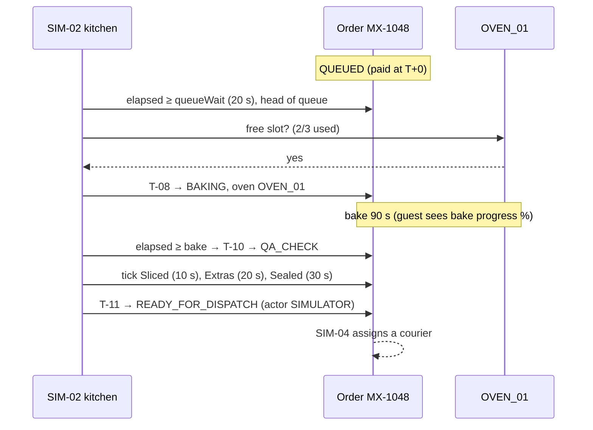

# SIM-02 — Kitchen auto-advance

| | |
|---|---|
| Drives | T-08 Start bake, T-10 Pull to QA, T-11 / T-12 Seal, T-13 QA failed (remake) — automatic variants ([order-lifecycle.md](../05-processes/order-lifecycle.md) section 4) |
| Rules referenced | BR-ORD-11, BR-ORD-12, BR-ORD-13, BR-ORD-14, BR-ORD-17, BR-ORD-18, BR-ORD-21 |
| Objects | `Order` (status, timestamps, oven, qa*Done, remakeCount, isPriority), `Oven`, `OrderStatusChange`, `OrderLogEntry`, `SimulationEvent`, `SimulationSettings` |
| Screens | SCR-09 Tracking (stage, bake progress, queue position, ETA), SCR-08 Confirmation (queue position), SCR-01 Home (KPIs) |
| Process | PR-04 Kitchen flow |
| Related | SIM-09 Simulation clock. SIM-03 is not part of Lite; the oven temperature and the customer bake progress it used to own are in section 3.6. |
| Default | Always on in Lite (`autoAdvanceKitchen = true`, fixed; [lite-configuration.md](lite-configuration.md)) |

---

## 1. Purpose

The kitchen works by itself. In Lite nobody operates it, so every order moves through the kitchen automatically. The ovens have a limited number of slots, so when several orders arrive close together (the guest's own and those of the traffic generator, SIM-05) orders wait in the queue: the guest sees a queue position above 1, and a longer ETA when the ovens are full.

## 2. Parameters

Durations: seconds at 1×, stored in `SimulationSettings`, scaled by the speed factor (SIM-09). Effective duration `eff(x) = max(1, ceil(x / factor))`.

| Parameter | Meaning | Value | Range | Editable |
|---|---|---|---|---|
| `autoAdvanceKitchen` | Master switch for this simulation | ON | always ON in Lite | no (fixed in Lite) |
| `queueWait` | Minimum time in `QUEUED` before the simulator starts the bake | 20 s | 5–120 s | no (fixed in Lite) |
| `bake` | Bake time; the simulator pulls the order when it is reached | 90 s | 30–300 s | no (fixed in Lite) |
| `qa` | Time in `QA_CHECK` until the simulator seals | 30 s | 10–120 s | no (fixed in Lite) |
| Ovens | ONLINE ovens and their `capacityOrders` | `OVEN_01`, `OVEN_02`, 3 slots each | seed (`ovens.json`) | no (fixed in Lite) |
| `qaFailurePercent` | Probability that a QA check fails when the simulator seals | 0 % | 0–50 % | no (fixed in Lite) |

## 3. Behaviour step by step

The simulator evaluates the kitchen on every tick (at least every 2 s). "Elapsed" always means the progress of the state's timer per BR-ORD-21: it starts when the state is entered and keeps its progress when the app restarts with another speed factor. Lite has no pause, and `autoAdvanceKitchen` is always ON.

### 3.1 Start bake (T-08)

1. Build the queue: all `QUEUED` orders sorted by `isPriority` (true first), then `queuedAt` (oldest first) (BR-ORD-11).
2. Take the first order of the queue. If its elapsed time is below `eff(queueWait)`, stop (strict queue order: later orders do not overtake it).
3. Find the first ONLINE oven by oven code with `ordersBaking < capacityOrders`. If there is none, stop.
4. Perform T-08: `status = BAKING`, `bakingStartedAt = now`, `oven` = that oven, actor `SIMULATOR` / `sim/kitchen-auto`. Log lines per lifecycle T-08, with the oven code, its temperature (section 3.6) and the effective bake time, e.g. `[OVEN] Entered OVEN_01 at 850°F. Bake timer 01:30.`
5. Repeat from step 2 with the next order of the queue (several orders may start in one tick if several slots are free).

### 3.2 Pull to QA (T-10)

For every `BAKING` order whose elapsed time ≥ `eff(bake)`: perform T-10 (`status = QA_CHECK`, `qaStartedAt`, slot released). An order is therefore pulled on time; overbake does not occur in Lite.

### 3.3 QA checklist and seal (T-11 / T-12)

For every `QA_CHECK` order:

| Elapsed in QA_CHECK | Simulator action | Internal log line (`isCustomerVisible = false`) |
|---|---|---|
| ≥ ⅓ of `eff(qa)` | tick `qaSlicedDone` | `[QA] Slice matrix done: 8 slices.` (6 for Small, "calzone not cut" for calzone, "no pizzas" when none) |
| ≥ ⅔ of `eff(qa)` | tick `qaExtrasDone` | `[QA] Dips and sides packed.` |
| ≥ `eff(qa)` | tick `qaSealedDone`, then decide QA (3.4), then seal | `[QA] Box sealed.` |

Seal: `DELIVERY` → T-11 `READY_FOR_DISPATCH` (`readyAt`; courier assignment starts, SIM-04). `PICKUP` → T-12 `READY_FOR_PICKUP` (`readyAt`; SIM-06 starts waiting). Customer log lines per lifecycle T-11 / T-12.

### 3.4 Random QA failure (T-13)

In Lite `qaFailurePercent` is 0 %, so T-13 never happens; the rule is kept for completeness of the engine. Just before sealing, if `qaFailurePercent` > 0 and `remakeCount < 2`, the simulator draws once. On failure it performs T-13 instead of sealing: `remakeCount + 1`, `isPriority = true`, the three QA checks reset to false, `oven` cleared, `queuedAt = now`, status `QUEUED`, ETA recalculated, `OrderStatusChange.reason` = the chosen reason, one `SimulationEvent` `QA_FAILED`. The reason is picked at random from:

| Reason (stored with the status change) | Customer log line |
|---|---|
| `Crust under-baked in the center` | `[QA] Check failed: crust not up to spec. Rebuilding your order.` |
| `Uneven topping distribution` | `[QA] Check failed: toppings not up to spec. Rebuilding your order.` |
| `Cheese pulled off while slicing` | `[QA] Check failed: slicing not up to spec. Rebuilding your order.` |
| `Wrong size boxed` | `[QA] Check failed: packing not up to spec. Rebuilding your order.` |

With `remakeCount = 2` no draw happens; the order is sealed (BR-ORD-14).

### 3.5 Rules

| ID | Rule |
|---|---|
| BR-SIM-16 | Lite has no manual kitchen actions: only the Simulator moves orders through the kitchen. A guest's rollback (T-09, only in `QUEUED`) removes the order from the queue; a due automatic transition whose source state no longer matches is skipped without error or log line. |
| BR-SIM-17 | Not used in Lite (`autoAdvanceKitchen` is always ON). |
| BR-SIM-18 | After an app restart, orders whose elapsed time already exceeds their effective duration advance on the next ticks, one transition per order per tick (lifecycle 7.4). |
| BR-SIM-19 | Orders of every source (customer, guest, simulator) are treated identically. Orders without pizzas (for example wings and a tiramisu) follow the same states and occupy an oven slot; this is a deliberate simplification of the demo. |

### 3.6 Oven temperature, bake progress, queue position and kitchen load (guest view)

| ID | Rule |
|---|---|
| BR-SIM-16a | **Oven temperature in the log.** The temperature in the T-08 log line is the oven's `targetTempF` (`OVEN_01` 850 °F, `OVEN_02` 780 °F). Lite has no oven telemetry: `Oven.currentTempF` is not simulated. |
| BR-SIM-16b | **Bake progress** shown to the guest on SCR-09 (stage 2) = `min(100, floor(100 × elapsed / eff(bake)))` %, elapsed per BR-ORD-21. After 100 % the caption reads "Coming out of the oven". Overbake states never exist in Lite. |
| BR-SIM-16c | **Queue position** of a `QUEUED` order = 1 + the number of `QUEUED` orders before it in the queue order of 3.1 step 1 (orders of every source, including simulated ones). It is shown on SCR-08 and SCR-09 (TXT-PAY-19, TXT-TRK-08) and recalculated at least every 5 s. |
| BR-SIM-16d | **Kitchen load** for the home page KPIs (SCR-01, US-023) = `Σ ordersBaking / Σ capacityOrders` of the ONLINE ovens (information model 7.2). |

## 4. What the user sees

| Screen | During auto-advance |
|---|---|
| SCR-09 | Stepper advances QUEUED (with queue position) → BAKING (with bake progress %) → QA_CHECK → stage 4; ETA updated (lifecycle 7.3); customer log lines appear. |
| SCR-08 | Queue position at payment (TXT-PAY-19). |
| SCR-01 | KPIs change as orders enter and leave the ovens and finish (US-023). |

## 5. Data changes

| Transition | Attributes set |
|---|---|
| T-08 | `status` BAKING, `statusChangedAt`, `bakingStartedAt`, `oven`; Oven `ordersBaking` +1 (derived) |
| T-10 | `status` QA_CHECK, `statusChangedAt`, `qaStartedAt`; oven slot released (`oven` kept for history) |
| QA ticks | `qaSlicedDone`, `qaExtrasDone`, `qaSealedDone` |
| T-11 / T-12 | `status` READY_FOR_DISPATCH / READY_FOR_PICKUP, `statusChangedAt`, `readyAt` |
| T-13 | `status` QUEUED, `statusChangedAt`, `queuedAt`, `remakeCount`, `isPriority` true, QA checks false, `oven` cleared |
| every transition | one `OrderStatusChange` (actor `SIMULATOR`, `sim/kitchen-auto`), log lines (SIM-07), one `SimulationEvent` (`STAGE_ADVANCED` or `QA_FAILED`) |

## 6. Sequence diagram

## 7. Edge cases

| Case | Expected behaviour |
|---|---|
| All ovens full | Queue waits; SCR-09 shows the queue position; ETA adds the remaining bake time of the oldest baking order (lifecycle 7.3). |
| Head of queue still within `queueWait` | Orders behind it wait (strict order, 3.1 step 2) for at most `eff(queueWait)`. |
| Guest rolls back a `QUEUED` order (T-09) | It leaves the queue; queue positions of the orders behind it go down by 1 within 5 s. |
| App restarted while orders are in the oven | Timers continue from their progress (SIM-09); due steps fire on the next ticks. |

## 8. Acceptance checks

| # | Check |
|---|---|
| C1 | At 1× with auto-advance ON and free ovens, a paid order goes QUEUED → BAKING 20–23 s after `queuedAt`, BAKING → QA_CHECK 90–93 s later, QA_CHECK → READY_* 30–33 s later. |
| C2 | During QA_CHECK the three checks are ticked in the order Sliced, Extras, Sealed, at about 10 s, 20 s and 30 s (1×). |
| C3 | With 7 queued orders and two empty ovens of capacity 3, exactly 6 start baking (3 in OVEN_01 first, then 3 in OVEN_02); the 7th starts only when a slot frees. |
| C4 | Orders leave the queue in the order: priority first, then oldest `queuedAt`. |
| C5 | A guest order placed while 6 orders bake and 2 more wait shows queue position 3 on SCR-08 and SCR-09; the position goes down as orders start baking, and the ETA is longer than for an order placed into an empty kitchen. |
| C6 | During BAKING, SCR-09 shows a bake progress that rises from 0 to 100 % and then "Coming out of the oven"; the T-08 log line names the oven and its target temperature (850°F or 780°F). |
| C8 | At 10×, an order goes from QUEUED to READY_* in 14–20 s (2 + 9 + 3 s plus tick latency). |
