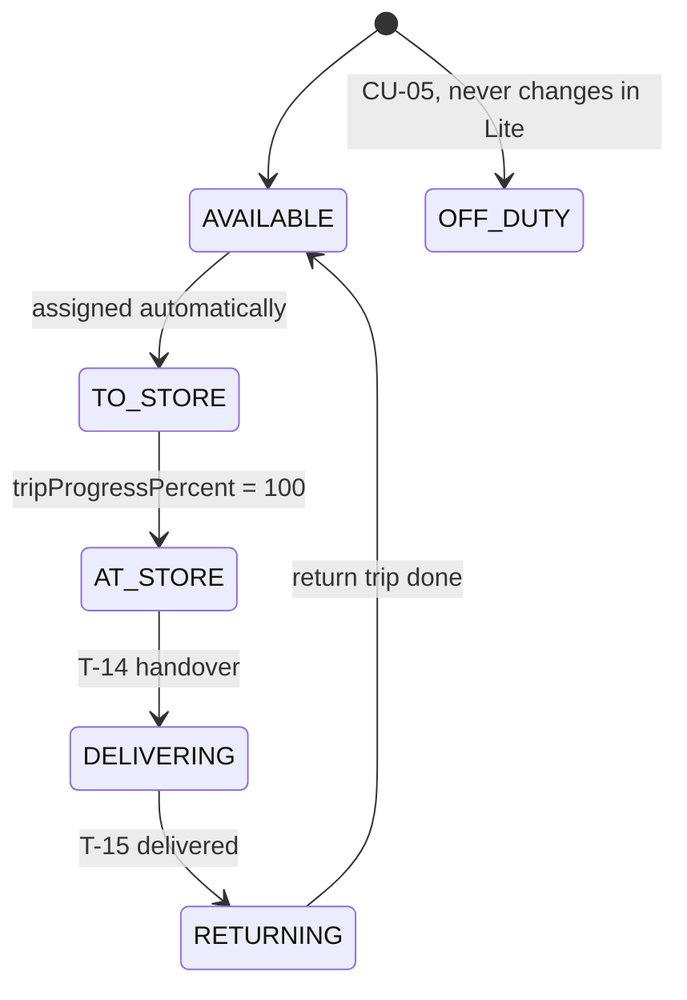
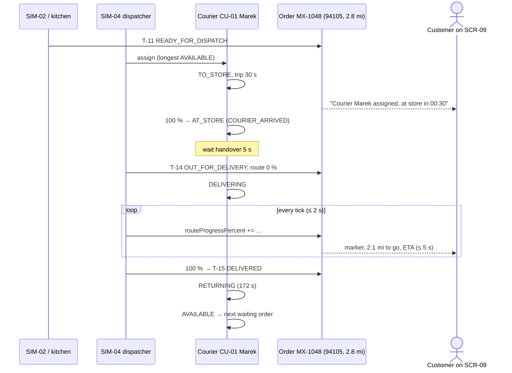

# SIM-04 — Courier dispatch, route and delivery

| | |
|---|---|
| Drives | Courier states (`CourierStatus`), courier assignment (BR-ORD-16), T-14 Hand over to courier, `Order.routeProgressPercent`, T-15 Delivered, the courier's return |
| Rules referenced | BR-ORD-15, BR-ORD-16, BR-ORD-17, BR-ORD-18, BR-ORD-20, BR-ORD-21; lifecycle sections 7.1, 7.3, 8 |
| Objects | `Courier`, `Order` (courier, dispatchedAt, completedAt, routeProgressPercent, distanceMiles, deliveryZone), `DeliveryZone`, `OrderStatusChange`, `OrderLogEntry`, `SimulationEvent`, `SimulationSettings` |
| Screens | SCR-09 Tracking (courier card, map, ETA, distance), SCR-01 Home (KPI couriers on duty) |
| Process | PR-05 Dispatch and delivery |
| Default | Always on in Lite (`autoDispatch = true`, fixed; [lite-configuration.md](lite-configuration.md)) |

---

## 1. Purpose

Couriers are simulated end to end: they are assigned to packed delivery orders, ride to the store, take the order, move along a route on a stylized map that the customer watches live, deliver, and ride back. In Lite nobody steers them: assignment, handover, delivery and return are all automatic. Four couriers are on duty (`CU-01` … `CU-04`); `CU-05` stays `OFF_DUTY` (lite-configuration section 2).

## 2. Parameters

Durations are seconds at 1×, stored in `SimulationSettings`, scaled by the speed factor (`eff(x) = max(1, ceil(x / factor))`).

| Parameter | Meaning | Value | Range | Editable |
|---|---|---|---|---|
| `autoDispatch` | Automatic courier assignment **and** automatic handover | ON | ON / OFF | no (fixed in Lite) |
| `courierToStore` | Trip AVAILABLE → AT_STORE | 30 s | 10–120 s | no (fixed in Lite) |
| `handover` | Courier `AT_STORE` until automatic handover (T-14) | 5 s | 0–30 s | no (fixed in Lite) |
| `travelBase` | Fixed part of a delivery trip | 60 s | 10–300 s | no (fixed in Lite) |
| `travelPerMile` | Per-mile part of a delivery trip | 40 s | 10–120 s | no (fixed in Lite) |
| Delivery trip | `travelBase + travelPerMile × Order.distanceMiles` | 92–172 s for the 8 zones | derived | — |
| Return trip (`courierReturn`) | Same formula as the delivery trip of the order just delivered (`currentOrder`) | derived | — | — |

Trips at 1× per zone (information model 7.8): 94110 92 s · 94103 116 s · 94114 124 s · 94107 136 s · 94102 140 s · 94158 152 s · 94117 164 s · 94105 172 s.

## 3. Courier lifecycle (lifecycle section 8)

UI labels (`CourierStatus` captions): `AVAILABLE` → `IDLE`, `TO_STORE` → `EN_ROUTE_TO_STORE`, `AT_STORE` → `WAITING_HANDOVER`, `DELIVERING` → `IN_TRANSIT`, `RETURNING` → `RETURNING`, `OFF_DUTY` → `OFF_DUTY`.

## 4. Behaviour step by step

Lite has no pause and no manual courier actions. A guest can cancel only in `QUEUED` (T-09), before any courier is involved.

### 4.1 Assignment (BR-ORD-16)

Triggered when an order enters `READY_FOR_DISPATCH` and whenever a courier becomes `AVAILABLE`, evaluated on every tick:

1. Waiting orders = `READY_FOR_DISPATCH` orders without a courier, oldest `readyAt` first.
2. Free couriers = `AVAILABLE` couriers, longest available first (oldest `statusChangedAt`; tie → lower courier code).
3. Pair them one by one: `Order.courier` = courier; `Courier.currentOrder` = order; courier → `TO_STORE`, `tripProgressPercent = 0`. One `SimulationEvent` `COURIER_ASSIGNED` (`Assigned Marek // Moto-v3 to MX-1048`). Customer log: `[ROUTER] Courier Marek // Moto-v3 assigned. Arriving at the store in 00:30.`
4. Orders left without a courier wait; SCR-09 shows "Waiting for courier" and the ETA keeps adding `courierToStore` from now.

### 4.2 Ride to the store

Each tick, `tripProgressPercent` grows by the progress model of section 4.6 with trip length `eff(courierToStore)`. At 100 %: courier → `AT_STORE`; `SimulationEvent` `COURIER_ARRIVED`; customer log `[ROUTER] Courier Marek // Moto-v3 is at the store.`

### 4.3 Handover (T-14)

- When the courier has been `AT_STORE` for `eff(handover)` (timer per BR-ORD-21), the simulator performs T-14 (guard BR-ORD-15).
- Effects: order `OUT_FOR_DELIVERY`, `dispatchedAt`, `routeProgressPercent = 0`; courier → `DELIVERING`; SCR-09 map becomes live. Log lines per lifecycle T-14.

### 4.4 Delivery trip and arrival (T-15)

1. Each tick, `routeProgressPercent` (= courier `tripProgressPercent`) grows per section 4.6 with trip length `eff(travelBase + travelPerMile × distanceMiles)`.
2. When progress passes 25 %, 50 % and 75 %, one customer log line each: `[COURIER] 2.1 mi to go. ETA 02:09.` (remaining distance and ETA at that moment).
3. At 100 %: T-15 `DELIVERED`, `completedAt`; courier → `RETURNING`, `tripProgressPercent = 0`, `currentOrder` stays the delivered order until the courier is `AVAILABLE` (4.5); `SimulationEvent` `DELIVERY_COMPLETED`; log `[DEPLOY] Delivered. Enjoy your build!`

### 4.5 Return

`RETURNING` lasts the return trip: as long as the delivery trip of `currentOrder`, `eff(travelBase + travelPerMile × distanceMiles)` (section 2). Until then the courier keeps `currentOrder`. At 100 %: courier → `AVAILABLE`, `currentOrder` empty; assignment (4.1) runs in the same tick if orders are waiting.

### 4.6 Progress model for trips

Trips (to store, delivery, return) are progress-based so that the map marker never jumps backwards:

- The simulator keeps, per moving courier, an anchor (`anchorTime`, `anchorPercent`) as internal simulation state (naming free; not shown to users).
- Anchor is set to (trip start, 0) when the trip starts, and to (now, current progress) when the app starts with a different speed factor (SIM-09).
- On each tick: `progress = min(100, anchorPercent + 100 × (now − anchorTime) / effectiveTrip)`; stored as a whole number (floor) in `tripProgressPercent` and, while delivering, in `Order.routeProgressPercent`.
- Progress never decreases.

| ID | Rule |
|---|---|
| BR-SIM-23 | A courier carries one order at a time and is assigned only from `AVAILABLE`. An `OFF_DUTY` courier is never assigned. |
| BR-SIM-24 | Automatic assignment pairs the oldest waiting order with the longest-available courier, every tick. |
| BR-SIM-25 | Not used in Lite (`autoDispatch` is always ON). |
| BR-SIM-26 | Trip progress follows section 4.6; `routeProgressPercent` is non-decreasing for an order and reaches 100 only at delivery. |
| BR-SIM-27 | ETAs and remaining distance follow lifecycle 7.3 and are recalculated at least every 5 s. |

## 5. What the user sees

### 5.1 SCR-09 — tracking (delivery orders)

| Order state | Map and ETA panel |
|---|---|
| `PAYMENT_*` … `QA_CHECK` | Static map: store marker, destination marker, dashed route; `ESTIMATED_ETA mm:ss · ~HH:mm` (lifecycle 7.3). |
| `READY_FOR_DISPATCH`, no courier | "Waiting for courier" (stage 4 sub-label); ETA includes `courierToStore`. |
| `READY_FOR_DISPATCH`, courier `TO_STORE` / `AT_STORE` | Courier card: `Marek // Moto-v3`, vehicle (`SCOOTER`, plate), "heading to the store · 00:18" or "at the store"; no courier marker on the map yet. |
| `OUT_FOR_DELIVERY` | Live: courier marker moves along the solid route line (`color.info.default`), LIVE dot, `DISTANCE_REMAINING 1.2 mi`, countdown ETA. Marker moves smoothly between updates (`motion.duration.progress`, linear; jumps with reduced motion). |
| `DELIVERED` | Marker on the destination, route solid green (`color.status.deployed`), "Delivered at HH:mm". |

Courier phone numbers are never shown to customers. Only name, node handle and vehicle are visible (access matrix).

### 5.2 Map geometry (schematic, no maps API)

The map is the image `assets/illustrations/map-sf-dark.jpg` (1600 × 1000, present); the markers are drawn on it. Positions are percentages of the map width (x, left → right) and height (y, top → bottom). The drawing is schematic; displayed distances always come from `distanceMiles`.

| Point | x % | y % |
|---|---|---|
| Store (2140 Folsom Street, 94110) | 55 | 60 |
| 94110 Mission | 50 | 78 |
| 94103 SoMa | 62 | 38 |
| 94114 Castro / Noe Valley | 28 | 70 |
| 94107 Potrero Hill / Dogpatch | 80 | 72 |
| 94102 Hayes Valley / Civic Center | 40 | 32 |
| 94158 Mission Bay | 82 | 48 |
| 94117 Haight-Ashbury | 18 | 42 |
| 94105 Rincon Hill / Financial District | 76 | 16 |

Route = polyline store → corner (destination x, store y) → destination. Courier marker = the point at `routeProgressPercent` % of the polyline length. Unknown or newly added zones use the destination (50, 50) unless the contractor adds coordinates.

## 7. Sequence diagrams

### 7.1 Automatic dispatch and delivery

## 8. Edge cases

| Case | Expected behaviour |
|---|---|
| All four couriers busy | Orders wait in `READY_FOR_DISPATCH`; SCR-09 shows "Waiting for courier"; the guest's ETA keeps adding `courierToStore` from now. |
| App restarted with another speed factor mid-trip at 30 % | Marker continues from 30 % at the new speed; no jump (4.6). |
| Demo reset (scheduled, or start with `ResetOnStartup`) during a delivery | Couriers return to their seed state (SIM-08). |

## 9. Acceptance checks

| # | Check |
|---|---|
| C1 | At 1×, with an AVAILABLE courier, a delivery order to 94105 shows a courier assigned within 3 s of `READY_FOR_DISPATCH`, courier `AT_STORE` 30–33 s later, `OUT_FOR_DELIVERY` 5–8 s after that, and `DELIVERED` 172–175 s after handover. |
| C2 | On SCR-09 during `OUT_FOR_DELIVERY` the marker moves at least every 5 s, never backwards, and `DISTANCE_REMAINING` decreases from 2.8 to 0.0 mi. |
| C3 | Three customer log lines appear at 25 %, 50 % and 75 % of the route, each with remaining miles and ETA. |
| C4 | With 2 waiting orders and 1 AVAILABLE courier, the order with the older `readyAt` gets the courier; the other shows `WAITING_FOR_COURIER` until a courier returns. |
| C6 | After delivery to 94110 at 1×, the courier is `RETURNING` and `AVAILABLE` again 92–95 s later. |
| C8 | With all four on-duty couriers busy (several delivery orders placed quickly at 10×), a new delivery order shows "Waiting for courier" on SCR-09 until a courier returns; the server log shows each courier's status changes (`COURIER` lines, [lite-configuration.md](lite-configuration.md)). `CU-05` never leaves `OFF_DUTY`. |
| C9 | Customers never see a courier phone number. |
