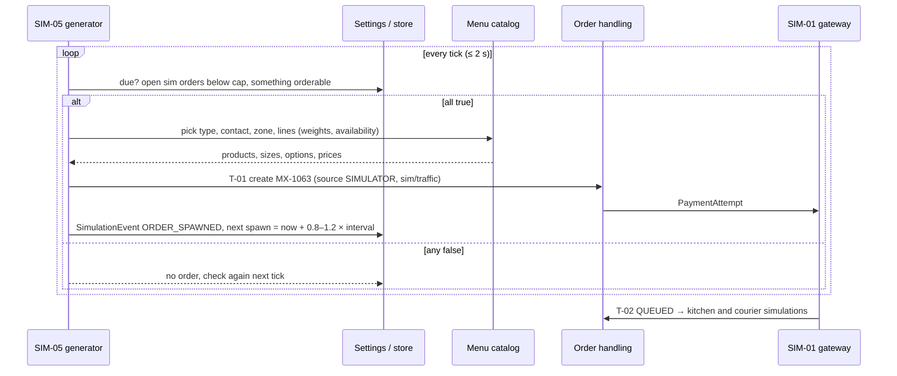

# SIM-05 — Order traffic generator

| | |
|---|---|
| Drives | T-01 for orders with `source = SIMULATOR` (then SIM-01 … SIM-06 take over like for any order) |
| Rules referenced | BR-ORD-03, BR-ORD-22, BR-PRICE-01 … BR-PRICE-13, BR-DATA-03, BR-DATA-12 |
| Objects | `Order`, `OrderLine`, `OrderLineModifier`, `PaymentAttempt`, `Product`, `ProductSize`, `Option`, `Ingredient`, `Coupon`, `DeliveryZone`, `StoreSettings`, `SimulationSettings`, `SimulationEvent` |
| Screens | SCR-01 Home (KPIs, US-023); indirectly SCR-08 / SCR-09 (queue position, ETA); server log `SPAWN` lines ([lite-configuration.md](lite-configuration.md)) |
| Process | PR-10 Simulated order traffic |
| Default | ON after reset (A-12): one order about every 120 s at 1×, at most 8 open simulated orders |

---

## 1. Purpose

Simulated customers place realistic orders from the live menu so that the kitchen and the couriers are always busy, even when nobody is ordering. The guest sees this in the KPIs on the home page, in the queue position of their own order and in its ETA. Generated orders are indistinguishable in content from real ones: real products, plausible configurations, real San Francisco delivery zones, correct prices, fees, tax, tips and coupons.

## 2. Parameters

| Parameter | Meaning | Value | Range | Editable |
|---|---|---|---|---|
| `trafficEnabled` | Generator on/off | ON | ON / OFF | no (fixed in Lite) |
| `trafficIntervalSeconds` | Mean time between two automatic spawns, at 1× (scaled by the speed factor) | 120 s | 30–600 s | no (fixed in Lite) |
| `trafficMaxActiveOrders` | Cap: no automatic spawn while this many `SIMULATOR` orders are open | 8 | 1–20 | no (fixed in Lite) |
| Jitter | Each gap is a random value between 0.8× and 1.2× of the effective interval | ±20 % | fixed | — |
| First spawn delay | After app start and after a reset | 10 s at 1× (scaled) | fixed | — |

Effective interval = `max(1, ceil(trafficIntervalSeconds / factor))` (lifecycle 7.2). Examples: 120 s → 1× 120 s, 2× 60 s, 5× 24 s, 10× 12 s.

## 3. Trigger and spawn conditions

| ID | Rule |
|---|---|
| BR-SIM-28 | An automatic spawn happens when the next spawn time is reached and **all** hold: `trafficEnabled` (always true in Lite); open orders with `source = SIMULATOR` < `trafficMaxActiveOrders`; at least one orderable non-drink product exists (BR-DATA-12). If a condition fails, no order is created and the next check happens on the next tick; the spawn time is not "saved up" (at most one automatic spawn per tick). After a successful spawn the next spawn time = now + jittered effective interval. |
| BR-SIM-29 | Not used in Lite (no manual spawns). |
| BR-SIM-30 | Every generated order satisfies BR-ORD-03 exactly like a checkout: available lines only, at least one non-drink line, total quantity ≤ 30, valid contact data, delivery ZIP of an active zone, delivery subtotal ≥ `minDeliverySubtotal`. All amounts are calculated with BR-PRICE rules and stored as snapshots. |
| BR-SIM-31 | Generated orders have `source = SIMULATOR`, no `customer`, `placedAt = now`, actor `SIMULATOR` / `sim/traffic` on the T-01 status change, one `SimulationEvent` `ORDER_SPAWNED`, e.g. `Spawned MX-1063 (DELIVERY, 94107, 4 items)`, and one server log line `SPAWN MX-1063 DELIVERY 94107 items=4` (LITE-CFG-06). |

## 4. How an order is composed

All random choices are independent draws with the weights given. Only orderable products and available options are eligible (BR-DATA-12, `Option.isAvailable`); weights of ineligible items are dropped and the rest re-normalized.

### 4.1 Order type, contact and address

| Element | Rule |
|---|---|
| Order type | DELIVERY 70 % · PICKUP 30 % (PICKUP: any row of the pool is eligible, including `inDeliveryZone = false`; the address is not used) |
| Contact | One person from the simulated-customer pool (4.6), uniform among the eligible rows: `contactName` = first + last name, `contactEmail`, `contactPhone` exactly as in the pool |
| Delivery address | The chosen person's own address from the pool (`line1`, `line2`, `city`, `state`, `zip`, `deliveryNotes`). For DELIVERY only rows with `inDeliveryZone = true` whose ZIP belongs to an **active** `DeliveryZone` are eligible; `distanceMiles` and `deliveryZone` come from that zone. If no row is eligible (all zones of the pool inactive), the order becomes PICKUP. |

### 4.2 Pizzas

| Element | Rule |
|---|---|
| Number of pizza lines | 1 (45 %) · 2 (35 %) · 3 (15 %) · 4 (5 %) |
| Product | PZ-02 Boolean Pepperoni 18 · PZ-01 The Root Pizza 15 · PZ-05 Inferno Payload 12 · PZ-04 Binary BBQ 10 · PZ-03 SQL Supreme 9 · PZ-06 Kernel Panic Meat 8 · PZ-10 Low-Mem Garden 6 · PZ-08 Quad-Core Formaggi 6 · PZ-07 Truffle Kernel 5 · PZ-09 The Clean Code 5 · PZ-11 Hawaiian Legacy Fix 4 · PZ-12 Calzone Container 2 |
| Size | SMALL 15 % · MEDIUM 50 % · LARGE 35 %, among the sizes the product has (calzone: MEDIUM) |
| Crust | Product default 80 %; otherwise uniform among the other crusts available for the size (only if `crustSelectable`) |
| Sauce | Product default always |
| Cheese | Product default 92 %; CH-02 Buffalo Mozzarella 5 %; CH-03 Vegan Cashew Mozzarella 3 % (skipped if it is the default) |
| Extras | 0 (60 %) · 1 (28 %) · 2 (12 %), uniform among available extras, never more than `maxExtras`, each at most once |
| Removal | 10 %: one removable recipe ingredient, uniform |
| Quantity | 1; identical configurations are merged into one line with quantity 2+ (`configurationKey`) |

### 4.3 Sides, drinks, desserts

| Category | Count | Weights |
|---|---|---|
| Sides & Dips | 0 (50 %) · 1 (35 %) · 2 (15 %) | SD-01 Garlic Knot Loop 30 · SD-03 Hot Wings Webhook 25 · SD-02 Caesar Cipher Salad 20 · SD-04 Garlic Driver Dip 15 · SD-05 Jalapeño Patch Dip 10 |
| Drinks | none 30 %; otherwise uniform 1 … (number of pizzas + 1) | DR-01 Mate Compiler Tonic 30 · DR-03 Cola Cache 25 · DR-02 Cold Brew Commit 15 · DR-04 Lemon Lint Soda 15 · DR-05 Sparkling Stream Water 15 |
| Desserts | 0 (75 %) · 1 (20 %) · 2 (5 %) | uniform |

Same products are merged into one line with the summed quantity (max 10 per line).

### 4.4 Validity top-up

- If no pizza could be chosen (all pizzas sold out), the order is built from sides and desserts only; if those are also unavailable, the spawn is skipped (`NO_ORDERABLE_ITEMS`).
- DELIVERY with subtotal below `minDeliverySubtotal` ($15.00): add one more pizza line by 4.2 until the minimum is met.

### 4.5 Coupon, tip and payment

| Element | Rule |
|---|---|
| Coupon | DELIVERY: `GITHUB_STUDENT` 8 %, `FREE_DISPATCH` 5 % (only when subtotal < `freeDeliveryThreshold`). PICKUP: `GITHUB_STUDENT` 8 %. A coupon is used only if it would be `APPLIED` (BR-PRICE-06); otherwise none. |
| Tip (DELIVERY) | `NONE` 10 % · `TEN` 25 % · `FIFTEEN` 45 % · `TWENTY` 20 %. PICKUP: `NONE`. |
| Payment | CARD `VISA_4242` 35 % · CARD `MASTERCARD_4444` 15 % · `APPLE_PAY` 30 % · `GOOGLE_PAY` 20 %. In Lite generated orders never fail (`randomPaymentFailurePercent` 0 %). |

### 4.6 Simulated customer pool (fictional)

The **only** pool is [`09-demo-data/simulated-customers.csv`](../09-demo-data/simulated-customers.csv) (also `.json`): 28 fictional people `SC-01` … `SC-28` with name, email (reserved domains `example.com`, `example.net`, `example.org`), `(415) 555-01xx` phone, a fixed San Francisco address, optional delivery notes and the flag `inDeliveryZone`. 27 rows are inside the delivery zone; `SC-28` (ZIP 94109) is outside it and is used by the generator for PICKUP orders only (testers may also use it for the zone check). The same pool supplies the guest and simulated seed orders (`poolCustomer` in `orders.json`). The generator neither invents names nor random addresses.

## 5. Behaviour step by step

1. On each tick the generator checks BR-SIM-28.
2. It composes the order (section 4) from the current menu and prices.
3. It creates the order with T-01: order number (next in sequence), `commitHash`, `trackingToken`, lines and modifiers as snapshots, amounts by BR-PRICE, `tipOption`, coupon (if applied), `PaymentAttempt` #1 with the chosen method.
4. It writes `SimulationEvent` `ORDER_SPAWNED` and the T-01 log lines.
5. From here the order is handled by SIM-01 (payment), SIM-02 (kitchen), SIM-04 (delivery) or SIM-06 (pickup).
6. It sets the next spawn time.

## 6. Sequence diagram

## 7. What the user sees

| Screen | Effect |
|---|---|
| Guest screens | Simulated orders are never shown to guests (their tracking token is never shown). Indirect effects: the KPIs on SCR-01 change (US-023), and guest orders wait longer in the queue (queue position on SCR-08 and SCR-09) with longer ETAs when ovens or couriers are busy. |

## 8. Edge cases

| Case | Expected behaviour |
|---|---|
| Cap reached | No spawn; the next spawn happens on the first tick after an open simulated order finishes (at most one per tick). |
| A product is sold out (seed: Tiramisu Stack) | It is never generated; other weights re-normalize. |
| Ingredient `jalapeno` out of stock | PZ-05 stays orderable only if jalapeño is removable (it is), and is generated without jalapeños; EX-09 is never chosen; PZ-11 likewise. |
| Speed 10× | Effective interval 12 s, but the cap (8) limits load. |
| Housekeeping | Finished simulated orders older than `retentionHours` are removed (BR-ORD-22, SIM-08 section 7). |

## 9. Acceptance checks

| # | Check |
|---|---|
| C1 | After a reset the seed is at the cap (8 open simulated orders, `09-demo-data/orders.json`), so no spawn happens until one of them finishes; the first new simulated order then appears on the next tick (≤ 2 s at 1×). While under the cap, new ones follow every 96–144 s (+ up to 2 s tick latency). |
| C2 | At 10× with interval 120 s, gaps between automatic spawns are 9.6–14.4 s (+ tick latency). |
| C3 | The number of open `SIMULATOR` orders never exceeds 8 because of automatic spawns. |
| C4 | Every generated order recalculated by hand with BR-PRICE rules gives the stored subtotal, discount, fee, tax, tip and total to the cent. |
| C5 | No generated order contains a sold-out product, an inactive or out-of-stock option, a removed fixed ingredient, more than `maxExtras` extras, or a ZIP outside the active zones; delivery orders have subtotal ≥ $15.00. |
| C6 | Over 100 generated orders: delivery share between 60 % and 80 %; at least 8 different pizzas appear; at least one order has a coupon. |
| C8 | Generated orders are never shown on guest screens; their tracking token is never exposed. |
| C9 | Every spawn writes one `SPAWN` server log line (LITE-CFG-06) with order number, type, ZIP (delivery) or `COUNTER` (pickup) and item count, and no contact data. |
| C10 | Every generated order's contact and (for DELIVERY) address equal one row of `simulated-customers.csv`; no DELIVERY order uses `SC-28`. |
