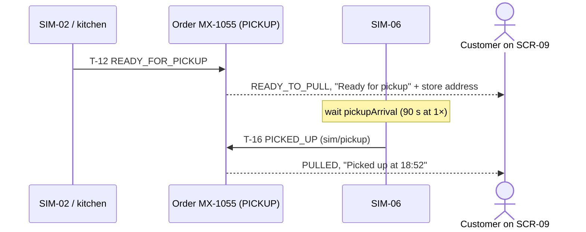

# SIM-06 — Pickup customer arrival

| | |
|---|---|
| Drives | T-16 `READY_FOR_PICKUP` → `PICKED_UP` (automatic variant) |
| Rules referenced | BR-ORD-17, BR-ORD-18, BR-ORD-21 |
| Objects | `Order` (status, readyAt, completedAt), `OrderStatusChange`, `OrderLogEntry`, `SimulationEvent`, `SimulationSettings` |
| Screens | SCR-09 Tracking |
| Process | PR-06 Pickup |
| Default | Always on in Lite (`autoPickup = true`, fixed; [lite-configuration.md](lite-configuration.md)) |

---

## 1. Purpose

A pickup order is collected by a simulated customer after a realistic wait, so pickup orders finish without anyone pressing a button.

## 2. Parameters

| Parameter | Meaning | Value | Range | Editable |
|---|---|---|---|---|
| `autoPickup` | Switch | ON | ON / OFF | no (fixed in Lite) |
| `pickupArrival` | Time in `READY_FOR_PICKUP` until the simulated customer collects (scaled) | 90 s | 15–600 s | no (fixed in Lite) |

## 3. Behaviour

1. Order enters `READY_FOR_PICKUP` (T-12). SCR-09 shows stage 4 "Ready for pickup" with the store address `2140 Folsom Street, San Francisco, CA 94110` and the order number to show at the counter.
2. Each tick: when the order's elapsed time in `READY_FOR_PICKUP` (timer per BR-ORD-21) ≥ `eff(pickupArrival)`, the simulator performs T-16 with actor `SIMULATOR` / `sim/pickup`: `status = PICKED_UP`, `completedAt`. Log lines: customer `[COUNTER] Customer arrived for pickup.` followed by `[DEPLOY] Picked up. Enjoy your build!`; one `SimulationEvent` `PICKUP_COMPLETED`.
3. SCR-09 shows stage 5 `PULLED` "Picked up at HH:mm".

| ID | Rule |
|---|---|
| BR-SIM-32 | SIM-06 applies to every pickup order, including guest orders, so a visitor who orders pickup sees it completed automatically. |
| BR-SIM-33 | Not used in Lite (`autoPickup` is always ON; there is no manual pickup). |

## 4. Sequence diagram

## 5. Edge cases

| Case | Expected behaviour |
|---|---|
| App restarted while an order is ready for pickup | The timer continues from its progress; if it is due, the order is picked up on the next tick. |
| Customer ETA | "Ready for pickup at HH:mm" = `estimatedReadyAt` (lifecycle 7.3); SIM-06 does not change it. |

## 6. Acceptance checks

| # | Check |
|---|---|
| C1 | At 1×, a pickup order is `PICKED_UP` 90–93 s after `READY_FOR_PICKUP`, with actor `SIMULATOR` and both log lines. |
| C2 | At 10×, a pickup order is `PICKED_UP` 9–12 s after `READY_FOR_PICKUP`. |
| C4 | A pickup order is completed about 4 minutes after payment at 1× (20 + 90 + 30 + 90 s plus tick latency). |
