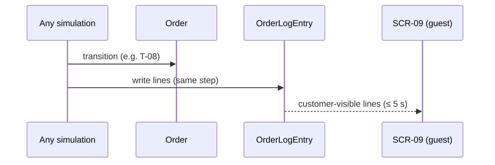

# SIM-07 — Live logs

| | |
|---|---|
| Drives | `OrderLogEntry` lines for every order; display of logs on guest screens |
| Rules referenced | BR-ORD-02, BR-ORD-20; lifecycle section 4 (minimum lines per transition) |
| Objects | `OrderLogEntry` (loggedAt, level, tag, message, isCustomerVisible), `Order` |
| Screens | SCR-08 Confirmation (first lines), SCR-09 Tracking (`bash — track.log`) |
| Default | Always on |

---

## 1. Purpose

The terminal-style log is the signature of the theme: every step of an order is narrated as build output. Guests see their own order's customer-visible lines. Staff-only lines (`isCustomerVisible = false`) are still written, but no Lite screen shows them.

## 2. Line format

| Part | Rule | Example |
|---|---|---|
| Time | `loggedAt` in store time, `HH:mm:ss`, shown as `[18:30:44]` in `color.log.timestamp` | `[18:30:44]` |
| Tag | `[` + tag + `]`, upper case, max 12 characters | `[OVEN]` |
| Message | One sentence, max 200 characters. Customer-visible lines contain no personal data except the courier's node handle (`Marek // Moto-v3`) | `Entered OVEN_01 at 850°F. Bake timer 01:30.` |
| Level | Sets the color of tag and message: `INFO` `color.log.info` · `SUCCESS` `color.log.success` · `WARN` `color.log.warn` · `ERROR` `color.log.error` · `DEBUG` `color.log.debug` | |
| Visibility | `isCustomerVisible`; `DEBUG` lines are always internal (`isCustomerVisible = false`, never shown in Lite) | |

Tags in use: `INIT`, `PAYMENT`, `KITCHEN`, `OVEN`, `QA`, `ROUTER`, `COURIER`, `COUNTER`, `DEPLOY`, `ROLLBACK`, `OPS`.

## 3. Which lines are written

Lifecycle section 4 defines the minimum lines per transition. The simulations add the lines below. The UI text catalogue in `06-ui-specification/` is authoritative for exact wording; the trigger moments, tags, levels and visibility here are binding.

| Trigger | Level | Tag | Default message | Customer | Owner |
|---|---|---|---|---|---|
| T-01 | INFO | INIT / PAYMENT | lifecycle T-01 | yes | SIM-01 |
| Payment success / failure / retry / timeout | SUCCESS / ERROR / INFO | PAYMENT, ROLLBACK | lifecycle T-02 … T-07 | yes | SIM-01 |
| Attempt voided by cancellation | INFO | PAYMENT | `Payment attempt n voided: order cancelled.` | no | SIM-01 |
| T-08 … T-13 | INFO / SUCCESS / WARN | KITCHEN, OVEN, QA | lifecycle T-08 … T-13 | yes | SIM-02 |
| QA checklist ticks | INFO | QA | `Slice matrix done: 8 slices.` · `Dips and sides packed.` · `Box sealed.` | no | SIM-02 |
| Courier assigned / at store | INFO | ROUTER | `Courier Marek // Moto-v3 assigned. Arriving at the store in 00:30.` · `Courier Marek // Moto-v3 is at the store.` | yes | SIM-04 |
| T-14 | INFO | ROUTER, COURIER | lifecycle T-14 | yes | SIM-04 |
| Route 25 / 50 / 75 % | INFO | COURIER | `2.1 mi to go. ETA 02:09.` | yes | SIM-04 |
| T-15 | SUCCESS | DEPLOY | lifecycle T-15 | yes | SIM-04 |
| Pickup arrival, T-16 | INFO / SUCCESS | COUNTER, DEPLOY | `Customer arrived for pickup.` · lifecycle T-16 | yes | SIM-06 |
| T-09 guest rollback | INFO | ROLLBACK | lifecycle T-09 | yes | lifecycle |

| ID | Rule |
|---|---|
| BR-SIM-34 | Log lines are immutable and append-only. They are ordered by `loggedAt`, then by creation order; lines of one transition share the same second and keep their listed order. |
| BR-SIM-35 | A log line is written in the same step as the change it reports; a line never appears before its status change is visible. |
| BR-SIM-36 | Guest views show only `isCustomerVisible` lines of that order. Other orders, QA failure reasons and any `DEBUG` line are never customer-visible. |
| BR-SIM-37 | Log lines are removed only together with their order (housekeeping BR-ORD-22 or demo reset). |

## 4. Display

| Screen | Content | Behaviour |
|---|---|---|
| SCR-08 | Last 4 customer lines of the order | static |
| SCR-09 | Terminal panel `bash — track.log`: customer lines, newest at the bottom; the last 50 lines with "Show full log" | new lines appear within 5 s; auto-scroll to the newest line unless the user has scrolled up (then a `↓ new lines` chip appears); blinking cursor after the last line (static with reduced motion) |

The log panel is an ARIA live region with polite announcements for customers (SCR-09) only for SUCCESS, WARN and ERROR lines, to avoid noise.

## 5. Sequence diagram

## 6. Acceptance checks

| # | Check |
|---|---|
| C1 | For one delivery order followed from payment to delivery, SCR-09 shows at least the lifecycle minimum lines for T-01, T-02, T-08, T-10, T-11, T-14, T-15 plus courier assigned, at store and the three route milestones, in chronological order. |
| C2 | No internal line (`isCustomerVisible = false`: QA ticks, `DEBUG`) is visible on SCR-09, also not after a page reload or in the page source of the guest view. |
| C4 | A new line appears on SCR-09 within 5 s of the related status change without reload. |
| C5 | Lines have `HH:mm:ss` timestamps in `America/Los_Angeles` time. |
