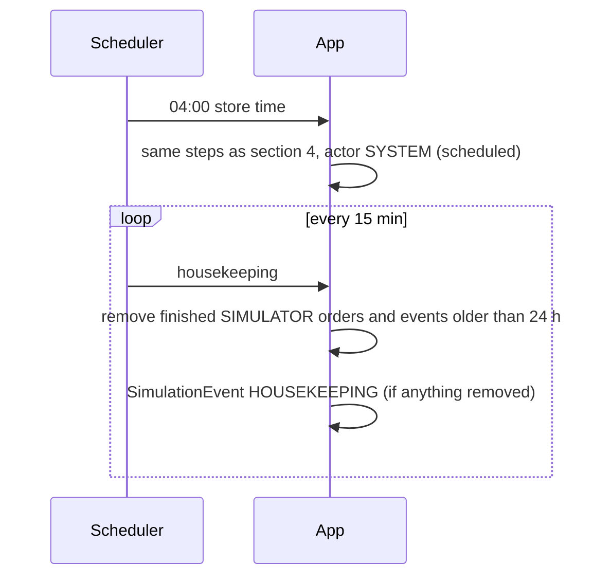

# SIM-08 — Demo seed, reset and housekeeping

| | |
|---|---|
| Drives | Restoring all demo data to the baseline of `09-demo-data/` (on first start, at a start with `ResetOnStartup`, and scheduled); housekeeping of old simulated orders |
| Rules referenced | BR-DATA-09, BR-ORD-22, BR-ORD-21 |
| Objects | all objects (section 3); `SimulationSettings.lastResetAt`, `lastResetBy`, `lastResumedAt`; `SimulationEvent` `RESET`, `HOUSEKEEPING` |
| Screens | All guest screens (refresh and notices) |
| Process | PR-09 Demo reset |
| Default | At every start with the constant `Simulation.ResetOnStartup = true`, also on an empty database ([lite-configuration.md](lite-configuration.md)); at the first start of an empty database with `ResetOnStartup = false`; and every day at 04:00 store time (A-42) |

---

## 1. Purpose

Every demo can start from the same, known state: the menu as in the catalog, couriers and ovens in their seed state, and seed orders in every status. A reset also repairs anything a visitor changed or broke during a demo. Lite has no reset button, dialog or endpoint: the automated tests reset by restarting the app with `ResetOnStartup = true`.

## 2. Triggers

| Trigger | Actor | Confirmation | `lastResetBy` |
|---|---|---|---|
| Start of the app with `Simulation.ResetOnStartup = true`, also on an empty database | SYSTEM (`sys/reset`) | none | `SYSTEM (startup)` |
| Scheduled: every day at 04:00 `America/Los_Angeles` | SYSTEM (`sys/reset`) | none | `SYSTEM (scheduled)` |
| First start of the app with an empty database and `Simulation.ResetOnStartup = false` | SYSTEM | none | `SYSTEM (initial seed)` |

Each reset stores the text of the last column in `lastResetBy` (information model 7.6); the seed file `simulation-settings.json` has it empty, so it is empty only before the first start. The server log names the trigger `startup`, `scheduled` or `initial-seed` (LITE-CFG-07).

> **Assumption A-42:** A scheduled reset runs every day at 04:00 store time, so an app left running always starts the day clean. It is not configurable.

## 3. What a reset does (BR-DATA-09)

### 3.1 Deleted

| Data | Note |
|---|---|
| All `Order`s with their `OrderLine`s, `OrderLineModifier`s, `PaymentAttempt`s, `OrderStatusChange`s, `OrderLogEntry`s | of every source, including orders placed by visitors |
| All `Cart`s and `CartLine`s | guest session carts |
| All `SimulationEvent`s | the RESET event of this reset is written afterwards; the seed's `simulation-events.json` is not loaded (3.2) |

### 3.2 Restored to the seed of `09-demo-data/`

| Data | Restored values |
|---|---|
| Catalog | Categories, all products (status, prices, sizes, recipes, flags, badges, sold-out per seed: only Tiramisu Stack is sold out, images and alt texts), ingredients (all in stock except `jalapeno`, BR-DEMO-03a), options (prices, active, sizes), coupons (menu catalog section 8) |
| `StoreSettings` | All defaults of information model 7.5, including `intakeStatus = OPEN` |
| `SimulationSettings` | All defaults of information model 7.6 and lifecycle 7.1 (speed from the constant `SpeedFactor`, all switches ON, traffic ON, interval 120 s, cap 8, failure rates 0 %), `isPaused = false`, `lastResumedAt = reset moment`, `lastResetAt = reset moment`, `lastResetBy` per section 2 |
| Couriers, ovens, delivery zones | Information model 7.8 and the seed state of `09-demo-data/` |
| Seed orders | All seed orders of `09-demo-data/` (guest orders with their history, and open orders in every status) with their lines, payment attempts, status histories and log lines |
| Simulation events | Not restored: the event log starts with the `RESET` event of this reset. `09-demo-data/simulation-events.json` is a reference file only (`09-demo-data/README.md` section 2). |
| Order number sequence | Next order number = highest seed order number + 1 |

### 3.3 Time rebasing

Seed data must look current after every reset. `09-demo-data/` therefore defines seed times relative to the reset moment (open orders: offsets such as "entered BAKING 40 s before reset"; history: day offsets such as "12 days before reset, 19:40"). The reset converts every relative time into an absolute timestamp. Consequences:

- Every automatic timer of an open seed order starts at the reset moment with progress 0 (BR-DEMO-09, BR-ORD-21): an order seeded "40 s into its bake" shows `T+00:40` in the stage but is pulled one full effective bake (90 s at 1×) after the reset. Stored courier trip and route progress continue from their seed value.
- Because the simulation runs immediately after a reset, the open seed orders progress and finish within minutes; from then on, the traffic generator (SIM-05) keeps the kitchen and the couriers busy.
- A seed order in `PAYMENT_PENDING` gets its attempt `startedAt` = reset moment and is resolved by SIM-01 a few seconds later.

## 4. Behaviour step by step

1. **Lock.** The app enters *resetting* mode: the simulator tick is suspended; any attempt to place an order, pay or retry is refused with the toast "Demo data is being reset. Try again in a few seconds." (At a start with `ResetOnStartup` the reset runs before the app accepts requests.)
2. **Delete** (3.1) and **restore** (3.2, 3.3) as one unit of work.
3. **Record.** Set `lastResetAt`, `lastResetBy`, `lastResumedAt`; write `SimulationEvent` `RESET`, e.g. `Demo data reset by SYSTEM (startup). 37 orders removed. Seed restored.` (scheduled: `… by SYSTEM (scheduled). …`; first start with `ResetOnStartup = false`: `… by SYSTEM (initial seed). 0 orders removed. …`), and the server log lines `RESET start` / `RESET end` (LITE-CFG-07).
4. **Unlock.** Start the simulator tick; SIM-05 schedules its first spawn after 10 s (scaled). The seed starts at the traffic cap (8 open simulated orders), so that spawn waits until one of them finishes (SIM-05 "Cap reached").

| ID | Rule |
|---|---|
| BR-SIM-38 | A reset is all-or-nothing: either every step of 3.1–3.3 completes, or no data is changed, the lock is released and the error is logged (NFR-19.4); the next scheduled reset or start with `ResetOnStartup` repairs it. |
| BR-SIM-39 | A reset completes within 60 seconds (NFR-05.12) with the seed data volume of `09-demo-data/` plus the visitor data of one demo day. |
| BR-SIM-40 | After a reset, the data is identical to the seed except for generated values that are random by definition (`trackingToken` may be regenerated; `commitHash` and order numbers of seed orders are restored exactly) and for timestamps (rebased, 3.3). Two consecutive resets give the same content. |
| BR-SIM-41 | Only the system resets (section 2). Lite has no reset button, dialog, URL or endpoint (LITE-CFG-03). A scheduled reset that falls due while one runs is skipped. |
| BR-SIM-42 | The contractor's technical configuration, including the constants of [lite-configuration.md](lite-configuration.md), is never changed by a reset. |

## 5. Effects on people who are using the app

| Who | What happens (within 10 s, or at their next action; NFR-16.4) |
|---|---|
| Everybody on a live screen | Toast "Demo data was reset by the system at {HH:mm}."; live screens reload their data. Visitors whose cart or tracked order disappeared also see once: "The demo was reset. Your cart and session data were cleared." |
| Guest with a cart | Cart is empty. |
| Guest on SCR-09 of a deleted order | The invalid-link state of SCR-09 (BR-TRK-21, TXT-TRK-44 – TXT-TRK-46). |
| Payer with SCR-07 open | Sheet closes with the same reset notice; the order no longer exists; the cart is empty. |

## 7. Housekeeping (BR-ORD-22)

| Item | Rule |
|---|---|
| Schedule | Every 15 minutes (real time, independent of the speed factor) |
| Orders removed | `source = SIMULATOR`, in a final state, `completedAt` or `cancelledAt` older than `retentionHours` (24 h, fixed in Lite), with all dependent records |
| Events removed | `SimulationEvent`s older than `retentionHours` |
| Kept | Guest orders (until the next reset) |
| Record | One `SimulationEvent` `HOUSEKEEPING` when at least one record was removed, e.g. `Housekeeping removed 41 simulated orders and 380 events older than 24 h.` Actor `SYSTEM` / `sys/housekeeping`. Nothing is written when nothing was removed. |

| ID | Rule |
|---|---|
| BR-SIM-43 | Housekeeping never removes an open order or a non-simulated order. |

## 8. Sequence diagrams

### 8.2 Scheduled reset and housekeeping

## 9. Edge cases

| Case | Expected behaviour |
|---|---|
| Visitor presses Execute Order during the reset | Refused with "Demo data is being reset. Try again in a few seconds."; the cart is cleared by the reset. |
| Reset at 04:00 while a guest is ordering | Runs anyway (A-42); the toast informs everybody. |
| Reset fails half-way (e.g. server restart) | No partial data remains (BR-SIM-38); the next scheduled reset or start with `ResetOnStartup` repairs everything. |

## 10. Acceptance checks

| # | Check |
|---|---|
| C1 | After placing 3 orders as a guest and a restart with `ResetOnStartup = true`: the 3 visitor orders cannot be found on SCR-10, their tracking links show the invalid-link state, and the seed orders are back. |
| C2 | Immediately after a reset, the seed orders of `09-demo-data/` can be found on SCR-10 by order number and contact email and show their seed status. |
| C4 | The reset finishes within 60 s: the server log shows `RESET start by startup` and `RESET end … duration=<s>s` with s ≤ 60 (LITE-CFG-07); the newest `SimulationEvent` is `RESET`. |
| C5 | With traffic ON, the first simulated order after the reset appears on the first tick after one of the 8 open seed simulated orders finishes (the seed is at the cap; SIM-05 C1). |
| C6 | No screen, URL or endpoint of the app starts a reset. |
| C7 | A guest on SCR-09 of an order placed before the reset sees the invalid-link state of SCR-09 (BR-TRK-21, TXT-TRK-44 – TXT-TRK-46). |
| C8 | Two resets in a row give the same counts per object type. |
