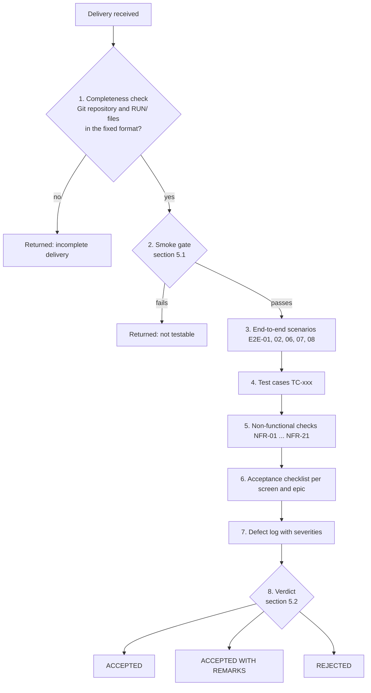

# Acceptance — How a Delivery Is Evaluated

This folder defines how a delivery of Git Pizza MxDev Lite is accepted. The delivery is checked by **automated acceptance tests** that build and start the app locally and use it as a guest. The delivery formats are fixed because the tests and the completeness check read them automatically.

| File | Contents |
|---|---|
| `README.md` (this file) | Acceptance process, test environment, test conventions, defect severity, verdict rules |
| [deliverables.md](deliverables.md) | Exactly what the contractor hands over: the Git repository and the `RUN/` folder (`journal.md`, `self-assessment.json`, `delivery-notes.md`, `operations.md`, `start.ps1`, `stop.ps1`) |
| [test-scenarios.md](test-scenarios.md) | End-to-end scenarios `E2E-xx` and test cases `TC-xxx` covering every Lite epic and every simulation, with setups, steps, test data and expected results |
| [acceptance-checklist.md](acceptance-checklist.md) | Checklist per screen, per epic, for non-functional requirements and for the delivery |

Related: [../11-non-functional/requirements.md](../11-non-functional/requirements.md) (`NFR-xx`), [../10-simulations/lite-configuration.md](../10-simulations/lite-configuration.md) (constants and server log lines), [../01-product-brief/ids-and-traceability.md](../01-product-brief/ids-and-traceability.md) (ID ranges), [../09-demo-data/](../09-demo-data/menu-catalog.md) (test data).

---

## 1. Acceptance process

| Step | Who | What |
|---|---|---|
| 0 | Contractor | Builds the app, commits after every user story (`US-xxx: <title>`) and fills the `RUN/` files (`deliverables.md`). Running the test cases before delivery is recommended; no own test report is delivered. |
| 1 | Owner | Checks that the repository and the `RUN/` files are complete and in the formats of `deliverables.md` (checklist section 1). |
| 2 | Automated tests | Build and start the app with `RUN/start.ps1` (stop it with `RUN/stop.ps1`), without a person and without the Studio Pro user interface, as described in `RUN/operations.md` (`deliverables.md` section 6.1), and run the smoke gate (section 5.1). If it fails, the delivery is not evaluated further. |
| 3 – 6 | Automated tests, owner | Run every E2E scenario and every test case, the NFR checks that can be automated and the checklist. Checks that need a person (screen reader, real iPhone, reading the model) are done by the owner. |
| 7 | Owner | Records defects (section 4). |
| 8 | Owner | Decides the verdict (section 5.2). |

**What is executed for the verdict.** The verdict is based on the executed test cases (`TC-xxx`), end-to-end scenarios (`E2E-xx`), NFR checks and the acceptance checklist. The acceptance criteria of the user stories (`03-user-stories/`) and the acceptance checks of the simulation files (`10-simulations/`, `C1 …`) are reference material: they are not executed one by one, but every story is mapped to the tests that verify it ([traceability matrix](../03-user-stories/traceability-matrix.md), column "Verified by"; `test-scenarios.md` section 1.4 lists the two stories that cannot be tested in Lite). If a test observes that a story criterion or a simulation check is not met, this is recorded as a defect of that TC or E2E with the normal severity (section 4). `RUN/self-assessment.json` is compared with the results: a story marked `done` whose tests fail is reported as a separate finding.

The evaluation is done on the app running locally, built from the delivered Git repository with Mendix 11.16.1 (`NFR-18`). There is no public instance.

---

## 2. Test environment

| Item | Default |
|---|---|
| App | Built and started locally with `RUN/start.ps1` and stopped with `RUN/stop.ps1` (`deliverables.md` section 6.1; Mendix 11.16.1, base URL as printed by `RUN/start.ps1`, for example `http://localhost:8080`), with the constants `Simulation.SpeedFactor = 10` and `Simulation.ResetOnStartup = true` unless a test says otherwise (`test-scenarios.md` section 2.1) |
| Server log | Read by the tests from the start of the app: INFO lines of the log node `Simulation` (`lite-configuration.md` section 3) |
| Time window | Tests run between 02:00 and 24:00 store time (`America/Los_Angeles`, A-31) and never across the daily reset at 04:00; a test interrupted by it is repeated after S1 (`test-scenarios.md` section 2.1) |
| Main browser | Desktop Chrome, latest stable, window 1440 × 900 |
| Phone layout | Chrome device emulation 390 × 844 with touch (and a real iPhone with Safari for E2E-06) |
| Tablet layout | 834 × 1194 portrait and 1194 × 834 landscape |
| Other browsers | Smoke run of E2E-01 and E2E-06 in the browsers of `NFR-04` |
| Fresh visitor | A new private window or browser context (no cookies, empty cache) = a new guest session |
| Several guests at once | Separate browser contexts (one guest session each) |
| Tools | Browser automation with network, performance and device emulation; axe-core; a screen reader (NVDA or VoiceOver) for NFR-14.18; `mx check` of Studio Pro 11.16.1 |

---

## 3. Test conventions

### 3.1 Test data

All test data comes from the package and is binding:

- Products, options, prices, ingredients, allergens, coupons, seed stock (Tiramisu Stack sold out, `jalapeno` out of stock): `09-demo-data/menu-catalog.md` and `09-demo-data/`
- Delivery zones, ovens, couriers, store and simulation defaults: `04-information-model/information-model.md` section 7 and `10-simulations/lite-configuration.md` section 2
- Seed orders and their contact emails for the lookup on SCR-10: `09-demo-data/orders.json`
- Price calculations: worked examples A – D in `information-model.md` section 6.1, and the additional calculated examples in `test-scenarios.md` section 2.3
- Fictional guest data used in tests: `test-scenarios.md` section 2.2

### 3.2 Standard setups

Test cases refer to the standard setups `S1` – `S7` defined in `test-scenarios.md` section 2.1 (for example "S1, S2, S4, S5": fresh start at 10×, server log read, guest browser).

### 3.3 Timing tolerance

Simulated durations are short and screens refresh within a few seconds, so timed expectations use this tolerance:

| What is measured | Passes when |
|---|---|
| Time an order spent in a state, read from the timestamps of its `ORDER` lines in the server log (second precision) | between *effective duration − 1 s* and *effective duration + 3 s* (`NFR-08.2`) |
| A change becoming visible on a live screen | within the latency of `NFR-07` (5 s on SCR-08 and SCR-09, 10 s on SCR-01) after the matching server log line |
| A countdown shown on screen vs. the calculated value | within ± 2 s (`NFR-07.2`) |
| Whole order duration observed on a screen | each automatic transition within its duration + 2 s, plus 5 s for the final screen update |

Effective duration = `ceil(base / speedFactor)`, minimum 1 s (`order-lifecycle.md` section 7.2). Durations that depend on the queue (`queueWait` when other orders are ahead, courier availability) are not timed. The traffic generator cannot be switched off in Lite, so the kitchen is never guaranteed to be empty; timed tests start after the open seed orders have finished (setup S3).

### 3.4 Result codes

| Code | Meaning |
|---|---|
| PASS | Every expected result observed |
| FAIL | At least one expected result not observed; a defect is recorded |
| BLOCKED | Could not be executed because of another defect (reference it) |
| N/A | The tested feature is a Could (or a Should with a documented deviation in `RUN/delivery-notes.md`) and was not implemented |

### 3.5 Texts in expected results

Every visible text of the app is defined once in [`../06-ui-specification/ui-copy.md`](../06-ui-specification/ui-copy.md) (`TXT-…` IDs); for visible text that file wins over every other document (00-README section 6.5). Expected results that quote a text are checked against `ui-copy.md` (placeholders filled in). Where an expected result says only "an error message" or "a toast", the text of the matching `TXT-…` entry is expected. A visible text that differs from `ui-copy.md` without changing the meaning is a Minor defect; one that changes or hides the meaning is Major.

### 3.6 Server log lines in expected results

Expected results that quote the server log refer to the formats of `lite-configuration.md` section 3 (LITE-CFG-04 – LITE-CFG-07). A missing, duplicated or differently formatted line makes the step fail, even if the screen shows the right state, because the tests cannot see simulated orders in any other way.

---

## 4. Defect severity

| Severity | Definition | Examples |
|---|---|---|
| **Blocker** | The app cannot be built or started with `RUN/start.ps1` as described in `RUN/operations.md`, the guest cannot complete the main journey, data loss, a security breach between guests | `mx check` errors; app does not start; order cannot be placed; a guest can read another guest's or a simulated order; reset destroys the app; simulation stops |
| **Major** | A Must requirement fails without a reasonable workaround, or results are wrong | Wrong price, tax, tip or total; a status transition that must not be possible; live screen not updating within 15 s; missing or wrong server log lines; KPIs not derived from data; WCAG "critical"/"serious" axe violation; layout unusable at one breakpoint; obsolete branding visible |
| **Minor** | A requirement is partly met, or met with a workaround; a Should requirement missing without a written reason | Text differs from the catalogue; a non-essential state missing; refresh resets a filter; small layout problem at one width |
| **Cosmetic** | Visual deviation from the design tokens that does not affect use or comprehension | Wrong spacing, radius or shade; icon differs |

---

## 5. Acceptance criteria

### 5.1 Smoke gate

All of the following must pass before the full evaluation starts:

| # | Check |
|---|---|
| G-1 | The app is built and started from a fresh clone of the Git repository with `RUN/start.ps1 -SpeedFactor 10 -ResetOnStartup $true` alone (no manual step, no Studio Pro user interface); the script returns with exit code 0 and the base URL it prints shows SCR-01 with the Git Pizza MxDev logo and the DEMO MODE banner, without a sign-in page |
| G-2 | SCR-02 shows the 4 categories and the 25 products of the menu catalog with their card prices |
| G-3 | The server log shows `CONFIG SpeedFactor=10 ResetOnStartup=true`, `RESET start by startup` and `RESET end …` after the start |
| G-4 | E2E-01 (guest delivery order) completes up to `DEPLOYED` |
| G-5 | `mx check` of Studio Pro 11.16.1 reports 0 errors on the delivered project |

### 5.2 Verdict

> **Assumption A-55:** The verdict thresholds below are defaults chosen on the owner's behalf. The owner may change them before sending the package.

| Verdict | Conditions (all must hold) |
|---|---|
| **ACCEPTED** | Repository and `RUN/` files complete; smoke gate passed; all E2E scenarios PASS; all Must test cases PASS; all Must NFR sub-requirements met; 0 open Blocker and 0 open Major defects; at most 10 open Minor defects; every Should requirement not met is listed as a deviation with a reason in `RUN/delivery-notes.md` |
| **ACCEPTED WITH REMARKS** | Repository and `RUN/` files complete; smoke gate passed; all E2E scenarios PASS; 0 open Blocker defects; at most 3 open Major defects, none of them in an E2E scenario or a security requirement (`NFR-09` – `NFR-13`); at most 20 open Minor defects |
| **REJECTED** | Any other result |

Cosmetic defects are recorded but do not affect the verdict.
